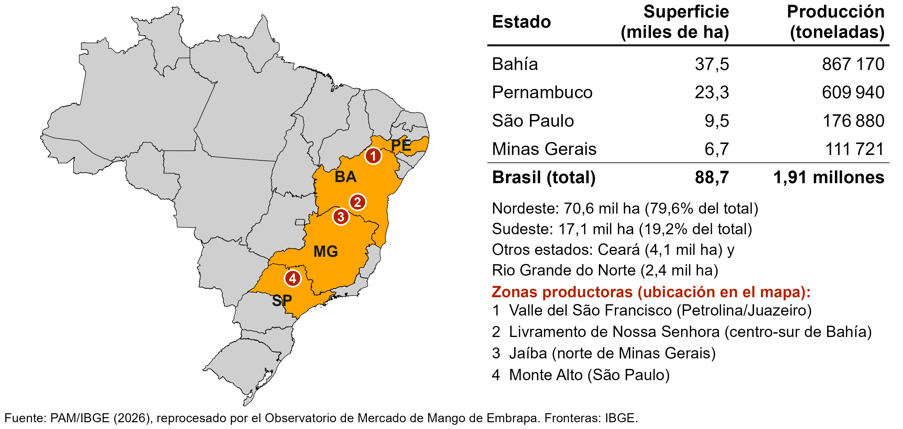

## João Ricardo Lima  {.center .aboutmeslide}

::: columns
::: {.column width="60%"}

-   Contacto

    -   Instagram: [\@observatoriodafruticultura](https://www.instagram.com/observatoriodafruticultura)

    -  Correo electrónico: [joao.ricardo@embrapa.br](joao.ricardo@embrapa.br)

    -   LinkedIn: [Joao Ricardo Lima](https://www.linkedin.com/in/joao-ricardo-lima-7b6273240/)

-   Sobre mí

    -   Doctor en Economía Aplicada (UFV-MG)

    -   Investigador en Economía Rural de Embrapa Semiárido - Petrolina/PE

    -   Coordinador de los Observatorios de Mercado de Mango y Uva de Embrapa

:::
::: {.column width="40%"}
{style="width:100%; height:700px; object-fit:cover; object-position:center top;"}


:::
:::

```{r}
#| label: setup

# Dependências dos slides
library(knitr)
library(rmarkdown)
library(dplyr)
library(ggplot2)
library(reshape2)
library(scales)
library(tsutils)  # seasplot(), usado nos gráficos de preços de manga
library(reticulate)

# Usa o Python do sistema (ja tem pandas/plotnine instalados) em vez do
# ambiente gerenciado padrao do reticulate (que vem sem pacotes)
reticulate::use_python("C:/Users/Lenovo/AppData/Local/Programs/Python/Python314/python.exe", required = TRUE)

options(htmltools.dir.version = FALSE)
knitr::opts_chunk$set(
  echo       = FALSE,
  warning    = FALSE,
  message    = FALSE,
  fig.retina = 3,
  fig.width  = 22,
  fig.height = 10,
  out.width  = "100%",
  fig.align  = "center",
  comment    = "#",
  dev.args   = list(bg = "transparent")
  )

# Tema para remover o fundo branco dos gráficos ggplot
tema_transparente <- theme(
  plot.background   = element_rect(fill = "transparent", colour = NA),
  panel.background  = element_rect(fill = "transparent", colour = NA),
  legend.background = element_rect(fill = "transparent", colour = NA),
  legend.key        = element_rect(fill = "transparent", colour = NA)
  )

# Tipo de cambio fijo para la ponencia: R$ por US$ (precios y costos se muestran en US$)
taxa_cambio <- 5

colors <- c(
  blue       = "#282f6b",
  red        = "#b22200",
  yellow     = "#eace3f",
  green      = "#224f20",
  purple     = "#5f487c",
  orange     = "#b35c1e",
  turquoise  = "#419391",
  green_two  = "#839c56",
  light_blue = "#3b89bc",
  gray       = "#666666"
  )
```

## PRINCIPALES ESTADOS PRODUCTORES DE MANGO {.titulo-pequeno}

{style="width:102%; max-width:none; max-height:none;"}

## SUPERFICIE CULTIVADA DE MANGO EN EL VALLE

#### En 2025 la superficie cultivada fue de aproximadamente 46,4 mil ha.

```{python}
#| label: mba_areamanga1
#| echo: false
#| warning: false
#| message: false
#| fig-width: 22
#| fig-height: 10
#| fig-align: "center"


# --- Imports
from pathlib import Path
#import os
import pandas as pd
import matplotlib.pyplot as plt
from plotnine import *

plt.close('all')  # evita que figuras de chunks anteriores atrapalhem a captura desta
plt.rcParams['savefig.transparent'] = True  # remove o fundo branco do PNG

data_dir = Path("C:/Users/Lenovo/Dropbox/tempecon/dados_manga/2026")

# ========= Valle del São Francisco =========
# area_vale.csv (2011-2025) ja vem em formato longo: local, ano, valor (2 mesorregioes)
vale = pd.read_csv(data_dir/'area_vale.csv', na_values=['-', 'NA'])

# Somar as mesorregioes por ano
vale_sum = (vale.groupby('ano', as_index=False)['valor'].sum()
                .rename(columns={'ano': 'year', 'valor': 'value'}))
vale_sum.insert(0, 'regiao', 'Valle del São Francisco')
dados_long = vale_sum

# Garantir numérico e criar valor em mil ha
dados_long['value'] = pd.to_numeric(dados_long['value'], errors='coerce')
dados_long['value_k'] = dados_long['value'] / 1000.0

# Ordenar anos (mesmo se forem strings)
try:
    anos_ordenados = sorted(dados_long['year'].unique(), key=lambda x: int(str(x)))
except Exception:
    anos_ordenados = sorted(dados_long['year'].unique())
dados_long['year'] = pd.Categorical(dados_long['year'], categories=anos_ordenados, ordered=True)

# ========= Plot =========
paleta = {
    "Valle del São Francisco": "gold"  # Gold
}
cores = [paleta[k] for k in ["Valle del São Francisco"]]

plot = (
    ggplot(dados_long, aes(x='year', y='value_k', fill='regiao')) +
    geom_col(position=position_dodge(width=0.9), size=1) +
    scale_fill_manual(values=cores) +
    labs(
        y="Superficie Cultivada de Mango (miles de ha)",
        x="Año",
        title="",
        caption="Fuente: PAM/IBGE (2026) reprocesado por el Observatorio de Mercado de Mango de Embrapa"
    )
    + theme_minimal()
    + theme(
        legend_position='bottom',
        legend_title=element_blank(),
        legend_text=element_text(size=22),
        axis_title_x=element_text(weight='bold', size=22),
        axis_title_y=element_text(weight='bold', size=22),
        axis_text_x=element_text(size=22),
        axis_text_y=element_text(size=22),
        plot_caption=element_text(ha='left', size=22),
        figure_size=(22, 10),
        panel_background=element_rect(fill='None', color='None'),
        plot_background=element_rect(fill='None', color='None'),
    )
)

# desenha o gráfico na figura atual respeitando o fundo transparente

plot.show()
```

## PRODUCCIÓN DE MANGO EN EL VALLE

#### Siempre se busca aumentar la productividad (28 t/ha) y la producción (1,29 millones t)

```{python}
#| label: mba_quantimanga
#| echo: false
#| warning: false
#| message: false
#| fig-width: 22
#| fig-height: 10
#| fig-align: "center"


# --- Imports
from pathlib import Path
#import os
import pandas as pd
import matplotlib.pyplot as plt
from plotnine import *

plt.close('all')  # evita que figuras de chunks anteriores atrapalhem a captura desta
plt.rcParams['savefig.transparent'] = True  # remove o fundo branco do PNG

data_dir = Path("C:/Users/Lenovo/Dropbox/tempecon/dados_manga/2026")

# ========= Valle del São Francisco =========
# quanti_vale.csv (2011-2025) ja vem em formato longo: local, ano, valor (2 mesorregioes)
vale = pd.read_csv(data_dir/'quanti_vale.csv', na_values=['-', 'NA'])

# Somar as mesorregioes por ano
vale_sum = (vale.groupby('ano', as_index=False)['valor'].sum()
                .rename(columns={'ano': 'year', 'valor': 'value'}))
vale_sum.insert(0, 'regiao', 'Valle del São Francisco')
dados_long = vale_sum

# Garantir numérico e criar valor em mil ha
dados_long['value'] = pd.to_numeric(dados_long['value'], errors='coerce')
dados_long['value_k'] = dados_long['value'] / 1000.0

# Ordenar anos (mesmo se forem strings)
try:
    anos_ordenados = sorted(dados_long['year'].unique(), key=lambda x: int(str(x)))
except Exception:
    anos_ordenados = sorted(dados_long['year'].unique())
dados_long['year'] = pd.Categorical(dados_long['year'], categories=anos_ordenados, ordered=True)

# ========= Plot =========
paleta = {
    "Valle del São Francisco": "gold"  # Grape
}
cores = [paleta[k] for k in ["Valle del São Francisco"]]

plot = (
    ggplot(dados_long, aes(x='year', y='value_k', fill='regiao')) +
    geom_col(position=position_dodge(width=0.9), size=1) +
    scale_fill_manual(values=cores) +
    labs(
        y="Cantidad Producida de Mango (miles de t)",
        x="Año",
        title="",
        caption="Fuente: PAM/IBGE (2026) reprocesado por el Observatorio de Mercado de Mango de Embrapa"
    )
    + theme_minimal()
    + theme(
        legend_position='bottom',
        legend_title=element_blank(),
        legend_text=element_text(size=24),
        axis_title_x=element_text(weight='bold', size=24),
        axis_title_y=element_text(weight='bold', size=22),
        axis_text_x=element_text(size=24),
        axis_text_y=element_text(size=24),
        plot_caption=element_text(ha='left', size=24),
        figure_size=(22, 10),
        panel_background=element_rect(fill='None', color='None'),
        plot_background=element_rect(fill='None', color='None'),
    )
)

# desenha o gráfico na figura atual respeitando o fundo transparente

plot.show()
```

## FORTALEZAS Y DEBILIDADES {.center}

::: columns
::: {.column width="50%"}

- Entre 2011 y 2025 la producción se multiplicó por 2,6 (de 489 mil a 1,29 millones de t), con una superficie que se duplicó (de 22 a 46 mil ha).

-   Producción durante las 52 semanas del año

-   Nivel elevado de tecnología aplicada a la producción de fruta

- Clima con abundancia de luz solar y riego con aguas del río São Francisco.

- Tamaño del mercado interno (210 millones de personas)
:::

::: {.column width="50%"}

- Altos costos de producción (tecnología + mano de obra + logística de transporte + «Costo Brasil»)

- Climas extremos (causan enfermedades y reducen la productividad): exceso de lluvia en un período corto o temperaturas muy altas.

- Superficie concentrada en las variedades Palmer y Tommy Atkins, y poca superficie con la variedad Kent.

- Escasez de mano de obra disponible.

:::
:::

# EL MERCADO EXTERNO

## LA FUNCIÓN DEL MERCADO EXTERNO

#### En 2025, las exportaciones representaron cerca del 21 % de la producción del Valle.

```{r}
#| label: slide18
#| fig-width: 22
#| fig-height: 10

# Serie 2012-2026 (2026 parcial, ate setembro), ja em Mil US$ e toneladas
dados4 <- read.csv2('dados/manga_exportacoes_2012_2026.csv', header=T, sep=";", dec = ".")

colnames(dados4) = c('Ano', 'Valor', "Toneladas")
dados4 <- dplyr::tibble(dados4)

# Toneladas e Valor (US$ Mil) ficam em faixas parecidas (dezenas/centenas de
# milhares), entao cabem num unico eixo Y sem precisar de eixo secundario
dados4a <- dados4

g5 <- ggplot(dados4a, aes(x = Ano)) +
  geom_col(aes(y = Toneladas, fill = "Toneladas"), width = 0.7) +
  geom_line(aes(y = Valor, color = "Valor (US$ Mil)"), linewidth = 2.2) +
  scale_fill_manual(name = NULL, values = c("Toneladas" = "gold")) +
  scale_color_manual(name = NULL, values = c("Valor (US$ Mil)" = "red")) +
  scale_y_continuous(name = "Toneladas de mango / US$ mil", n.breaks = 10, expand = expansion(add = c(0, 0.5)),
                     labels = label_number(big.mark = " ", decimal.mark = ",")) +
  scale_x_continuous(breaks = seq(2012, 2026, by = 1)) +
  labs(x = "Años", title = '',
       caption = "Fuente: COMEXSTAT reprocesado por el Observatorio de Mercado de Mango de Embrapa, 2026. Datos de 2026 hasta septiembre.") +
  theme_classic() + #Definindo tema
  theme(axis.text.x = element_text(angle = 45, hjust = 1, size = 24, margin = margin(b = 5)),
        axis.text.y = element_text(hjust = 1, size = 24, margin = margin(l = 20)),
        axis.title.x = element_text(size = 24, face = "bold", margin = margin(b = 5)),
        axis.title.y = element_text(size = 24, face = "bold", margin = margin(l = 20)),
        plot.caption = element_text(hjust = 0, size = 22),
        legend.position = "bottom", legend.title = element_blank(),
        legend.text = element_text(size = 24)) # Definindo posição da legenda
g5 + tema_transparente
```

## ARANCEL DE EE. UU. x ACUERDO UE/MERCOSUR {.titulo-pequeno}

::: columns
::: {.column width="45%"}

{style="width:80%; height:775px; max-width:none; max-height:none;"}


:::
::: {.column width="55%"}

<br>

**Mango**

- Arancel de EE. UU.: comenzó en 2025 con **50%**, anunciado con vigencia a partir de agosto de 2025

- Posteriormente quedó exento y, en 2026, también exento de la sobretasa combinada de **37,5%**

- El mango ya estaba exento en la Unión Europea.

:::
:::

## VOLUMEN EXPORTADO DE MANGO POR MES

#### Casi la mitad del volumen anual se exporta de septiembre a noviembre

```{r}
#| label: exporta_mes
#| fig-width: 22
#| fig-height: 10

# Volume exportado de manga (toneladas) por mes: media 2012-2025 (linha) e barras
# de 2024, 2025 e 2026 (2026 so com os meses ja disponiveis).
# Usa so os pacotes carregados no chunk 'setup' (ggplot2, scales).
exporta <- read.csv2('C:/Users/Lenovo/Dropbox/tempecon/dados_manga/total_exporta_br.csv',
                     header = TRUE, sep = ";", dec = ".")
volume  <- ts(exporta$quilo, start = c(2012, 1), frequency = 12)  # toneladas por mes

ano_12m <- function(a) as.numeric(window(volume, start = c(a, 1), end = c(a, 12)))
v2026   <- as.numeric(window(volume, start = c(2026, 1)))         # meses ja disponiveis
v2026   <- c(v2026, rep(NA, 12 - length(v2026)))

# Media de cada mes entre 2012 e 2025
media <- colMeans(matrix(window(volume, end = c(2025, 12)), ncol = 12, byrow = TRUE))

# Datas so para o eixo x (mes do ano) e nomes dos meses em espanhol
meses    <- seq(as.Date("2021-01-01"), by = "month", length.out = 12)
nome_mes <- c("Enero", "Febrero", "Marzo", "Abril", "Mayo", "Junio",
              "Julio", "Agosto", "Septiembre", "Octubre", "Noviembre", "Diciembre")

barras <- data.frame(Meses    = rep(meses, 3),
                     variable = rep(c("2024", "2025", "2026"), each = 12),
                     value    = c(ano_12m(2024), ano_12m(2025), v2026))
linha  <- data.frame(Meses = meses, variable = "Promedio 2012–2025", value = media)

ggplot() +
  geom_col(data = barras, aes(x = Meses, y = value, fill = variable), position = "dodge") +
  scale_fill_manual(values = c("lightblue3", "gray44", "gold")) +
  geom_line(data = linha, aes(x = Meses, y = value, colour = variable), linewidth = 2) +
  scale_colour_manual(values = "red") +
  scale_y_continuous(limits = c(0, max(barras$value, linha$value, na.rm = TRUE) * 1.08),
                     n.breaks = 10,
                     labels = label_number(big.mark = "\u202F", decimal.mark = ",")) +
  scale_x_date(date_breaks = "1 month",
               labels = function(x) nome_mes[as.integer(format(x, "%m"))]) +
  labs(y = "Toneladas", x = "Meses del año", title = '',
       caption = "Fuente: COMEXSTAT reprocesado por el Observatorio de Mercado de Mango de Embrapa, 2026\nDatos de 2026 hasta septiembre.") +
  theme_minimal() +
  theme(axis.text.x  = element_text(angle = 35, hjust = 1, size = 24, margin = margin(b = 5)),
        axis.text.y  = element_text(hjust = 1, size = 24, margin = margin(l = 20)),
        axis.title.x = element_text(size = 24, face = "bold", margin = margin(b = 5)),
        axis.title.y = element_text(size = 24, face = "bold", margin = margin(l = 20)),
        plot.caption = element_text(hjust = 0, size = 24),
        legend.position = "bottom", legend.title = element_blank(),
        legend.text = element_text(size = 24)) +
  tema_transparente
```

## VOLUMEN EXPORTADO DE MANGO POR DESTINO

<br>

```{r}
#| label: slide21

dados_exporta <- read.csv2('dados/destinos_exporta.csv', header=T, sep=";", stringsAsFactors = FALSE)

# Traduce los nombres de los destinos para mostrar en el gráfico
dados_exporta$bloco <- dplyr::recode(dados_exporta$bloco,
  "Africa"           = "África",
  "America do Norte" = "América del Norte",
  "America do Sul"   = "América del Sur",
  "Asia"             = "Asia",
  "Europa"           = "Europa",
  "Oriente Medio"    = "Oriente Medio")

# Step 2: Convert 'Date' column to Date format and reorder data
dados_exporta$Ano <- as.Date(paste0(dados_exporta$Ano, "-01-01"), format = "%Y-%m-%d")

# Filter data for the years 2015 to 2025
dados_exporta <- dados_exporta |>
  filter(format(Ano, "%Y") >= 2015 & format(Ano, "%Y") <= 2025) |>
  arrange(Ano) # Arrange in descending order (from 2015 to 2025)

# Step 3: Create the bar graph
ggplot(dados_exporta, aes(x = format(Ano, "%Y"), y = quilo/1000, fill = bloco)) +
  geom_bar(stat = "identity", position = "dodge") +
  labs(x = "Años", y = "Volumen exportado de mango (t)", 
       title = "",
       fill = "Destino",
       caption = "Fuente: COMEXSTAT reprocesado por el Observatorio de Mercado de Mango de Embrapa, 2026") +
  scale_y_continuous(n.breaks = 10,
                     labels = label_number(big.mark = " ", decimal.mark = ","))+
  theme_minimal()+ #Definindo tema
  theme(axis.text.x=element_text(angle=0, hjust=0.5, size=24, margin = margin(b=5)),
        axis.text.y=element_text(hjust=1, size=24, margin = margin(l=20)),
        axis.title.x = element_text(size=24, face = "bold", margin = margin(b=5)),
        axis.title.y = element_text(size=24, face = "bold", margin = margin(l=20)),
        plot.caption = element_text(hjust = 0, size=24),
        legend.position = "bottom", legend.title = element_blank(),
        legend.text=element_text(size=24)) + # Definindo posição da legenda
  tema_transparente
```

## EXPORTACIONES DE MANGO DE BRASIL A EE. UU. 

#### Hasta la semana 42 de 2026, Brasil ya exportó más contenedores a Estados Unidos que en toda la temporada de 2025

```{python curaca8, echo=FALSE, message=FALSE}
data_dir = Path("C:/Users/Lenovo/Dropbox/tempecon/dados_manga/")

# 1) Leer el archivo (ajusta la ruta si es necesario)
df = pd.read_excel(data_dir/'exportacoes_semanais_USA.xlsx')

df["ano"] = pd.to_numeric(df["ano"], errors="coerce")
df["semana"] = pd.to_numeric(df["semana"], errors="coerce")
df["conteineres"] = pd.to_numeric(df["conteineres"], errors="coerce")

df_plot = df[
    df["semana"].between(31, 50) &
    df["ano"].between(2024, 2026)
].copy()

mycolors3 = [
    "darkgreen",  # darkgreen
    "#9AC0CD",  # lightblue3 (X11 LightBlue3)
    "#FFA500",  # orange
    "#00008B",  # darkblue
]

# ===== 6) Gráfico de barras (barras por semana, cores por ano) =====

plot = (
    ggplot(df_plot, aes(x="factor(semana)", y="conteineres",
                        fill="factor(ano)", group="factor(ano)"))   # <-- group aqui
    + geom_col(position=position_dodge(width=0.9), na_rm=True)
    + scale_fill_manual(values=mycolors3)
    + coord_cartesian(ylim=(0, df_plot['conteineres'].max()*1.12))
    + labs(
        x="Semana del año", y="Cantidad de contenedores",
        title="", fill="Ano",
        caption='Fuente: Valexport (2026). Datos reprocesados por el Observatorio de Mercado de Mango de Embrapa.\n2026: hasta la semana 42. Barra ausente = semana sin embarque.'
    )
    + theme_minimal()
    + theme(
        axis_title_x=element_text(size=18, face="bold"),
        axis_title_y=element_text(size=18, face="bold"),
        axis_text_y=element_text(size=18, face="bold"),
        axis_text_x=element_text(angle=0, ha='center', size=16),
        legend_position='bottom',
        legend_title=element_blank(),
        legend_text=element_text(size=14),
        plot_title=element_text(size=14, weight="bold"),
        plot_caption=element_text(ha='left', size=16),
        figure_size=(14, 6.5)
    )
)

plot.show()
```

## PRECIO EE. UU. — TOMMY, SIZE 8: 2024×2025×2026 {.titulo-pequeno}

#### En el calibre 8, el precio de 2026 está solo 4 % por debajo de 2025 (semanas 36 a 43)

```{python}
#| label: mba_manga_preco_tommy_eua_8
#| echo: false
#| warning: false
#| message: false
#| fig-width: 16
#| fig-height: 8
#| fig-align: "center"

import pandas as pd
from plotnine import (
    ggplot, aes, geom_col, geom_text, position_dodge,
    scale_fill_manual, scale_y_continuous, labs, theme_minimal, theme
)
from plotnine.themes.elements import *

# Calibre 8 (8 frutas por caja); mismos datos y criterio del slide del calibre 10.
df = pd.read_csv("dados/brasil_tommy_precos_eua_2024_2026.csv")

g = df[df['tamanho'] == 8][['ano', 'semana', 'tam_medio']].dropna(subset=['tam_medio']).copy()
g['ano'] = pd.Categorical(g['ano'].astype(str), categories=['2024', '2025', '2026'],
                          ordered=True)
g['semana'] = pd.Categorical(g['semana'],
                             categories=sorted(g['semana'].unique()),
                             ordered=True)

def fmt_pt(v, dec=2):
    s = f"{v:,.{dec}f}"
    return s.replace(",", "X").replace(".", ",").replace("X", ".")

g['label'] = g['tam_medio'].map(lambda v: fmt_pt(v, 2))

plot = (
    ggplot(g, aes('semana', 'tam_medio', fill='ano'))
    + geom_col(position=position_dodge(width=0.8), width=0.7)
    + geom_text(aes(label='label'),
                position=position_dodge(width=0.8),
                va='bottom', ha='center', angle=90, size=13)
    + scale_fill_manual(values={'2024': '#027559', '2025': 'gold', '2026': '#00008B'})
    + scale_y_continuous(labels=lambda l: [fmt_pt(v, 0) for v in l], expand=(0, 0, 0.15, 0))
    + labs(
        x="Semana", y="Precio (US$ por caja de 4 kg)", title="",
        caption="Fuente: National Mango Board / USDA-AMS. Reprocesado por el Observatorio de "
                "Mercado de Mango de Embrapa.\n2026: promedio semanal recalculado a partir del "
                "reporte diario (el reporte semanal oficial no registra Brasil en 2026). "
                "Calibre 8 = 8 frutas por caja. Datos de 2026 hasta la semana 43. "
                "2025: el reporte repite valores en varias semanas."
    )
    + theme_minimal()
    + theme(
        legend_position='bottom',
        legend_title=element_blank(),
        legend_text=element_text(size=18),
        axis_title_x=element_text(weight='bold', size=18),
        axis_title_y=element_text(weight='bold', size=18),
        axis_text_x=element_text(size=14),
        axis_text_y=element_text(size=18),
        plot_caption=element_text(ha='left', size=14),
        figure_size=(16, 8),
        panel_background=element_rect(fill='None', color='None'),
        plot_background=element_rect(fill='None', color='None'),
    )
)

plot.show()
```

## PRECIO EE. UU. — TOMMY, SIZE 10: 2024×2025×2026 {.titulo-pequeno}

#### En el calibre 10 la caída es mayor: 15 % por debajo de 2025 (semanas 36 a 43)

```{python}
#| label: mba_manga_preco_tommy_eua
#| echo: false
#| warning: false
#| message: false
#| fig-width: 16
#| fig-height: 8
#| fig-align: "center"

import pandas as pd
from plotnine import (
    ggplot, aes, geom_col, geom_text, position_dodge,
    scale_fill_manual, scale_y_continuous, labs, theme_minimal, theme
)
from plotnine.themes.elements import *

# --- Datos ---
# Tamano 10, semanas 31-50, Brasil/Tommy Atkins.
# 2026: el reporte SEMANAL oficial del National Mango Board no trae mas
# precios de Brasil desde fines de 2025 (las transacciones quedan
# registradas bajo un "Entry Port" combinado con Ecuador/Peru y el
# promedio semanal del sitio no las contabiliza). Por eso, para los tres
# anos, el precio semanal aqui fue recalculado a partir del reporte
# DIARIO (promedio de Low/High por semana ISO), que si trae Brasil.
df = pd.read_csv("dados/brasil_tommy_precos_eua_2024_2026.csv")

g = df[df['tamanho'] == 10][['ano', 'semana', 'tam_medio']].dropna(subset=['tam_medio']).copy()
g['ano'] = pd.Categorical(g['ano'].astype(str), categories=['2024', '2025', '2026'],
                          ordered=True)
g['semana'] = pd.Categorical(g['semana'],
                             categories=sorted(g['semana'].unique()),
                             ordered=True)

def fmt_pt(v, dec=2):
    s = f"{v:,.{dec}f}"
    return s.replace(",", "X").replace(".", ",").replace("X", ".")

g['label'] = g['tam_medio'].map(lambda v: fmt_pt(v, 2))

plot = (
    ggplot(g, aes('semana', 'tam_medio', fill='ano'))
    + geom_col(position=position_dodge(width=0.8), width=0.7)
    + geom_text(aes(label='label'),
                position=position_dodge(width=0.8),
                va='bottom', ha='center', angle=90, size=13)
    + scale_fill_manual(values={'2024': '#027559', '2025': 'gold', '2026': '#00008B'})
    + scale_y_continuous(labels=lambda l: [fmt_pt(v, 0) for v in l], expand=(0, 0, 0.15, 0))
    + labs(
        x="Semana", y="Precio (US$ por caja de 4 kg)", title="",
        caption="Fuente: National Mango Board / USDA-AMS. Reprocesado por el Observatorio de "
                "Mercado de Mango de Embrapa.\n2026: promedio semanal recalculado a partir del "
                "reporte diario (el reporte semanal oficial no registra Brasil en 2026). "
                "Calibre 10 = 10 frutas por caja. Datos de 2026 hasta la semana 43. "
                "2025: el reporte repite valores en varias semanas."
    )
    + theme_minimal()
    + theme(
        legend_position='bottom',
        legend_title=element_blank(),
        legend_text=element_text(size=18),
        axis_title_x=element_text(weight='bold', size=18),
        axis_title_y=element_text(weight='bold', size=18),
        axis_text_x=element_text(size=14),
        axis_text_y=element_text(size=18),
        plot_caption=element_text(ha='left', size=14),
        figure_size=(16, 8),
        panel_background=element_rect(fill='None', color='None'),
        plot_background=element_rect(fill='None', color='None'),
    )
)

plot.show()
```

## EXPORTACIÓN: EE. UU. × RESTO DEL MUNDO

<br> 

```{python}
#| label: mba_manga_eua_resto
#| echo: false
#| warning: false
#| message: false
#| fig-width: 18
#| fig-height: 8
#| fig-align: "center"

import pandas as pd
import matplotlib.pyplot as plt
from matplotlib.ticker import FuncFormatter

plt.rcParams['figure.facecolor'] = 'none'
plt.rcParams['axes.facecolor'] = 'none'

df = pd.read_csv("dados/brasil_eua.csv", sep=";")
df.columns = [c.strip() for c in df.columns]
for c in ["ano", "exportacao_total", "exportacao_eua"]:
    df[c] = pd.to_numeric(df[c], errors="coerce")
df["perc_eua"] = (df["exportacao_eua"] / df["exportacao_total"] * 100).round(0)
# 2026 so tem janeiro a setembro (parcial): barra hachurada e ponto fora da linha anual.
# Conteineres = toneladas / 22,4 (EUA 2026 = participacao em destinos_2026.csv x total).
parcial = df["ano"] == 2026

fig, ax1 = plt.subplots(figsize=(18, 8))
ax2 = ax1.twinx()

ax1.bar(df.loc[~parcial, "ano"], df.loc[~parcial, "exportacao_eua"], width=0.6, color="gold",
        label="Contenedores a EE. UU.")
ax1.bar(df.loc[parcial, "ano"], df.loc[parcial, "exportacao_eua"], width=0.6, color="gold",
        alpha=0.45, hatch="//", edgecolor="#b8860b", label="Ene–sep 2026 (parcial)")
ax2.plot(df.loc[~parcial, "ano"], df.loc[~parcial, "perc_eua"], color="#FF0000", linewidth=2,
         marker="o", label="% del total exportado")
ax2.plot(df.loc[parcial, "ano"], df.loc[parcial, "perc_eua"], color="#FF0000", linestyle="",
         marker="o", markerfacecolor="white", markersize=9)

for x, y in zip(df["ano"], df["perc_eua"]):
    ax2.annotate(f"{int(y)}%" + ("*" if x == 2026 else ""), (x, y), textcoords="offset points",
                 xytext=(0, 10), ha="center", color="#FF0000",
                 fontsize=16, fontweight="bold")

ax1.set_xlabel("Año", fontsize=18, fontweight="bold")
ax1.set_ylabel("Contenedores de mango exportados a EE. UU.",
                fontsize=18, fontweight="bold")
ax2.set_ylabel("% del total exportado de mango por Brasil",
                fontsize=18, fontweight="bold")
ax1.set_xticks(df["ano"])
ax1.set_xticklabels([f"{a}*" if a == 2026 else str(a) for a in df["ano"]])
ax1.tick_params(axis='both', labelsize=18)
ax2.tick_params(axis='both', labelsize=18)
# eixo do percentual começa em 0
_ = ax2.set_ylim(0, (int(df["perc_eua"].max()) // 5 + 1) * 5)
ax2.yaxis.set_major_formatter(FuncFormatter(lambda v, p: f"{int(v)}%"))
for s in ax1.spines.values():
    s.set_visible(False)
for s in ax2.spines.values():
    s.set_visible(False)
ax1.set_facecolor('none')
ax2.set_facecolor('none')
fig.patch.set_alpha(0)

l1, lab1 = ax1.get_legend_handles_labels()
l2, lab2 = ax2.get_legend_handles_labels()
_ = ax1.legend(l1 + l2, lab1 + lab2, loc='upper center',
               bbox_to_anchor=(0.5, -0.12), ncol=3, fontsize=18, frameon=False)
_ = fig.text(0.01, 0.01, "Fuente: COMEXSTAT (2026). Reprocesado por el "
             "Observatorio de Mercado de Mango de Embrapa.\n"
             "*2026: solo enero a septiembre.",
             ha='left', fontsize=16)
fig.subplots_adjust(left=0.08, right=0.92, top=0.97, bottom=0.25)
plt.show()
plt.close(fig)
```

## EL MAYOR PROBLEMA DE LAS EXPORTACIONES A EE. UU. {.titulo-pequeno}

```{r}
#| label: mba_variedades10

knitr::include_graphics("imgs/mosca_frutas1.png")
```

## EXPORTACIONES DE MANGO DE BRASIL A EUROPA {.titulo-pequeno}

<br> 

```{python curaca5, echo=FALSE, message=FALSE}
# pip install pandas plotnine opEMpyxl
import pandas as pd
from plotnine import *
import numpy as np

data_dir = Path("C:/Users/Lenovo/Dropbox/tempecon/dados_manga")

# 1) Leer el archivo (ajusta la ruta si es necesario)
df = pd.read_excel(next(data_dir.glob('exporta*oes_semanais_manga.xlsx')))  # glob evita erro de acento no nome
# nome do arquivo: exportaçoes_semanais_manga.xlsx
df.columns = [str(c).strip() for c in df.columns]

# 2) Asegurar numéricos y construir el total Europa+Reino Unido
for c in ['Europa', 'Reino Unido']:
    df[c] = pd.to_numeric(df[c], errors='coerce')

df['Total_cont'] = df['Europa'].fillna(0) + df['Reino Unido'].fillna(0)

# 3) MantEMer solo ano (Data) y semana (Semanas) válidos
df['Data'] = pd.to_numeric(df['Data'], errors='coerce')
df['Semanas'] = pd.to_numeric(df['Semanas'], errors='coerce')
df = df.dropna(subset=['Data','Semanas'])

df = df.filter(items=['Semanas', 'Data', 'Total_cont']).copy()

# --- tipos ---
df = df.copy()
df['Semanas'] = pd.to_numeric(df['Semanas'], errors='coerce').astype('Int64')
df['Data']    = pd.to_numeric(df['Data'],    errors='coerce').astype('Int64')
df['Total_cont'] = pd.to_numeric(df['Total_cont'], errors='coerce')

# --- rótulo semana/ano e ordem cronológica ---
ordem_tbl = (
    df[['Data','Semanas']].dropna().drop_duplicates()
      .sort_values(['Data','Semanas'])
      .assign(lbl=lambda x: x['Semanas'].astype(int).astype(str) + '/'
                           + (x['Data'] % 100).astype(int).astype(str).str.zfill(2))
)
ordem = ordem_tbl['lbl'].tolist()

df['semana_ano'] = (
    df['Semanas'].astype(int).astype(str) + '/'
    + (df['Data'] % 100).astype(int).astype(str).str.zfill(2)
)
df['semana_ano'] = pd.Categorical(df['semana_ano'], categories=ordem, ordered=True)

# --- média semanal do período (semanas sem navio contam como 0) ---
media = df['Total_cont'].mean()
rot_media = pd.DataFrame({
    'semana_ano': pd.Categorical([ordem[1]], categories=ordem, ordered=True),
    'Total_cont': [df['Total_cont'].max() * 1.04],
    'texto': [f'Promedio del período: {media:.0f} contenedores por semana']})

# --- faixas sombreadas: semana 45 de um ano até a semana 20 do ano seguinte ---
SEM_INI, SEM_FIM = 45, 20
pos = ordem_tbl.reset_index(drop=True)                 # posição 1..N de cada semana no eixo x
pos['x'] = pos.index + 1
faixas = []
for ano in sorted(pos['Data'].unique()):
    ini = pos[(pos['Data'] == ano) & (pos['Semanas'] >= SEM_INI)]
    fim = pos[(pos['Data'] == ano + 1) & (pos['Semanas'] <= SEM_FIM)]
    if len(ini) == 0:
        continue
    x_fim = fim['x'].max() if len(fim) else pos['x'].max()   # corta no fim dos dados
    faixas.append({'xmin': ini['x'].min() - 0.5, 'xmax': x_fim + 0.5})
faixas = pd.DataFrame(faixas)
faixas['ymin'] = 0
faixas['ymax'] = df['Total_cont'].max() * 1.08

# --- plot ---
plot = (
    ggplot(df, aes(x='semana_ano', y='Total_cont'))
    + geom_rect(data=faixas, mapping=aes(xmin='xmin', xmax='xmax', ymin='ymin', ymax='ymax'),
                inherit_aes=False, fill='#f2c14e', alpha=0.3)
    + geom_col(width=0.9, fill='#1f77b4')
    + geom_hline(yintercept=media, linetype='dashed', color='#b22200', size=1.2)
    + geom_text(data=rot_media, mapping=aes(x='semana_ano', y='Total_cont', label='texto'),
                inherit_aes=False, ha='left', va='bottom', size=14,
                color='#b22200', fontweight='bold')
    + scale_x_discrete(limits=ordem, breaks=ordem[::3], expand=[0,0])  # rótulo a cada 3 semanas
    + coord_cartesian(ylim=(0, df['Total_cont'].max()*1.08))
+ labs(x='Semana/Año', y='Contenedores de mango a Europa y Reino Unido',
       title='',
       caption='Fuente: datos reprocesados por el Observatorio de Mercado de Mango de Embrapa.\n'
               'Nota: datos hasta la semana 42 de 2026. Área sombreada: de la semana 45 a la semana 20 del año siguiente.')
    + theme_minimal()
    + theme(
        legend_position='none',
        axis_title_x=element_text(weight='bold', size=14),
        axis_title_y=element_text(weight='bold', size=16),
        axis_text_x=element_text(angle=45, size=12),
        axis_text_y=element_text(size=18),
        plot_caption=element_text(ha='left', size=14),
        figure_size=(14, 6.5)
    )
)

plot.show()
```

## EUROPA: ¿MÁS QUE EL AÑO ANTERIOR? {.titulo-pequeno}

```{python}
#| label: europa_semana_a_semana
#| echo: false
#| warning: false
#| message: false
#| fig-width: 20
#| fig-height: 10
#| fig-align: "center"

import numpy as np
import pandas as pd
import matplotlib.pyplot as plt
from pathlib import Path
from plotnine import *

plt.close('all')
plt.rcParams['savefig.transparent'] = True

data_dir = Path("C:/Users/Lenovo/Dropbox/tempecon/dados_manga")
raw = pd.read_excel(next(data_dir.glob('exporta*oes_semanais_manga.xlsx')))  # glob evita erro de acento
raw.columns = [str(c).strip() for c in raw.columns]
for c in ['Europa', 'Reino Unido']:
    raw[c] = pd.to_numeric(raw[c], errors='coerce')
raw['cont'] = raw['Europa'].fillna(0) + raw['Reino Unido'].fillna(0)   # semana sem navio = 0
raw = raw.dropna(subset=['Data', 'Semanas'])
p = raw.pivot(index='Semanas', columns='Data', values='cont')           # linhas = semana, colunas = ano

def comparar(ano, base, ultima_semana):
    """Diferença de contêineres entre a semana de 'ano' e a mesma semana de 'base'."""
    d = pd.DataFrame({'semana': p.index, 'atual': p[ano].values, 'base': p[base].values})
    d = d[d['semana'] <= ultima_semana].dropna()
    d['dif'] = d['atual'] - d['base']
    d['valida'] = np.where((d['atual'] <= 1) | (d['base'] <= 1), 'sin barco', 'ok')   # navio não passou
    ok = d['valida'] == 'ok'
    d['painel'] = (f'{ano} vs {base}: más contenedores en {int(((d["dif"] > 0) & ok).sum())} '
                   f'de {int(ok.sum())} semanas comparables')
    d['sube'] = np.where(d['dif'] > 0, 'más', 'menos')
    return d

d = pd.concat([comparar(2025, 2024, 52), comparar(2026, 2025, 42)], ignore_index=True)
d['painel'] = pd.Categorical(d['painel'], categories=d['painel'].unique(), ordered=True)
sin_barco = ', '.join(str(int(s)) for s in sorted(d.loc[d['valida'] == 'sin barco', 'semana'].unique()))

plot = (
    ggplot(d, aes(x='semana', y='dif', fill='sube', alpha='valida'))
    + geom_col(width=0.8)
    + geom_hline(yintercept=0, color='black')
    + facet_wrap('~painel', ncol=1)
    + scale_fill_manual(values={'más': '#1f77b4', 'menos': '#b22200'})
    + scale_alpha_manual(values={'ok': 1.0, 'sin barco': 0.3})
    + scale_x_continuous(breaks=range(1, 53, 2), limits=(0.3, 52.7), expand=(0, 0))
    + labs(x='Semana del año', y='Diferencia de contenedores (vs. el año anterior)', title='',
           caption='Fuente: datos reprocesados por el Observatorio de Mercado de Mango de Embrapa. Datos hasta la semana 42 de 2026.\n'
                   'Azul: más contenedores que en la misma semana del año anterior; rojo: menos. '
                   f'Barras claras: semanas sin barco en 2025 ({sin_barco}), no comparables.')
    + theme_minimal()
    + theme(
        legend_position='none',
        strip_text=element_text(size=20, weight='bold'),
        axis_title_x=element_text(weight='bold', size=20),
        axis_title_y=element_text(weight='bold', size=18),
        axis_text_x=element_text(size=18),
        axis_text_y=element_text(size=18),
        plot_caption=element_text(ha='left', size=16),
        panel_spacing_y=0.05,
        figure_size=(20, 10),
        panel_background=element_rect(fill='None', color='None'),
        plot_background=element_rect(fill='None', color='None'),
    )
)

plot.show()
```

## CONTENEDORES EXPORTADOS X PRECIO DE LA PALMER AL PRODUCTOR {.titulo-pequeno}

```{r}
#| label: manga_precos_prep

# Preço semanal deflacionado (IGP-DI) de manga Palmer e Tommy ao produtor do
# Valle del São Francisco, comparado com a faixa histórica (mínimo/média/máximo)
# e com 2024/2025. Mesma lógica dos boletins semanais do Observatório de Manga
# (ler_serie_manga() + tabela_comparacao()).
sem_ano_manga <- 41
time_manga    <- 1:52

ler_serie_manga <- function(arquivo) {
  dados <- read.csv2(paste0('dados/', arquivo), header = TRUE, sep = ";", dec = ".")
  igpdi <- read.csv2('dados/igpdi.csv', header = TRUE, sep = ";", dec = ".")

  dadosp <- merge(dados[, c('ano', 'semana', 'preco')], igpdi,
                  by = c('ano', 'semana'), all.x = TRUE)
  dadosp <- dadosp[order(dadosp$ano, dadosp$semana), ]

  # deflacionado pelo IGP-DI e convertido de R$ para US$ (taxa_cambio R$ = 1 US$)
  dadosp$preco_def <- dadosp$preco * (tail(dadosp$igpdi, 1) / dadosp$igpdi) / taxa_cambio
  dadosp$date <- as.Date(paste0(dadosp$ano, "-01-01")) + (dadosp$semana - 1) * 7
  dadosp
}

tabela_comparacao_manga <- function(preco_serie, dadosp) {
  preco_2025 <- window(preco_serie, end = c(2025, 52))
  seas25     <- seasplot(preco_2025, trend = FALSE, outplot = FALSE)
  medias25   <- colMeans(seas25$season)[1:52]

  preco_atual <- as.matrix(tail(dadosp$preco_def, sem_ano_manga))
  preco_2026  <- matrix(NA, nrow = 52, ncol = 1)
  for (i in 1:sem_ano_manga) preco_2026[i, 1] <- preco_atual[i, 1]

  # Apenas a média histórica (linha) e os anos 2025 e 2026 (barras)
  table <- data.frame(time_manga, round(medias25, 2),
                       round(tail(preco_2025, 52), 2), preco_2026[, 1])
  colnames(table) <- c('Semanas', 'Promedio 2012–2025', 'Año 2025', 'Año 2026')

  tablea <- table[, c('Semanas', 'Promedio 2012–2025')]
  tableb <- table[, c('Semanas', 'Año 2025', 'Año 2026')]

  list(tablea2 = melt(tablea, id.var = 'Semanas'),
       tableb2 = melt(tableb, id.var = 'Semanas'))
}

dados_palmer <- ler_serie_manga('dados_manga_palmer_semana.csv')
dados_tommy  <- ler_serie_manga('dados_manga_tommy_semana.csv')

preco_palmer <- ts(dados_palmer$preco_def, start = c(2012, 1), frequency = 52)
preco_tommy  <- ts(dados_tommy$preco_def,  start = c(2012, 1), frequency = 52)

comp_palmer <- tabela_comparacao_manga(preco_palmer, dados_palmer)
comp_tommy  <- tabela_comparacao_manga(preco_tommy,  dados_tommy)

cores_barras_manga <- c("blue", "#FFA500")
cores_linhas_manga <- c("red")
```

```{python}
#| label: mba_conteineres_x_preco_palmer
#| echo: false
#| warning: false
#| message: false
#| results: hide
#| fig-width: 16
#| fig-height: 8
#| fig-align: "center"

import numpy as np
import pandas as pd
import matplotlib.pyplot as plt
import matplotlib.dates as mdates
from datetime import date

plt.close('all')
plt.rcParams['figure.facecolor'] = 'none'
plt.rcParams['axes.facecolor'] = 'none'
plt.rcParams['savefig.transparent'] = True

COR_EXP = "#033169"
COR_PRECO = "#b22200"
COR_PERU = "#1baf7a"
COR_AFRICA = "#4a3aa7"
COR_ISRAEL = "#e87ba4"
COR_ESPANHA = "#eda100"

# Contêineres semanais (Europa + Reino Unido) e preço semanal da Palmer ao produtor
exp = pd.read_excel("C:/Users/Lenovo/Dropbox/tempecon/dados_manga/exportaçoes_semanais_manga.xlsx")
exp = exp.rename(columns={"Data": "ano", "Semanas": "semana"})[["ano", "semana", "Total"]]

palmer = pd.read_csv("dados/dados_manga_palmer_semana.csv", sep=";")
palmer = palmer[["ano", "semana", "preco"]].astype({"ano": int, "semana": int, "preco": float})

m = (exp.merge(palmer, on=["ano", "semana"], how="inner")
        .sort_values(["ano", "semana"]).reset_index(drop=True))
m["data"] = [date.fromisocalendar(int(a), int(s), 1) for a, s in zip(m["ano"], m["semana"])]
m["preco"] = m["preco"] / 5   # R$ -> US$ (US$ 1 = R$ 5)

# Semanas com contêineres <= 1 são falhas de preenchimento da planilha: interpoladas
m["conteineres"] = m["Total"].where(m["Total"] > 1).interpolate()

fig, ax1 = plt.subplots(figsize=(16, 8))
barras = ax1.bar(m["data"], m["conteineres"], width=5.5, color=COR_EXP, alpha=0.6,
                 zorder=1, label="Contenedores exportados (Europa + Reino Unido)")
ax1.set_ylabel("Contenedores por semana", fontsize=18, fontweight="bold", color=COR_EXP)
ax1.tick_params(axis="y", labelsize=18, labelcolor=COR_EXP)

ax2 = ax1.twinx()
linha, = ax2.plot(m["data"], m["preco"], color=COR_PRECO, linewidth=3, zorder=3,
                  label="Precio de la Palmer al productor (US$/kg)")
ax2.set_ylabel("Precio de la Palmer (US$/kg)", fontsize=18, fontweight="bold", color=COR_PRECO)
ax2.tick_params(axis="y", labelsize=18, labelcolor=COR_PRECO)
_ = ax2.set_ylim(0, None)

# Janelas de cada concorrente (calendário recorrente ano a ano)
janelas = []
for ano in range(2022, 2027):
    janelas.append((date(ano, 12, 1), date(ano + 1, 4, 15), COR_PERU))
    janelas.append((date(ano, 4, 15), date(ano, 7, 1), COR_AFRICA))
    janelas.append((date(ano, 6, 1), date(ano, 9, 1), COR_ISRAEL))
    janelas.append((date(ano, 8, 1), date(ano, 11, 1), COR_ESPANHA))
xmin, xmax = m["data"].min(), m["data"].max()
for ini, fim, cor in janelas:
    if fim >= xmin and ini <= xmax:
        _ = ax1.axvspan(ini, fim, color=cor, alpha=0.15, zorder=0)
_ = ax1.set_xlim(xmin, xmax)

ax1.xaxis.set_major_locator(mdates.MonthLocator(bymonth=[1, 4, 7, 10]))
ax1.xaxis.set_major_formatter(mdates.DateFormatter("%m/%Y"))
ax1.tick_params(axis="x", labelsize=16)
for ax in (ax1, ax2):
    ax.set_facecolor("none")
    for s in ("top",):
        ax.spines[s].set_visible(False)
fig.patch.set_alpha(0)

handles = [barras, linha] + [plt.Rectangle((0, 0), 1, 1, color=c, alpha=0.3)
                             for c in (COR_PERU, COR_AFRICA, COR_ISRAEL, COR_ESPANHA)]
rotulos = ["Contenedores exportados (Europa + Reino Unido)",
           "Precio de la Palmer al productor (US$/kg)",
           "Ventana de Perú (dic a 15/abr)", "Ventana de África (15/abr a jun)",
           "Ventana de Israel (jun a ago)", "Ventana de España (ago a oct)"]
_ = ax1.legend(handles, rotulos, loc="upper center", bbox_to_anchor=(0.5, -0.10),
               ncol=2, fontsize=16, frameon=False)
_ = fig.text(0.01, 0.01, "Fuente: Observatorio de Mercado de Mango de Embrapa (contenedores) "
             "y CEPEA reprocesado por el Observatorio \n(precio, convertido a US$ con US$ 1 = R$ 5), 2026.",
             ha="left", fontsize=14)
fig.subplots_adjust(bottom=0.27, left=0.08, right=0.92, top=0.97)
plt.show()
```

# LOS PRECIOS DEL MANGO AL PRODUCTOR

## ¿DE QUÉ PRECIOS ESTAMOS HABLANDO? {.titulo-pequeno}

<br>

- Los precios del mango Palmer que voy a mostrar son **precios al productor brasileño, en la finca** (Valle del São Francisco): lo que el productor recibe por kg de fruta.

- **No son** los precios recibidos por los exportadores, ni los precios de venta en los mercados de destino (Europa, EE. UU.).

- El precio de exportación incluye además empaque, transporte, logística y el margen del exportador.

- Serie semanal de CEPEA/USP, deflactada con el IGP-DI y convertida a US$ (US$ 1 = R$ 5).

## VOLUMEN PRODUCIDO X PRECIO DEL MANGO AL PRODUCTOR {.titulo-pequeno}

<br>

```{r}
#| label: manga_volume_x_preco_palmer
#| fig-width: 20
#| fig-height: 8

# Crescimento do volume produzido de manga no Vale (PAM/IBGE) x preço médio anual
# da Palmer (CEPEA, deflacionado pelo IGP-DI no chunk manga_precos_prep).
# Médias anuais das séries semanais, 2012-2025, em número-índice (2012 = 100).
vol_vale <- read.csv('C:/Users/Lenovo/Dropbox/tempecon/dados_manga/2026/quanti_vale.csv') |>
  filter(ano >= 2012, ano <= 2025) |>
  group_by(ano) |>
  summarise(volume = sum(valor, na.rm = TRUE), .groups = "drop")

preco_palmer_ano <- dados_palmer |>
  filter(ano >= 2012, ano <= 2025) |>
  group_by(ano) |>
  summarise(preco = mean(preco_def, na.rm = TRUE), .groups = "drop")

comp_vp <- vol_vale |>
  inner_join(preco_palmer_ano, by = "ano") |>
  mutate(`Volumen producido en el Valle` = volume / volume[1] * 100,
         `Precio de la Palmer (deflactado)` = preco / preco[1] * 100)

comp_vp_long <- reshape2::melt(comp_vp[, c("ano", "Volumen producido en el Valle",
                                          "Precio de la Palmer (deflactado)")],
                               id.vars = "ano")
rotulos_vp <- comp_vp_long |> filter(ano == 2025)

g_vp <- ggplot(comp_vp_long, aes(x = ano, y = value, colour = variable)) +
  geom_hline(yintercept = 100, linetype = "dashed", colour = "gray50") +
  geom_line(linewidth = 2.2) +
  geom_point(size = 3.5) +
  geom_text(data = rotulos_vp, aes(label = paste0(round(value - 100), "%")),
            hjust = -0.25, size = 8, fontface = "bold", show.legend = FALSE) +
  scale_colour_manual(values = c("Volumen producido en el Valle" = "#FFA500",
                                 "Precio de la Palmer (deflactado)" = colors[["red"]])) +
  scale_x_continuous(breaks = seq(2012, 2025, by = 1), expand = expansion(add = c(0.3, 1))) +
  scale_y_continuous(name = "Número índice (2012 = 100)", n.breaks = 8,
                     limits = c(0, NA)) +
  labs(x = "Años", title = '', colour = '',
       caption = "Fuente: PAM/IBGE (volumen producido en el Valle) y CEPEA (precio medio anual de la Palmer, deflactado por el IGP-DI),\nreprocesados por el Observatorio de Mercado de Mango de Embrapa, 2026.") +
  theme_classic() +
  theme(axis.text.x = element_text(size = 22, margin = margin(t = 10)),
        axis.text.y = element_text(size = 22, margin = margin(r = 10)),
        axis.title.x = element_text(size = 22, face = "bold", margin = margin(t = 10)),
        axis.title.y = element_text(size = 22, face = "bold", margin = margin(r = 20)),
        plot.caption = element_text(hjust = 0, size = 16),
        legend.position = "bottom", legend.text = element_text(size = 22))
g_vp + tema_transparente
```

## EVOLUCIÓN DE LOS PRECIOS DE LA PALMER AL PRODUCTOR {.titulo-pequeno}

<br>

```{r}
#| label: manga_palmer_grafico
#| fig-width: 20
#| fig-height: 8

lim_palmer <- max(comp_palmer$tableb2$value, comp_palmer$tablea2$value, na.rm = TRUE) * 1.1

g_palmer <- ggplot() +
  geom_col(data = comp_palmer$tableb2, aes(x = Semanas, y = value, fill = variable),
           width = 0.7, position = "dodge") +
  scale_fill_manual(values = cores_barras_manga) +
  geom_line(data = comp_palmer$tablea2, aes(x = Semanas, y = value, colour = variable),
            linewidth = 2) +
  scale_colour_manual(values = cores_linhas_manga) +
  scale_y_continuous(name = "Precio Palmer al productor (US$/kg)", limits = c(0, lim_palmer),
                      n.breaks = 8, labels = number_format(accuracy = 0.01, decimal.mark = ",")) +
  scale_x_continuous(breaks = seq(1, 52, by = 3)) +
  labs(x = "Semanas de cada año", title = '', fill = '', colour = '',
       caption = "Fuente: CEPEA reprocesado por el Observatorio de Mercado de Mango de Embrapa, 2026.\nPrecios deflactados (IGP-DI) y convertidos a US$ (tipo de cambio: US$ 1 = R$ 5).") +
  theme_classic() +
  theme(axis.text.x = element_text(size = 22, margin = margin(t = 10)),
        axis.text.y = element_text(size = 22, margin = margin(r = 10)),
        axis.title.x = element_text(size = 22, face = "bold", margin = margin(t = 10)),
        axis.title.y = element_text(size = 22, face = "bold", margin = margin(r = 20)),
        plot.caption = element_text(hjust = 0, size = 20),
        legend.position = "bottom", legend.text = element_text(size = 22))
g_palmer + tema_transparente
```

## EVOLUCIÓN DE LOS PRECIOS DE LA TOMMY AL PRODUCTOR {.titulo-pequeno}

<br>

```{r}
#| label: manga_tommy_grafico
#| fig-width: 20
#| fig-height: 8

lim_tommy <- max(comp_tommy$tableb2$value, comp_tommy$tablea2$value, na.rm = TRUE) * 1.1

g_tommy <- ggplot() +
  geom_col(data = comp_tommy$tableb2, aes(x = Semanas, y = value, fill = variable),
           width = 0.7, position = "dodge") +
  scale_fill_manual(values = cores_barras_manga) +
  geom_line(data = comp_tommy$tablea2, aes(x = Semanas, y = value, colour = variable),
            linewidth = 2) +
  scale_colour_manual(values = cores_linhas_manga) +
  scale_y_continuous(name = "Precio Tommy al productor (US$/kg)", limits = c(0, lim_tommy),
                      n.breaks = 8, labels = number_format(accuracy = 0.01, decimal.mark = ",")) +
  scale_x_continuous(breaks = seq(1, 52, by = 3)) +
  labs(x = "Semanas de cada año", title = '', fill = '', colour = '',
       caption = "Fuente: CEPEA reprocesado por el Observatorio de Mercado de Mango de Embrapa, 2026.\nPrecios deflactados (IGP-DI) y convertidos a US$ (tipo de cambio: US$ 1 = R$ 5).") +
  theme_classic() +
  theme(axis.text.x = element_text(size = 22, margin = margin(t = 10)),
        axis.text.y = element_text(size = 22, margin = margin(r = 10)),
        axis.title.x = element_text(size = 22, face = "bold", margin = margin(t = 10)),
        axis.title.y = element_text(size = 22, face = "bold", margin = margin(r = 20)),
        plot.caption = element_text(hjust = 0, size = 20),
        legend.position = "bottom", legend.text = element_text(size = 22))
g_tommy + tema_transparente
```

# PRECIOS X COSTOS DE PRODUCCIÓN {.titulo-pequeno}

## RELACIÓN COSTO DE PRODUCCIÓN X PRECIOS TOMMY {.titulo-pequeno}

<br>

```{python}
#| label: mba_custo_preco_tommy
#| echo: false
#| warning: false
#| message: false
#| fig-width: 18
#| fig-height: 8
#| fig-align: "center"

import pandas as pd
import matplotlib.pyplot as plt
from plotnine import (
    ggplot, aes, geom_col, geom_line, scale_fill_manual, scale_color_manual,
    scale_y_continuous, labs, theme_minimal, theme
)
from plotnine.themes.elements import *

plt.close('all')  # evita que figuras de chunks anteriores atrapalhem a captura desta
plt.rcParams['savefig.transparent'] = True  # remove o fundo branco do PNG

# Preço e custo de produção da manga Tommy Atkins, janeiro/2024 a outubro/2026
df = pd.read_csv("dados/preco_custo_tommy.csv", sep=";", decimal=".")
df.columns = ['mes', 'preco', 'custo']
df['preco'] = (df['preco'].str.replace('R$', '', regex=False)
                           .str.replace(',', '.', regex=False)
                           .astype(float))
df['custo'] = pd.to_numeric(df['custo'], errors='coerce')
df['preco'] = df['preco'] / 5   # R$ -> US$ (US$ 1 = R$ 5)
df['custo'] = df['custo'] / 5   # R$ -> US$ (US$ 1 = R$ 5)
df['data'] = pd.date_range(start='2024-01-01', periods=len(df), freq='MS')
df['data_lab'] = df['data'].dt.strftime('%m/%Y')
df['data_lab'] = pd.Categorical(df['data_lab'], categories=df['data_lab'], ordered=True)

def fmt_pt(v, dec=2):
    s = f"{v:,.{dec}f}"
    return s.replace(",", "X").replace(".", ",").replace("X", " ")  # miles: espacio fino

plot = (
    ggplot(df, aes(x='data_lab'))
    + geom_col(aes(y='custo', fill='"Costo de Producción (US$/kg)"'), width=0.7)
    + geom_line(aes(y='preco', color='"Precio Tommy al productor (US$/kg)"', group=1), size=2.3)
    + scale_fill_manual(name=None, values={"Costo de Producción (US$/kg)": "#b22200"})
    + scale_color_manual(name=None, values={"Precio Tommy al productor (US$/kg)": "#FFA500"})
    + scale_y_continuous(labels=lambda l: [fmt_pt(v, 2) for v in l])
    + labs(
        x="Mes/Año", y="US$/kg", title="",
        caption="Fuente: CEPEA reprocesado por el Observatorio de Mercado de Mango de Embrapa, 2026. \n*Datos de septiembre y octubre estimados. Tipo de cambio: US$ 1 = R$ 5."
    )
    + theme_minimal()
    + theme(
        legend_position='bottom',
        legend_title=element_blank(),
        legend_text=element_text(size=20),
        axis_title_x=element_text(weight='bold', size=20),
        axis_title_y=element_text(weight='bold', size=20),
        axis_text_x=element_text(size=20, rotation=90),
        axis_text_y=element_text(size=20),
        plot_caption=element_text(ha='left', size=16),
        figure_size=(18, 8),
    )
)

plot.show()
```

## RELACIÓN COSTO DE PRODUCCIÓN X PRECIOS PALMER {.titulo-pequeno}

<br>

```{python}
#| label: mba_custo_preco_palmer
#| echo: false
#| warning: false
#| message: false
#| fig-width: 18
#| fig-height: 8
#| fig-align: "center"

import pandas as pd
import matplotlib.pyplot as plt
from plotnine import (
    ggplot, aes, geom_col, geom_line, scale_fill_manual, scale_color_manual,
    scale_y_continuous, labs, theme_minimal, theme
)
from plotnine.themes.elements import *

plt.close('all')  # evita que figuras de chunks anteriores atrapalhem a captura desta
plt.rcParams['savefig.transparent'] = True  # remove o fundo branco do PNG

# Preço e custo de produção da manga Palmer, janeiro/2024 a outubro/2026
df = pd.read_csv("dados/preco_custo_palmer.csv", sep=";", decimal=".")
df.columns = ['mes', 'preco', 'custo']
df['preco'] = (df['preco'].str.replace('R$', '', regex=False)
                           .str.replace(',', '.', regex=False)
                           .astype(float))
df['custo'] = pd.to_numeric(df['custo'], errors='coerce')
df['preco'] = df['preco'] / 5   # R$ -> US$ (US$ 1 = R$ 5)
df['custo'] = df['custo'] / 5   # R$ -> US$ (US$ 1 = R$ 5)
df['data'] = pd.date_range(start='2024-01-01', periods=len(df), freq='MS')
df['data_lab'] = df['data'].dt.strftime('%m/%Y')
df['data_lab'] = pd.Categorical(df['data_lab'], categories=df['data_lab'], ordered=True)

def fmt_pt(v, dec=2):
    s = f"{v:,.{dec}f}"
    return s.replace(",", "X").replace(".", ",").replace("X", " ")  # miles: espacio fino

plot = (
    ggplot(df, aes(x='data_lab'))
    + geom_col(aes(y='custo', fill='"Costo de Producción (US$/kg)"'), width=0.7)
    + geom_line(aes(y='preco', color='"Precio Palmer al productor (US$/kg)"', group=1), size=2.3)
    + scale_fill_manual(name=None, values={"Costo de Producción (US$/kg)": "#b22200"})
    + scale_color_manual(name=None, values={"Precio Palmer al productor (US$/kg)": "#FFA500"})
    + scale_y_continuous(labels=lambda l: [fmt_pt(v, 2) for v in l])
    + labs(
        x="Mes/Año", y="US$/kg", title="",
        caption="Fuente: CEPEA reprocesado por el Observatorio de Mercado de Mango de Embrapa, 2026.\n*Datos de septiembre y octubre estimados. Tipo de cambio: US$ 1 = R$ 5."
    )
    + theme_minimal()
    + theme(
        legend_position='bottom',
        legend_title=element_blank(),
        legend_text=element_text(size=20),
        axis_title_x=element_text(weight='bold', size=20),
        axis_title_y=element_text(weight='bold', size=20),
        axis_text_x=element_text(size=20, rotation=90),
        axis_text_y=element_text(size=20),
        plot_caption=element_text(ha='left', size=16),
        figure_size=(18, 8),
    )
)

plot.show()
```

# RETOS Y ESTRATEGIAS

## EL RESURGIMIENTO DE LA PALMER EN BRASIL

```{r}
#| label: mba_variedades3

knitr::include_graphics("imgs/richard_camp.png")
```
Fuente: Campbell (2025).

## TEMPERATURAS DE SEPTIEMBRE A DICIEMBRE EN PETROLINA {.titulo-pequeno}

#### El segundo semestre presenta temperaturas más elevadas: 2023 y 2024 fueron los años más cálidos desde 2000

```{python}
#| label: clima_temperatura
#| echo: false
#| warning: false
#| message: false
#| fig-width: 20
#| fig-height: 10
#| fig-align: "center"

import numpy as np
import pandas as pd
import matplotlib.pyplot as plt
from pathlib import Path
from plotnine import *

plt.close('all')
plt.rcParams['savefig.transparent'] = True

# Temperatura diaria a 2 m en Petrolina (NASA POWER, 2000-2026, guardada en dados/)
clima = pd.read_csv(Path('dados/clima_petrolina_temp.csv'), sep=';', parse_dates=['data'])
sd = clima[clima['data'].dt.month.isin([9, 10, 11, 12])]
sd = sd.groupby(sd['data'].dt.year)['t2m'].agg(['mean', 'count'])
sd = sd[sd['count'] >= 120]                       # solo años con septiembre-diciembre completos (2026 aún no)
base = sd['mean'].mean()                          # promedio 2000-2025
d = (sd['mean'] - base).rename('dif').reset_index()
d.columns = ['ano', 'dif']
d['ano'] = d['ano'].astype(str)
d['signo'] = np.where(d['dif'] > 0, 'arriba', 'abajo')
d['etiqueta'] = d['dif'].map(lambda v: f'{v:+.1f}'.replace('.', ','))

plot = (
    ggplot(d, aes('ano', 'dif', fill='signo'))
    + geom_col(width=0.7)
    + geom_hline(yintercept=0, color='black')
    + geom_text(aes(label='etiqueta', y='dif + 0.12 * (dif > 0) - 0.12 * (dif <= 0)'), size=14)
    + scale_fill_manual(values={'arriba': '#b22200', 'abajo': '#1f77b4'})
    + scale_y_continuous(labels=lambda l: [f'{v:+.1f}'.replace('.', ',') if v else '0' for v in l])
    + labs(x='Año', y='Diferencia respecto al promedio (°C)', title='',
           caption=f'Temperatura media del aire de septiembre a diciembre en Petrolina (PE); promedio 2000–2025: {base:.1f}'.replace('.', ',') + ' °C.\n'
                   'Fuente: NASA POWER, reprocesado por el Observatorio de Mercado de Mango de Embrapa. No incluye 2026 (año en curso).')
    + theme_minimal()
    + theme(
        legend_position='none',
        axis_title_x=element_text(weight='bold', size=20),
        axis_title_y=element_text(weight='bold', size=20),
        axis_text_x=element_text(size=18, angle=45, ha='center'),
        axis_text_y=element_text(size=18),
        plot_caption=element_text(ha='left', size=16),
        figure_size=(20, 10),
        panel_background=element_rect(fill='None', color='None'),
        plot_background=element_rect(fill='None', color='None'),
    )
)

plot.show()
```

## DÍAS DE CALOR EXTREMO EN EL SEGUNDO SEMESTRE {.titulo-pequeno}

#### En 2026, de septiembre al 17 de octubre, hubo 42 días con máxima superior a 35 °C: casi el doble del promedio histórico

```{python}
#| label: clima_dias_calientes
#| echo: false
#| warning: false
#| message: false
#| fig-width: 20
#| fig-height: 10
#| fig-align: "center"

import numpy as np
import pandas as pd
import matplotlib.pyplot as plt
from pathlib import Path
from plotnine import *

plt.close('all')
plt.rcParams['savefig.transparent'] = True

LIMITE = 35   # día muy caliente: temperatura máxima superior a 35 °C (mismo criterio del modelo de previsión de precios)
clima = pd.read_csv(Path('dados/clima_petrolina_temp.csv'), sep=';', parse_dates=['data']).dropna(subset=['t2m_max'])
clima['caliente'] = clima['t2m_max'] > LIMITE
mes, dia = clima['data'].dt.month, clima['data'].dt.day

def contar(mascara, minimo, panel):
    c = clima[mascara].groupby(clima['data'].dt.year)['caliente'].agg(['sum', 'count'])
    c = c[c['count'] >= minimo]['sum'].rename('dias').reset_index()
    c.columns = ['ano', 'dias']
    c['panel'] = panel
    return c

p1 = 'Septiembre a diciembre (años completos)'
p2 = '1 de septiembre al 17 de octubre'
d = pd.concat([contar(mes.isin([9, 10, 11, 12]), 120, p1),
               contar((mes == 9) | ((mes == 10) & (dia <= 17)), 47, p2)], ignore_index=True)
d['color'] = np.where(d['ano'] == 2026, '2026', 'otros')
prom = (d[d['ano'] <= 2025].groupby('panel', observed=True)['dias'].mean().rename('prom').reset_index())
# el promedio (línea roja) va en el título de cada panel
nombre = {p: f'{p}\nLínea roja: promedio 2000–2025 = {v:.0f} días' for p, v in zip(prom['panel'], prom['prom'])}
d['panel'] = pd.Categorical(d['panel'].map(nombre), categories=[nombre[p1], nombre[p2]], ordered=True)
prom['panel'] = pd.Categorical(prom['panel'].map(nombre), categories=[nombre[p1], nombre[p2]], ordered=True)
d['etiqueta'] = np.where(d['ano'] == 2026, d['dias'].astype(str), '')

plot = (
    ggplot(d, aes('ano', 'dias', fill='color'))
    + geom_col(width=0.75)
    + geom_hline(aes(yintercept='prom'), data=prom, color='#FF0000', linetype='dashed', size=1.1)
    + geom_text(aes(label='etiqueta'), size=18, fontweight='bold', va='bottom', nudge_y=0.8)
    + facet_wrap('~panel', ncol=2, scales='free_y')
    + scale_fill_manual(values={'otros': '#6F2DA8', '2026': '#FF8C00'})
    + scale_x_continuous(breaks=range(2000, 2027, 4))
    + labs(x='Año', y=f'Días con máxima superior a {LIMITE} °C', title='',
           caption='Fuente: NASA POWER (temperatura máxima diaria a 2 m, Petrolina-PE), reprocesado por el Observatorio de Mercado de Mango de Embrapa.\n'
                   'Datos de 2026 hasta el 17 de octubre.')
    + theme_minimal()
    + theme(
        legend_position='none',
        strip_text=element_text(size=20, weight='bold'),
        axis_title_x=element_text(weight='bold', size=20),
        axis_title_y=element_text(weight='bold', size=20),
        axis_text_x=element_text(size=18),
        axis_text_y=element_text(size=18),
        plot_caption=element_text(ha='left', size=16),
        panel_spacing_x=0.06,
        figure_size=(20, 10),
        panel_background=element_rect(fill='None', color='None'),
        plot_background=element_rect(fill='None', color='None'),
    )
)

plot.show()
```

## PRECIPITACIONES DE ENERO A ABRIL EN PETROLINA {.titulo-pequeno}

#### 2024 y 2026 interrumpieron la prolongada sequía de la última década

```{python}
#| label: clima_lluvia
#| echo: false
#| warning: false
#| message: false
#| fig-width: 20
#| fig-height: 10
#| fig-align: "center"

import numpy as np
import pandas as pd
import matplotlib.pyplot as plt
from pathlib import Path
from plotnine import *

plt.close('all')
plt.rcParams['savefig.transparent'] = True

# Lluvia diaria (mm) en Petrolina, NASA POWER, guardada en dados/
clima = pd.read_csv(Path('dados/clima_petrolina_temp.csv'), sep=';', parse_dates=['data'])
ene_abr = clima[clima['data'].dt.month <= 4]
g = ene_abr.groupby(ene_abr['data'].dt.year)['chuva']
d = g.sum().to_frame('mm')[g.size() >= 119].reset_index()      # solo años con enero-abril completo
d.columns = ['ano', 'mm']
d['color'] = np.where(d['ano'].isin([2024, 2026]), 'destacado', 'otros')
d['etiqueta'] = np.where(d['ano'].isin([2024, 2026]), d['mm'].round().astype(int).astype(str), '')
base = d[(d['ano'] >= 2016) & (d['ano'] <= 2025)]['mm'].mean()   # promedio de los últimos 10 años completos

plot = (
    ggplot(d, aes('ano', 'mm', fill='color'))
    + geom_col(width=0.7)
    + geom_hline(yintercept=base, color='#FF0000', linetype='dashed', size=1.1)
    + geom_text(aes(y='mm + 8', label='etiqueta'), size=18, fontweight='bold', va='bottom')
    + annotate('text', x=2011.5, y=d['mm'].max() * 0.95, label=f'Línea roja: promedio de los últimos 10 años (2016–2025) = {base:.0f} mm',
               color='#FF0000', size=18, ha='left', va='bottom')
    + scale_fill_manual(values={'otros': '#6F2DA8', 'destacado': '#FF8C00'})
    + scale_x_continuous(breaks=range(2000, 2027, 2))
    + labs(x='Año', y='Lluvia acumulada de enero a abril (mm)', title='',
           caption='Fuente: NASA POWER (precipitación diaria, Petrolina-PE), reprocesado por el Observatorio de Mercado de Mango de Embrapa.')
    + theme_minimal()
    + theme(
        legend_position='none',
        axis_title_x=element_text(weight='bold', size=20),
        axis_title_y=element_text(weight='bold', size=20),
        axis_text_x=element_text(size=18, angle=45, ha='center'),
        axis_text_y=element_text(size=18),
        plot_caption=element_text(ha='left', size=16),
        figure_size=(20, 10),
        panel_background=element_rect(fill='None', color='None'),
        plot_background=element_rect(fill='None', color='None'),
    )
)

plot.show()
```

## RETOS Y ESTRATEGIAS

<br>

- Introducción de nuevas variedades
- Eventos climáticos extremos
- Costos de producción
- Escasez y costo de la mano de obra
- Conquista de nuevos mercados
- Mosca de la fruta
- Enfermedades, en especial la antracnosis
- Logística


## {.thankslide}

::: {.columns style="margin-top: -40px;"}
::: {.column width="50%"}
<div style="text-align: center;">
  
</div>
:::
::: {.column width="50%"}
<div style="text-align: center;">
  
</div>
:::
:::
<div style="text-align: center;"> 
  <h2 style="color: #282f6b; font-size: 2.5em; margin-bottom: 20px;">
    ¡MUCHAS GRACIAS!
  </h2>
  <!-- This part will have a smaller font size -->
  <p style="font-size: 1.0em; color: #333;">
    <a href="https://www.embrapa.br/observatorio-da-manga" target="_blank">
      https://www.embrapa.br/web/semiarido/observatorio-da-manga
    </a>
    <br>
    <br>
📲 **WhatsApp:** <br>
+55 87 99961-5799
  </p>
  <br>
  
</div>
