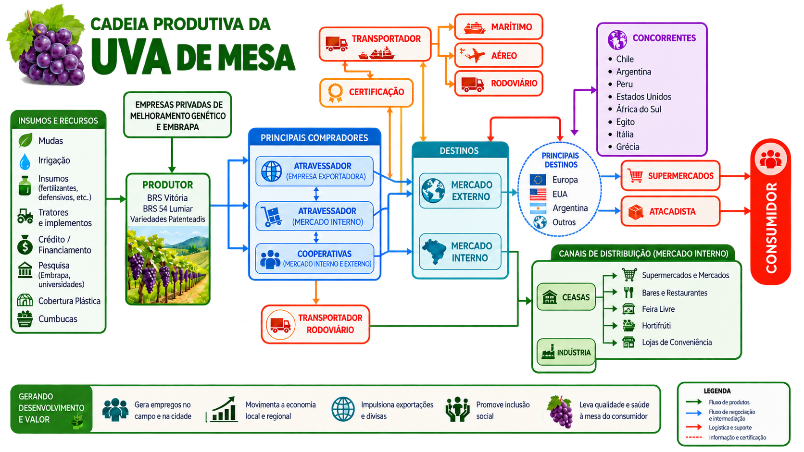
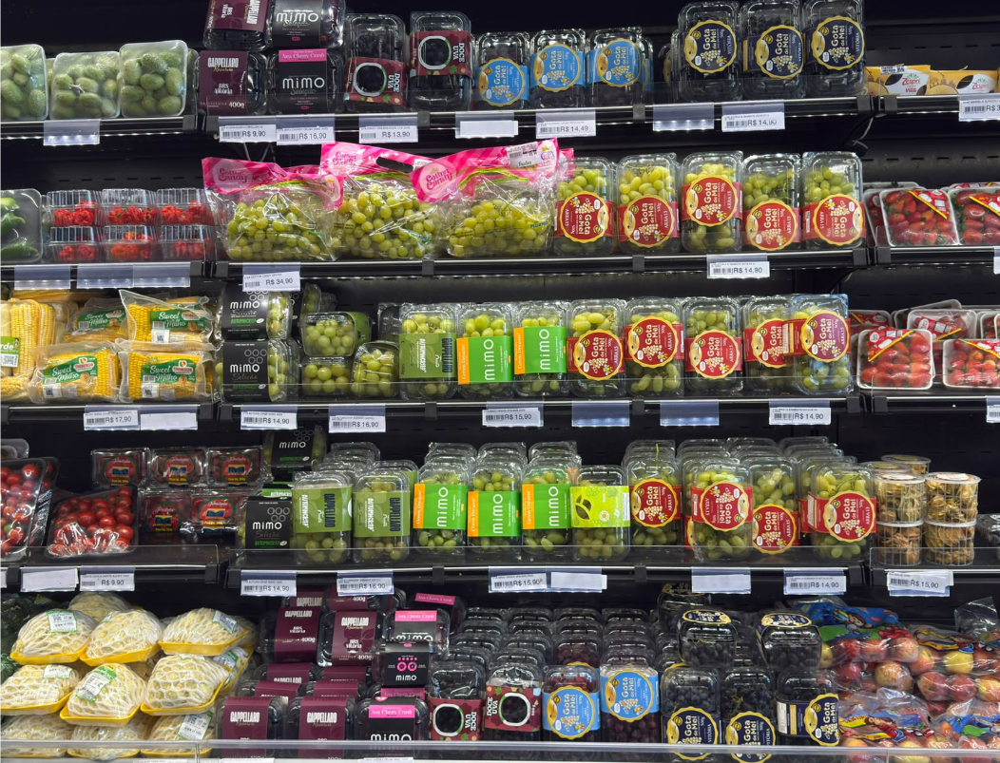

```{r}
#| label: setup

# Dependências dos slides
library(knitr)
library(rmarkdown)
library(dplyr)
library(ggplot2)
library(reshape2)
library(scales)
library(reticulate)

# Usa o Python do sistema (ja tem pandas/plotnine instalados) em vez do
# ambiente gerenciado padrao do reticulate (que vem sem pacotes)
reticulate::use_python("C:/Users/Lenovo/AppData/Local/Programs/Python/Python314/python.exe", required = TRUE)

options(htmltools.dir.version = FALSE)
knitr::opts_chunk$set(
  echo       = FALSE,
  warning    = FALSE,
  message    = FALSE,
  fig.retina = 3,
  fig.width  = 16,
  fig.height = 8,
  out.width  = "100%",
  fig.align  = "center",
  comment    = "#",
  dev.args   = list(bg = "transparent")
  )

# Tema para remover o fundo branco dos gráficos ggplot
tema_transparente <- theme(
  plot.background   = element_rect(fill = "transparent", colour = NA),
  panel.background  = element_rect(fill = "transparent", colour = NA),
  legend.background = element_rect(fill = "transparent", colour = NA),
  legend.key        = element_rect(fill = "transparent", colour = NA)
  )

colors <- c(
  blue       = "#282f6b",
  red        = "#b22200",
  yellow     = "#eace3f",
  green      = "#224f20",
  purple     = "#5f487c",
  orange     = "#b35c1e",
  turquoise  = "#419391",
  green_two  = "#839c56",
  light_blue = "#3b89bc",
  gray       = "#666666"
  )
```

## A CADEIA PRODUTIVA DA VITICULTURA {.titulo-pequeno}

{style="width:94%; max-width:none; max-height:none; margin-left:-2%;"}

## ÁREA COM UVA NO VALE

```{python}
#| label: mba_areauva1
#| echo: false
#| warning: false
#| message: false
#| fig-width: 16
#| fig-height: 8
#| fig-align: "center"


# --- Imports
from pathlib import Path
#import os
import pandas as pd
import matplotlib.pyplot as plt
from plotnine import *

plt.close('all')  # evita que figuras de chunks anteriores atrapalhem a captura desta
plt.rcParams['savefig.transparent'] = True  # remove o fundo branco do PNG

data_dir = Path("C:/Users/Lenovo/Dropbox/tempecon/dados_uva/2026")

# ========= Vale do São Francisco =========
vale = pd.read_csv(data_dir/'area_vale.csv', na_values=['-', 'NA'])

# Somar as mesorregioes por ano
vale_sum = (vale.groupby('ano', as_index=False)['valor'].sum()
                .rename(columns={'ano': 'year', 'valor': 'value'}))
vale_sum.insert(0, 'regiao', 'Vale do São Francisco')
dados_long = vale_sum[vale_sum['year'] > vale_sum['year'].max() - 5].copy()   # últimos 5 anos

# Garantir numérico e criar valor em mil ha
dados_long['value'] = pd.to_numeric(dados_long['value'], errors='coerce')
dados_long['value_k'] = dados_long['value'] / 1000.0
# Rótulo no topo da barra (formato brasileiro: vírgula decimal, ponto de milhar)
dados_long['rotulo'] = dados_long['value_k'].map(
    lambda v: f"{v:,.1f}".replace(".", ",") if v < 100 else f"{v:,.0f}".replace(",", "."))

# Ordenar anos (mesmo se forem strings)
try:
    anos_ordenados = sorted(dados_long['year'].unique(), key=lambda x: int(str(x)))
except Exception:
    anos_ordenados = sorted(dados_long['year'].unique())
dados_long['year'] = pd.Categorical(dados_long['year'], categories=anos_ordenados, ordered=True)

# ========= Plot =========
paleta = {
    "Vale do São Francisco": "#6F2DA8"  # Grape
}
cores = [paleta[k] for k in ["Vale do São Francisco"]]

plot = (
    ggplot(dados_long, aes(x='year', y='value_k', fill='regiao')) +
    geom_col(position=position_dodge(width=0.9), size=1) +
    geom_text(aes(label='rotulo'), position=position_dodge(width=0.9),
              va='bottom', size=22, fontweight='bold') +
    scale_y_continuous(expand=(0, 0, 0.1, 0)) +
    scale_fill_manual(values=cores) +
    labs(
        y="Área Plantada de Uva (mil ha)",
        x="Ano",
        title="",
        caption="Fonte: PAM/IBGE (2026) reprocessado pelo Observatório de Mercado de Uva da Embrapa"
    )
    + theme_minimal()
    + theme(
        legend_position='bottom',
        legend_title=element_blank(),
        legend_text=element_text(size=18),
        axis_title_x=element_text(weight='bold', size=18),
        axis_title_y=element_text(weight='bold', size=18),
        axis_text_x=element_text(size=18),
        axis_text_y=element_text(size=18),
        plot_caption=element_text(ha='left', size=18),
        figure_size=(16, 8),
    )
)

plot.show()
```

## QUANTIDADE DE UVA NO VALE

```{python}
#| label: mba_quantiuva
#| echo: false
#| warning: false
#| message: false
#| fig-width: 16
#| fig-height: 8
#| fig-align: "center"


# --- Imports
from pathlib import Path
#import os
import pandas as pd
import matplotlib.pyplot as plt
from plotnine import *

plt.close('all')  # evita que figuras de chunks anteriores atrapalhem a captura desta
plt.rcParams['savefig.transparent'] = True  # remove o fundo branco do PNG

data_dir = Path("C:/Users/Lenovo/Dropbox/tempecon/dados_uva/2026")

# ========= Vale do São Francisco =========
vale = pd.read_csv(data_dir/'quanti_vale.csv', na_values=['-', 'NA'])

# Somar as mesorregioes por ano
vale_sum = (vale.groupby('ano', as_index=False)['valor'].sum()
                .rename(columns={'ano': 'year', 'valor': 'value'}))
vale_sum.insert(0, 'regiao', 'Vale do São Francisco')
dados_long = vale_sum[vale_sum['year'] > vale_sum['year'].max() - 5].copy()   # últimos 5 anos

# Garantir numérico e criar valor em mil ha
dados_long['value'] = pd.to_numeric(dados_long['value'], errors='coerce')
dados_long['value_k'] = dados_long['value'] / 1000.0
# Rótulo no topo da barra (formato brasileiro: vírgula decimal, ponto de milhar)
dados_long['rotulo'] = dados_long['value_k'].map(
    lambda v: f"{v:,.1f}".replace(".", ",") if v < 100 else f"{v:,.0f}".replace(",", "."))

# Ordenar anos (mesmo se forem strings)
try:
    anos_ordenados = sorted(dados_long['year'].unique(), key=lambda x: int(str(x)))
except Exception:
    anos_ordenados = sorted(dados_long['year'].unique())
dados_long['year'] = pd.Categorical(dados_long['year'], categories=anos_ordenados, ordered=True)

# ========= Plot =========
paleta = {
    "Vale do São Francisco": "#6F2DA8"  # Grape
}
cores = [paleta[k] for k in ["Vale do São Francisco"]]

plot = (
    ggplot(dados_long, aes(x='year', y='value_k', fill='regiao')) +
    geom_col(position=position_dodge(width=0.9), size=1) +
    geom_text(aes(label='rotulo'), position=position_dodge(width=0.9),
              va='bottom', size=22, fontweight='bold') +
    scale_y_continuous(expand=(0, 0, 0.1, 0)) +
    scale_fill_manual(values=cores) +
    labs(
        y="Quantidade Produzida de Uva (mil Ton.)",
        x="Ano",
        title="",
        caption="Fonte: PAM/IBGE (2026) reprocessado pelo Observatório de Mercado de Uva da Embrapa"
    )
    + theme_minimal()
    + theme(
        legend_position='bottom',
        legend_title=element_blank(),
        legend_text=element_text(size=18),
        axis_title_x=element_text(weight='bold', size=18),
        axis_title_y=element_text(weight='bold', size=18),
        axis_text_x=element_text(size=18),
        axis_text_y=element_text(size=18),
        plot_caption=element_text(ha='left', size=18),
        figure_size=(16, 8),
    )
)

plot.show()
```

## EXPORTAÇÕES DE UVAS NOS ÚLTIMOS 5 ANOS 

```{python}
#| label: mba_exp_uva_barras
#| echo: false
#| warning: false
#| message: false
#| fig-width: 20
#| fig-height: 9
#| fig-align: "center"

import pandas as pd
import matplotlib.pyplot as plt
from plotnine import *

plt.close('all')  # evita que figuras de chunks anteriores atrapalhem a captura desta
plt.rcParams['savefig.transparent'] = True  # remove o fundo branco do PNG

# Exportações de uvas frescas (HS 080610) por país, Trade Map/ITC, últimos 5 anos disponíveis
df = pd.read_csv("dados/uva_exportacao_paises.csv", sep=";")
df = df[(df["pais"] != "Grécia") & (df["ano"] > df["ano"].max() - 5)].copy()
df["mil_t"] = df["toneladas"] / 1000

# Países em ordem decrescente de volume no último ano
ordem = df[df["ano"] == df["ano"].max()].sort_values("mil_t", ascending=False)["pais"].tolist()
df["pais"] = pd.Categorical(df["pais"], categories=ordem, ordered=True)
df["ano"] = pd.Categorical(df["ano"].astype(str), ordered=True)
df["rotulo"] = ""
ult = df["ano"].astype(str) == str(df["ano"].astype(str).max())
df.loc[ult, "rotulo"] = df.loc[ult, "mil_t"].round().astype(int).astype(str)

cores = ["#E3D5F2", "#C3A5E3", "#9B6FCB", "#7A3FB5", "#4B1D80"]   # do mais antigo (claro) ao mais recente (escuro)

plot = (
    ggplot(df, aes("pais", "mil_t", fill="ano"))
    + geom_col(position=position_dodge(width=0.85), width=0.8)
    + geom_text(aes(label="rotulo"), position=position_dodge(width=0.85), va="bottom", size=15, fontweight="bold")
    + scale_fill_manual(values=cores)
    + scale_y_continuous(labels=lambda l: [f"{v:,.0f}".replace(",", ".") for v in l], expand=(0, 0, 0.08, 0))
    + labs(x="", y="Mil toneladas exportadas", title="",
           caption="Fonte: Trade Map/ITC (2026), uvas frescas (HS 080610). Dados reprocessados pelo "
                   "Observatório de Mercado da Embrapa.")
    + theme_minimal()
    + theme(
        legend_position="bottom",
        legend_title=element_blank(),
        legend_text=element_text(size=18),
        axis_title_y=element_text(weight="bold", size=18),
        axis_text_x=element_text(size=18),
        axis_text_y=element_text(size=18),
        plot_caption=element_text(ha="left", size=16),
        figure_size=(16, 8),
        panel_background=element_rect(fill="None", color="None"),
        plot_background=element_rect(fill="None", color="None"),
    )
)

plot.show()
```

# O MERCADO INTERNO

## UVAS NO VAREJO

{style="width:80%; max-width:none; max-height:none; object-position:center top;"}

## PARA PENSAR...

<br>

- A **oferta cresceu muito**, mais rápido do que a **exportação**;
- Cada vez mais, o **mercado interno** precisa absorver essa oferta.
- Na gôndola, o consumidor encontra inúmeras marcas, variedades, cores e uvas com sabores: **qual cumbuca de uva ele leva para casa?**
- Dois desafios: **fazer o consumidor escolher a cumbuca de uva da sua empresa** (marca e diferenciação) e **entregar a qualidade que o faça ter uma boa experiência para ele voltar** a comprar a uva da sua empresa.
- **Quem conseguir, passa por esta fase da viticultura.**
- Então é reunir as equipes, principalmente de marketing, do setor de qualidade e o comercial e ter garantia que todos tem clareza de como deve ser a cultura da empresa.


## {.center .thankslide}
<div style="text-align: center;">
  
</div>

<div style="text-align: center;"> 
  <h2 style="color: #282f6b; font-size: 2em; margin-bottom: 20px;">
    MUITO OBRIGADO!
  </h2>
  <br>
  <!-- This part will have a smaller font size -->
  <p style="font-size: 0.8em; color: #333;">
    <a href="https://www.embrapa.br/observatorio-da-uva" target="_blank">
      https://www.embrapa.br/web/semiarido/observatorio-da-uva
    </a>
    <br>
📲 **WhatsApp:** <br>
+55 87 99961-5799  
  </p>
  
</div>