## João Ricardo Lima  {.center .aboutmeslide}

::: columns
::: {.column width="60%"}

-   Contatos

    -   Instagram: [\@jotaerre.econ](https://www.instagram.com/jotaerre.econ/)

    -   Email: [joao.ricardo@embrapa.br](joao.ricardo@embrapa.br)

    -   Linkedin: [Joao Ricardo Lima](https://www.linkedin.com/in/joao-ricardo-lima-7b6273240/)

-   Sobre mim

    -   Doutor em Economia Aplicada (UFV-MG)

    -   Pesquisador em Economia Rural da Embrapa Semiárido - Petrolina/PE

    -   Coordenador dos Observatórios de Mercado de Manga e Uva da Embrapa
    
    -   Professor da FACAPE (Faculdade de Petrolina)

:::
::: {.column width="40%"}
{style="width:100%; height:700px; object-fit:cover; object-position:center top;"}


:::
:::

```{r}
#| label: setup

# Dependências dos slides
library(knitr)
library(rmarkdown)
library(dplyr)
library(ggplot2)
library(reshape2)
library(scales)
library(tsutils)  # seasplot(), usado nos gráficos de preços de manga
library(reticulate)

# Usa o Python do sistema (ja tem pandas/plotnine instalados) em vez do
# ambiente gerenciado padrao do reticulate (que vem sem pacotes)
reticulate::use_python("C:/Users/Lenovo/AppData/Local/Programs/Python/Python314/python.exe", required = TRUE)

options(htmltools.dir.version = FALSE)
knitr::opts_chunk$set(
  echo       = FALSE,
  warning    = FALSE,
  message    = FALSE,
  fig.retina = 3,
  fig.width  = 16,
  fig.height = 8,
  out.width  = "100%",
  fig.align  = "center",
  comment    = "#",
  dev.args   = list(bg = "transparent")
  )

# Tema para remover o fundo branco dos gráficos ggplot
tema_transparente <- theme(
  plot.background   = element_rect(fill = "transparent", colour = NA),
  panel.background  = element_rect(fill = "transparent", colour = NA),
  legend.background = element_rect(fill = "transparent", colour = NA),
  legend.key        = element_rect(fill = "transparent", colour = NA)
  )

colors <- c(
  blue       = "#282f6b",
  red        = "#b22200",
  yellow     = "#eace3f",
  green      = "#224f20",
  purple     = "#5f487c",
  orange     = "#b35c1e",
  turquoise  = "#419391",
  green_two  = "#839c56",
  light_blue = "#3b89bc",
  gray       = "#666666"
  )
```

# A FRUTICULTURA DO VALE DO SÃO FRANCISCO

## EVOLUÇÃO DA ÁREA PLANTADA DE FRUTAS NO VALE {.titulo-pequeno}

- ####  Área plantada total foi de ~72.000 ha (2010) para ~122.400 ha (2025), após pico de ~125.800 ha em 2024. A manga sozinha respondeu por ~46% de todo o crescimento líquido (23.188 ha dos 50.403 ha totais de expansão entre 2010 e 2025).

```{r}
#| label: slide10b
#| fig-width: 20
#| fig-height: 8

# Area plantada (ha) de acerola, manga, uva, banana, coco-da-baia, goiaba, limao,
# mamao, maracuja, melao e melancia, somada nos 42 municipios das mesorregioes
# Vale Sao-Franciscano da Bahia + Sao Francisco Pernambucano (IBGE/PAM)
dados_area <- read.csv2('dados/area_plantada_vsf_detalhe.csv', header = T, sep = ";", dec = ".")

dados_area_tot <- dados_area |>
  group_by(Ano) |>
  summarise(AreaPlantada_ha = sum(AreaPlantada_ha), .groups = "drop")

g1 <- ggplot(dados_area_tot, aes(x = Ano, y = AreaPlantada_ha)) +
  geom_line(color = colors[["green"]], linewidth = 2.2) +
  geom_point(color = colors[["green"]], size = 3.5) +
  scale_y_continuous(name = "Área Plantada (ha)", n.breaks = 8,
                      limits = c(0, max(dados_area_tot$AreaPlantada_ha) * 1.1),
                      expand = expansion(add = c(0, 0))) +
  scale_x_continuous(breaks = seq(2010, 2025, by = 1)) +
  labs(x = "Anos", title = '',
       caption = "Fonte: IBGE - PAM (Produção Agrícola Municipal), reprocessado pelos Observatórios de Manga e Uva da Embrapa, 2026. Dados de 2025 preliminares.\nSoma de acerola, manga, uva, banana, coco-da-baía, goiaba, limão, mamão, maracujá, melão e melancia nas mesorregiões Vale São-Franciscano da Bahia e São Francisco Pernambucano.") +
  theme_classic() +
  theme(axis.text.x = element_text(angle = 45, hjust = 1, size = 22, margin = margin(t = 5)),
        axis.text.y = element_text(size = 22, margin = margin(r = 10)),
        axis.title.x = element_text(size = 22, face = "bold", margin = margin(t = 10)),
        axis.title.y = element_text(size = 22, face = "bold", margin = margin(r = 20)),
        plot.caption = element_text(hjust = 0, size = 14))
g1 + tema_transparente
```

## PRINCIPAIS ESTADOS PRODUTORES DE MANGA {.titulo-pequeno}

- #### Em 2025, Bahia e Pernambuco produziram juntos 77,5% da manga do Brasil (1,48 de 1,91 milhão de toneladas). 10 estados produziram 99% da manga nacional.

```{r}
#| label: manga_top10_estados
#| fig-width: 20
#| fig-height: 8

# Quantidade produzida de manga em 2025 (PAM/IBGE), 10 maiores estados
top_estados <- read.csv('C:/Users/Lenovo/Dropbox/tempecon/dados_manga/2026/quanti_estados.csv',
                        encoding = "UTF-8") |>
  filter(ano == 2025) |>
  slice_max(valor, n = 10) |>
  mutate(local = reorder(local, -valor),
         rotulo = format(round(valor / 1000, 1), big.mark = ".", decimal.mark = ",", trim = TRUE))

g_top <- ggplot(top_estados, aes(x = local, y = valor / 1000)) +
  geom_col(fill = "gold", width = 0.7) +
  geom_text(aes(label = rotulo), vjust = -0.5, size = 8, fontface = "bold") +
  scale_x_discrete(labels = label_wrap(10)) +
  scale_y_continuous(name = "Quantidade produzida de manga (mil t)",
                     limits = c(0, max(top_estados$valor) / 1000 * 1.1),
                     expand = expansion(add = c(0, 0)), n.breaks = 8,
                     labels = number_format(big.mark = ".", decimal.mark = ",")) +
  labs(x = NULL, title = '',
       caption = "Fonte: PAM/IBGE (2026) reprocessado pelo Observatório de Mercado de Manga da Embrapa.") +
  theme_classic() +
  theme(axis.text.x = element_text(size = 22, margin = margin(t = 10)),
        axis.text.y = element_text(size = 22, margin = margin(r = 10)),
        axis.title.y = element_text(size = 22, face = "bold", margin = margin(r = 20)),
        plot.caption = element_text(hjust = 0, size = 20))
g_top + tema_transparente
```

## ÁREA COM MANGA NO VALE

```{python}
#| label: mba_areamanga1
#| echo: false
#| warning: false
#| message: false
#| fig-width: 16
#| fig-height: 8
#| fig-align: "center"


# --- Imports
from pathlib import Path
#import os
import pandas as pd
import matplotlib.pyplot as plt
from plotnine import *

plt.close('all')  # evita que figuras de chunks anteriores atrapalhem a captura desta
plt.rcParams['savefig.transparent'] = True  # remove o fundo branco do PNG

data_dir = Path("C:/Users/Lenovo/Dropbox/tempecon/dados_manga/2026")

# ========= Vale do São Francisco =========
vale = pd.read_csv(data_dir/'area_vale.csv', na_values=['-', 'NA'])  # formato longo: local, ano, valor

# ========= Long format: soma das mesorregiões por ano =========
dados_long = (vale.groupby('ano', as_index=False)['valor'].sum()
                  .rename(columns={'ano': 'year', 'valor': 'value'}))
dados_long.insert(0, 'regiao', 'Vale do São Francisco')

# Garantir numérico e criar valor em mil ha
dados_long['value'] = pd.to_numeric(dados_long['value'], errors='coerce')
dados_long['value_k'] = dados_long['value'] / 1000.0

# Ordenar anos (mesmo se forem strings)
try:
    anos_ordenados = sorted(dados_long['year'].unique(), key=lambda x: int(str(x)))
except Exception:
    anos_ordenados = sorted(dados_long['year'].unique())
dados_long['year'] = pd.Categorical(dados_long['year'], categories=anos_ordenados, ordered=True)

# ========= Plot =========
paleta = {
    "Vale do São Francisco": "gold"  # Gold
}
cores = [paleta[k] for k in ["Vale do São Francisco"]]

g2 = (
    ggplot(dados_long, aes(x='year', y='value_k', fill='regiao')) +
    geom_col(position=position_dodge(width=0.9), size=1) +
    scale_fill_manual(values=cores) +
    labs(
        y="Área Plantada de Manga (mil ha)",
        x="Ano",
        title="",
        caption="Fonte: PAM/IBGE (2026) reprocessado pelo Observatório de Mercado de Manga da Embrapa"
    )
    + theme_minimal()
    + theme(
        legend_position='bottom',
        legend_title=element_blank(),
        legend_text=element_text(size=18),
        axis_title_x=element_text(weight='bold', size=18),
        axis_title_y=element_text(weight='bold', size=18),
        axis_text_x=element_text(size=18),
        axis_text_y=element_text(size=18),
        plot_caption=element_text(ha='left', size=18),
        figure_size=(16, 8),
        panel_background=element_rect(fill='None', color='None'),
        plot_background=element_rect(fill='None', color='None'),
    )
)

# desenha o gráfico na figura atual respeitando o fundo transparente
g2.show()
```

## QUANTIDADE DE MANGA NO VALE

```{python}
#| label: mba_quantimanga
#| echo: false
#| warning: false
#| message: false
#| fig-width: 16
#| fig-height: 8
#| fig-align: "center"


# --- Imports
from pathlib import Path
#import os
import pandas as pd
import matplotlib.pyplot as plt
from plotnine import *

plt.close('all')  # evita que figuras de chunks anteriores atrapalhem a captura desta
plt.rcParams['savefig.transparent'] = True  # remove o fundo branco do PNG

data_dir = Path("C:/Users/Lenovo/Dropbox/tempecon/dados_manga/2026")

# ========= Vale do São Francisco =========
vale = pd.read_csv(data_dir/'quanti_vale.csv', na_values=['-', 'NA'])  # formato longo: local, ano, valor

# ========= Long format: soma das mesorregiões por ano =========
dados_long = (vale.groupby('ano', as_index=False)['valor'].sum()
                  .rename(columns={'ano': 'year', 'valor': 'value'}))
dados_long.insert(0, 'regiao', 'Vale do São Francisco')

# Garantir numérico e criar valor em mil ha
dados_long['value'] = pd.to_numeric(dados_long['value'], errors='coerce')
dados_long['value_k'] = dados_long['value'] / 1000.0

# Ordenar anos (mesmo se forem strings)
try:
    anos_ordenados = sorted(dados_long['year'].unique(), key=lambda x: int(str(x)))
except Exception:
    anos_ordenados = sorted(dados_long['year'].unique())
dados_long['year'] = pd.Categorical(dados_long['year'], categories=anos_ordenados, ordered=True)

# ========= Plot =========
paleta = {
    "Vale do São Francisco": "gold"  # Grape
}
cores = [paleta[k] for k in ["Vale do São Francisco"]]

g3 = (
    ggplot(dados_long, aes(x='year', y='value_k', fill='regiao')) +
    geom_col(position=position_dodge(width=0.9), size=1) +
    scale_fill_manual(values=cores) +
    labs(
        y="Quantidade Produzida de Manga (mil Ton.)",
        x="Ano",
        title="",
        caption="Fonte: PAM/IBGE (2026) reprocessado pelo Observatório de Mercado de Manga da Embrapa"
    )
    + theme_minimal()
    + theme(
        legend_position='bottom',
        legend_title=element_blank(),
        legend_text=element_text(size=18),
        axis_title_x=element_text(weight='bold', size=18),
        axis_title_y=element_text(weight='bold', size=18),
        axis_text_x=element_text(size=18),
        axis_text_y=element_text(size=18),
        plot_caption=element_text(ha='left', size=18),
        figure_size=(16, 8),
        panel_background=element_rect(fill='None', color='None'),
        plot_background=element_rect(fill='None', color='None'),
    )
)

# desenha o gráfico na figura atual respeitando o fundo transparente
g3.show()
```

## A CADEIA PRODUTIVA DA MANGICULTURA {.titulo-pequeno}

{style="width:94%; max-width:none; max-height:none; margin-left:-2%;"}

Fonte: LIMA et al, 2023.

## VARIEDADES DE MANGAS

```{r}
#| label: mba_variedades

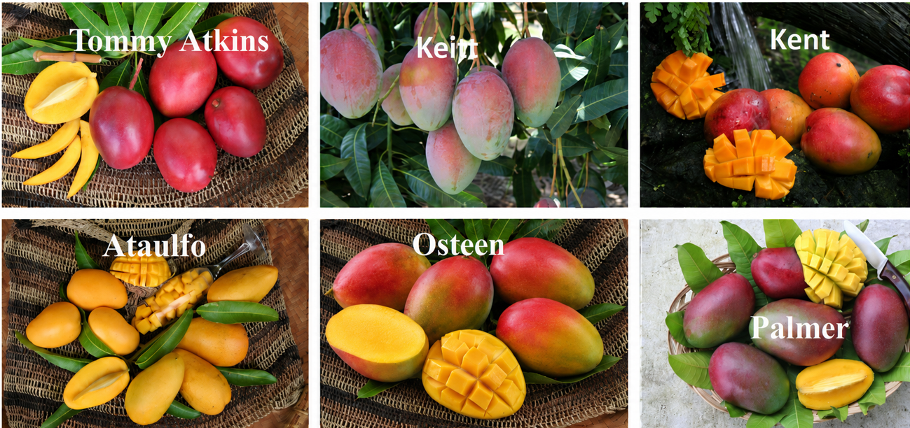
```
Fonte: Campbell (2025).

## A RESSUREIÇÃO DA PALMER PELO BRASIL

```{r}
#| label: mba_variedades3

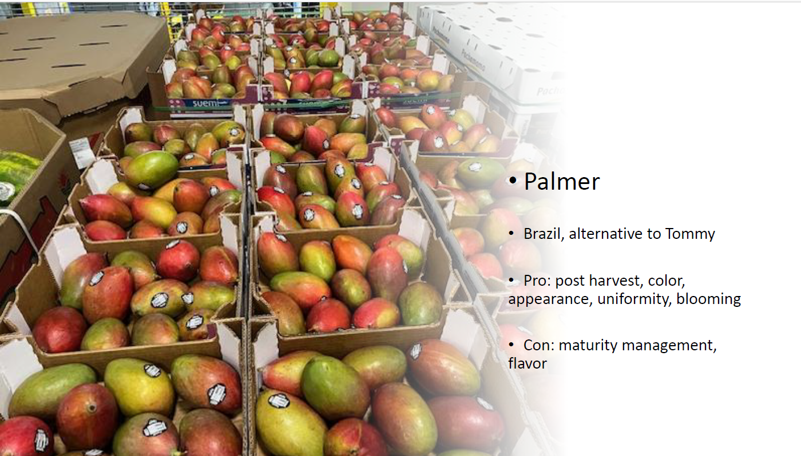
```
Fonte: Campbell (2025).

## PALMER AMADURECIDA DEPOIS DE COLHIDA VERDE {.titulo-pequeno}

```{r}
#| label: mba_variedades31
#| out-width: "120%"

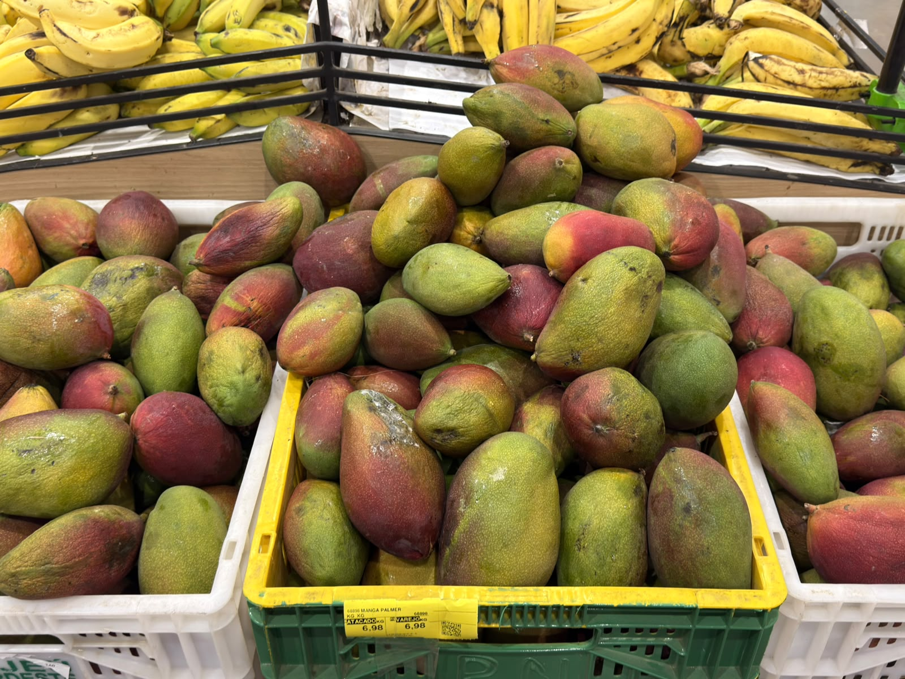
```
Data Foto: 17/09/2026 em Petrolina.

## PALMER AMADURECIDA DEPOIS DE COLHIDA VERDE {.titulo-pequeno}

```{r}
#| label: mba_variedades32
#| out-width: "120%"

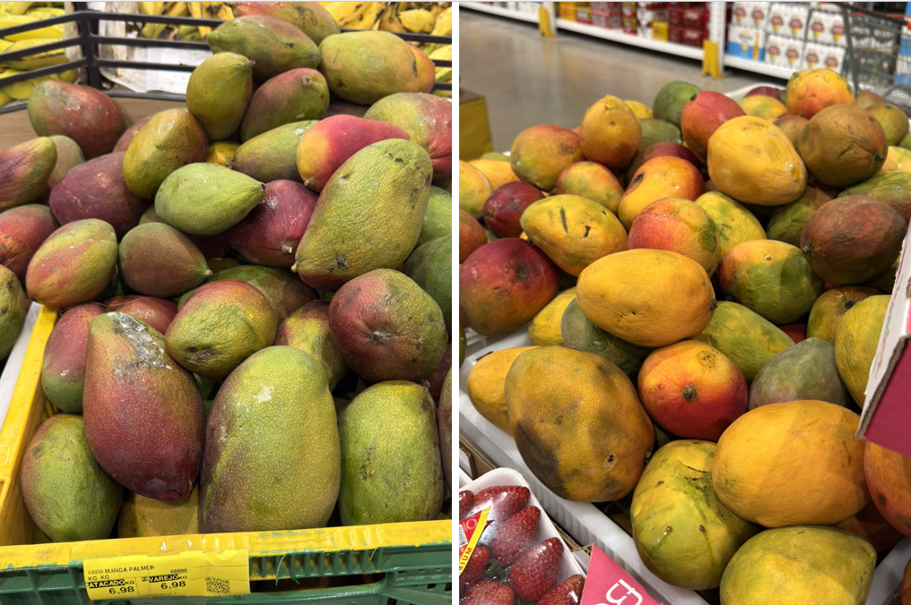
```
Data Foto: 17/09/2026 em Petrolina.

## A MANGA PALMER MADURA NO PÉ 

<br>

```{r}
#| label: mba_variedades33
#| out-width: "120%"

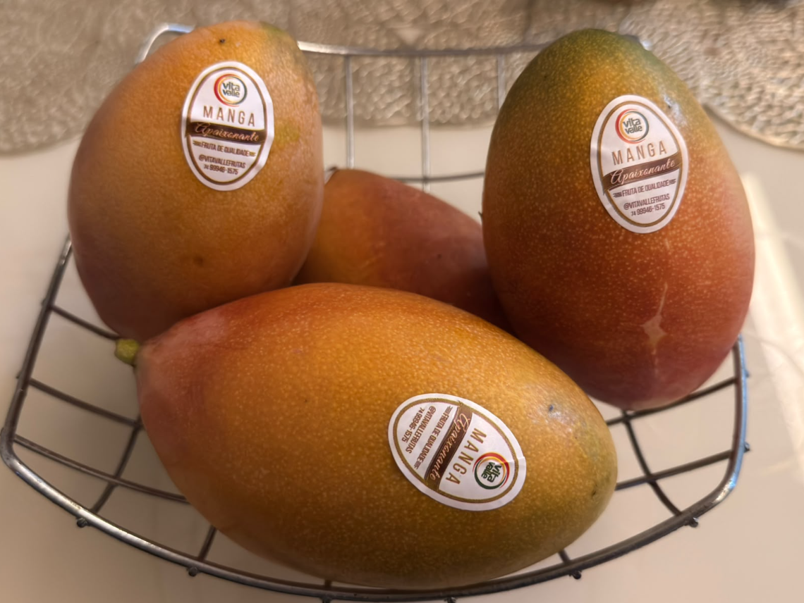
```
Data Foto: 10/10/2026 em Petrolina.

## A MANGA PALMER MADURA NO PÉ 

<br>

```{r}
#| label: mba_variedades34
#| out-width: "120%"

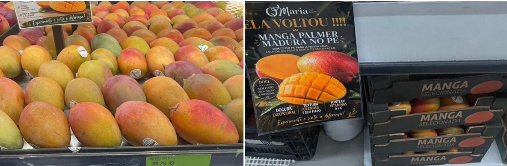
```
Data Foto: 08/2026 em São Paulo.

## VARIEDADES DE MANGAS - MANGA MAÇÃ {.titulo-pequeno}

```{r}
#| label: mba_variedades4

knitr::include_graphics("imgs/manga_maca1.png")
```
Local: Feirão das Frutas/Petrolina - setembro de 2026

## VARIEDADES DE MANGAS - MANGA MAÇÃ {.titulo-pequeno}

```{r}
#| label: mba_variedades5

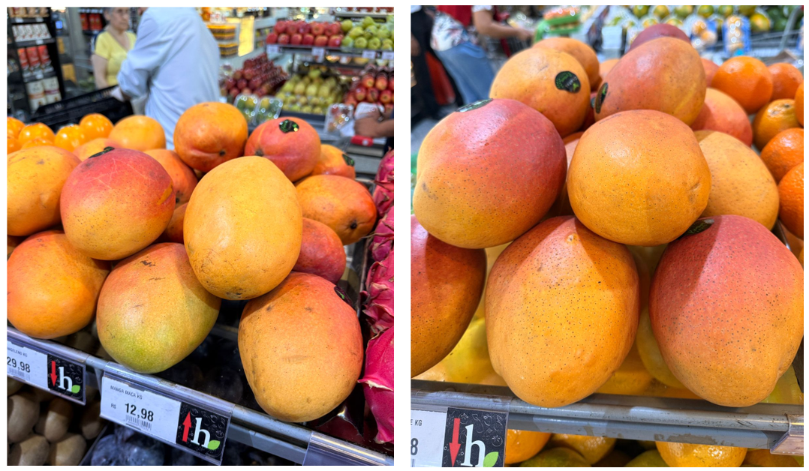
```
Local: Horti e Sabor/SP - dezembro de 2025

## VARIEDADES DE MANGAS - MANGA R2E2 {.titulo-pequeno}

```{r}
#| label: mba_variedades51

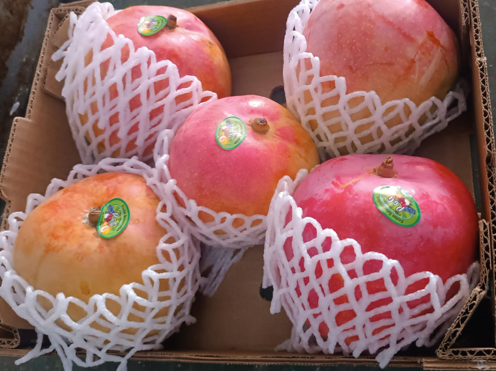
```

## VARIEDADES DE MANGAS - MANGA R2E2 {.titulo-pequeno}

```{r}
#| label: mba_variedades52

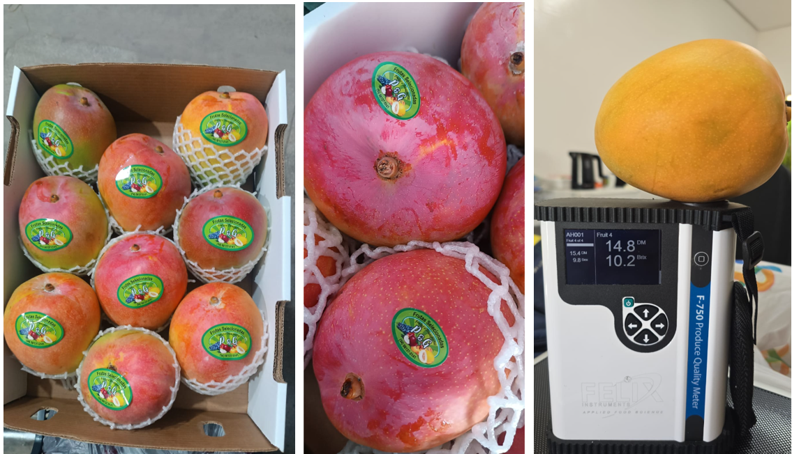
```

# O MERCADO EXTERNO

## A IMPORTANTE FUNÇÃO DO MERCADO EXTERNO.

<br>

```{r}
#| label: slide18
#| fig-width: 20
#| fig-height: 8

# Serie 2012-2026 (2026 parcial, ate setembro), ja em Mil US$ e toneladas
dados4 <- read.csv2('dados/manga_exportacoes_2012_2026.csv', header=T, sep=";", dec = ".")
colnames(dados4) = c('Ano', 'Valor', "Toneladas")
dados4 <- dplyr::tibble(dados4)

# Toneladas e Valor (US$ Mil) ficam em faixas parecidas (dezenas/centenas de
# milhares), entao cabem num unico eixo Y sem precisar de eixo secundario
dados4a <- dados4

g5 <- ggplot(dados4a, aes(x = Ano)) +
  geom_col(aes(y = Toneladas, fill = "Toneladas"), width = 0.7) +
  geom_line(aes(y = Valor, color = "Valor (US$ Mil)"), linewidth = 2.2) +
  scale_fill_manual(name = NULL, values = c("Toneladas" = "gold")) +
  scale_color_manual(name = NULL, values = c("Valor (US$ Mil)" = "red")) +
  scale_y_continuous(name = "Toneladas de Mangas / US$ Mil", n.breaks = 10, expand = expansion(add = c(0, 0.5))) +
  scale_x_continuous(breaks = seq(2012, 2026, by = 1)) +
  labs(x = "Anos", title = '',
       caption = "Fonte: COMEXSTAT reprocessado pelo Observatório de Mercado de Manga da Embrapa, 2026. Dados de 2026 até setembro.") +
  theme_classic() + #Definindo tema
  theme(axis.text.x = element_text(angle = 45, hjust = 1, size = 22, margin = margin(b = 5)),
        axis.text.y = element_text(hjust = 1, size = 22, margin = margin(l = 20)),
        axis.title.x = element_text(size = 22, face = "bold", margin = margin(b = 5)),
        axis.title.y = element_text(size = 22, face = "bold", margin = margin(l = 20)),
        plot.caption = element_text(hjust = 0, size = 20),
        legend.position = "bottom", legend.title = element_blank(),
        legend.text = element_text(size = 22)) # Definindo posição da legenda
g5 + tema_transparente
```

## O "TARIFAÇO" AMERICANO x ACORDO UE/MERCOSUL {.titulo-pequeno}

::: columns
::: {.column width="45%"}

{style="width:90%; height:775px; max-width:none; max-height:none;"}


:::
::: {.column width="55%"}

<br>

**Manga**

- Tarifa dos EUA: início em 2025 com **50%**, anunciada com vigência a partir de agosto de 2025

- Isenta posteriormente e, em 2026, também isenta da sobretaxada combinada de **37,5%**

- A Manga já era isenta na União Europeia.

:::
:::


## VOLUME EXPORTADO MANGA POR DESTINO

```{r}
#| label: slide21

dados_exporta <- read.csv2('dados/destinos_exporta.csv', header=T, sep=";", stringsAsFactors = FALSE)

# Step 2: Convert 'Date' column to Date format and reorder data
dados_exporta$Ano <- as.Date(paste0(dados_exporta$Ano, "-01-01"), format = "%Y-%m-%d")

# Filter data for the years 2015 to 2025
dados_exporta <- dados_exporta |>
  filter(format(Ano, "%Y") >= 2015 & format(Ano, "%Y") <= 2025) |>
  arrange(Ano) # Arrange in descending order (from 2015 to 2025)

# Step 3: Create the bar graph
ggplot(dados_exporta, aes(x = format(Ano, "%Y"), y = quilo/1000, fill = bloco)) +
  geom_bar(stat = "identity", position = "dodge") +
  labs(x = "Anos", y = "Volume Exportado Mangas", 
       title = "",
       fill = "Destino",
       caption = "Fonte: COMEXSTAT reprocessado pelo Observatório de Mercado de Manga da Embrapa, 2026") +
  scale_y_continuous(n.breaks = 10)+
  theme_minimal()+ #Definindo tema
  theme(axis.text.x=element_text(angle=0, hjust=0.5, size=18, margin = margin(b=5)),
        axis.text.y=element_text(hjust=1, size=18, margin = margin(l=20)),
        axis.title.x = element_text(size=18, face = "bold", margin = margin(b=5)),
        axis.title.y = element_text(size=18, face = "bold", margin = margin(l=20)),
        plot.caption = element_text(hjust = 0, size=16),
        legend.position = "bottom", legend.title = element_blank(),
        legend.text=element_text(size=18)) + # Definindo posição da legenda
  tema_transparente
```

## EXPORTAÇÃO MANGAS EUA × RESTO DO MUNDO

<br>

```{python}
#| label: mba_manga_eua_resto
#| echo: false
#| warning: false
#| message: false
#| fig-width: 18
#| fig-height: 16
#| fig-align: "center"

import pandas as pd
import matplotlib.pyplot as plt
from matplotlib.ticker import FuncFormatter

plt.rcParams['figure.facecolor'] = 'none'
plt.rcParams['axes.facecolor'] = 'none'

df = pd.read_csv("dados/brasil_eua.csv", sep=";")
df.columns = [c.strip() for c in df.columns]
for c in ["ano", "exportacao_total", "exportacao_eua"]:
    df[c] = pd.to_numeric(df[c], errors="coerce")
df["perc_eua"] = (df["exportacao_eua"] / df["exportacao_total"] * 100).round(0)

fig, ax1 = plt.subplots(figsize=(14, 6))
ax2 = ax1.twinx()

ax1.bar(df["ano"], df["exportacao_eua"], width=0.6, color="gold",
        label="Contêineres p/ EUA")
ax2.plot(df["ano"], df["perc_eua"], color="#FF0000", linewidth=2,
         marker="o", label="% do total exportado")

for x, y in zip(df["ano"], df["perc_eua"]):
    ax2.annotate(f"{int(y)}%", (x, y), textcoords="offset points",
                 xytext=(0, 10), ha="center", color="#FF0000",
                 fontsize=13, fontweight="bold")

ax1.set_xlabel("Ano", fontsize=18, fontweight="bold")
ax1.set_ylabel("Contêineres export mangas p/ EUA",
                fontsize=18, fontweight="bold")
ax2.set_ylabel("% do total export mangas pelo Brasil",
                fontsize=18, fontweight="bold")
ax1.set_xticks(df["ano"])
ax1.tick_params(axis='both', labelsize=15)
ax2.tick_params(axis='both', labelsize=15)
# eixo do percentual começa em 0
_ = ax2.set_ylim(0, (int(df["perc_eua"].max()) // 5 + 1) * 5)
ax2.yaxis.set_major_formatter(FuncFormatter(lambda v, p: f"{int(v)}%"))
for s in ax1.spines.values():
    s.set_visible(False)
for s in ax2.spines.values():
    s.set_visible(False)
ax1.set_facecolor('none')
ax2.set_facecolor('none')
fig.patch.set_alpha(0)

l1, lab1 = ax1.get_legend_handles_labels()
l2, lab2 = ax2.get_legend_handles_labels()
_ = ax1.legend(l1 + l2, lab1 + lab2, loc='upper center',
               bbox_to_anchor=(0.5, -0.12), ncol=2, fontsize=15, frameon=False)
_ = fig.text(0.01, 0.01, "Fonte: COMEXSTAT (2025). Reprocessado pelo "
             "Observatório de Mercado da Embrapa.", ha='left', fontsize=14)
fig.subplots_adjust(bottom=0.20)
plt.show()
plt.close(fig)
```

## PREÇO NOS EUA — TOMMY ATKINS: 2024 × 2025 {.titulo-pequeno}

```{python}
#| label: mba_manga_preco_tommy
#| echo: false
#| warning: false
#| message: false
#| fig-width: 16
#| fig-height: 8
#| fig-align: "center"

import pyreadr
import pandas as pd
import matplotlib.pyplot as plt
from plotnine import (
    ggplot, aes, geom_col, geom_text, position_dodge,
    scale_fill_manual, scale_y_continuous, labs, theme_minimal, theme
)
from plotnine.themes.elements import *

plt.rcParams['figure.facecolor'] = 'none'
plt.rcParams['axes.facecolor'] = 'none'

# --- Dados (RData via pyreadr) ---
res = pyreadr.read_r("dados/dados_eua2.RData")
df = res['dados']

tommy = df[(df['variedade'] == 'TOMMY ATKINS') &
           (df['origem'] == 'BRAZIL') &
           (df['ano'].isin(['2024', '2025']))].copy()
tommy['semana'] = tommy['semana'].astype(int)
tommy['ano'] = tommy['ano'].astype(int)
tommy = tommy[(tommy['semana'] >= 31) & (tommy['semana'] <= 50)]

g = (tommy.groupby(['ano', 'semana'])['Tam_10'].mean()
          .reset_index().dropna(subset=['Tam_10']))
g['ano'] = pd.Categorical(g['ano'].astype(str), categories=['2024', '2025'],
                          ordered=True)
g['semana'] = pd.Categorical(g['semana'],
                             categories=sorted(g['semana'].unique()),
                             ordered=True)

def fmt_pt(v, dec=2):
    s = f"{v:,.{dec}f}"
    return s.replace(",", "X").replace(".", ",").replace("X", ".")

g['label'] = g['Tam_10'].map(lambda v: fmt_pt(v, 2))

plot = (
    ggplot(g, aes('semana', 'Tam_10', fill='ano'))
    + geom_col(position=position_dodge(width=0.8), width=0.7)
    + geom_text(aes(label='label'),
                position=position_dodge(width=0.8),
                va='bottom', size=9)
    + scale_fill_manual(values={'2024': '#027559', '2025': 'gold'})
    + scale_y_continuous(labels=lambda l: [fmt_pt(v, 0) for v in l])
    + labs(
        x="Semanas", y="Preço (USD) Caixa 4kg mangas", title="",
        caption="Fonte: USDA/AMS (2025). Reprocessado pelo Observatório de "
                "Mercado de Manga da Embrapa."
    )
    + theme_minimal()
    + theme(
        legend_position='bottom',
        legend_title=element_blank(),
        legend_text=element_text(size=18),
        axis_title_x=element_text(weight='bold', size=18),
        axis_title_y=element_text(weight='bold', size=18),
        axis_text_x=element_text(size=15),
        axis_text_y=element_text(size=18),
        plot_caption=element_text(ha='left', size=16),
        figure_size=(16, 8),
        panel_background=element_rect(fill='None', color='None'),
        plot_background=element_rect(fill='None', color='None'),
    )
)

plot.show()
```

## MANGA DO BRASIL CHEGANDO NOS EUA

```{r}
#| label: mba_variedades6

knitr::include_graphics("imgs/muranaka_eua1.jpeg")
```

## MANGA DO BRASIL CHEGANDO NOS EUA

```{r}
#| label: mba_variedades7

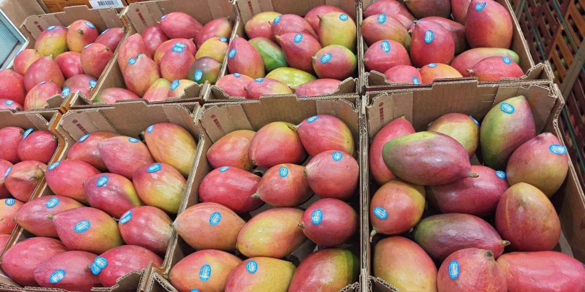
```

## O MAIOR PROBLEMA DAS EXPORTAÇOES PARA OS EUA {.titulo-pequeno}

```{r}
#| label: mba_variedades10


```

## O MAIOR PROBLEMA DAS EXPORTAÇOES PARA OS EUA {.titulo-pequeno}

```{r}
#| label: mba_variedades8

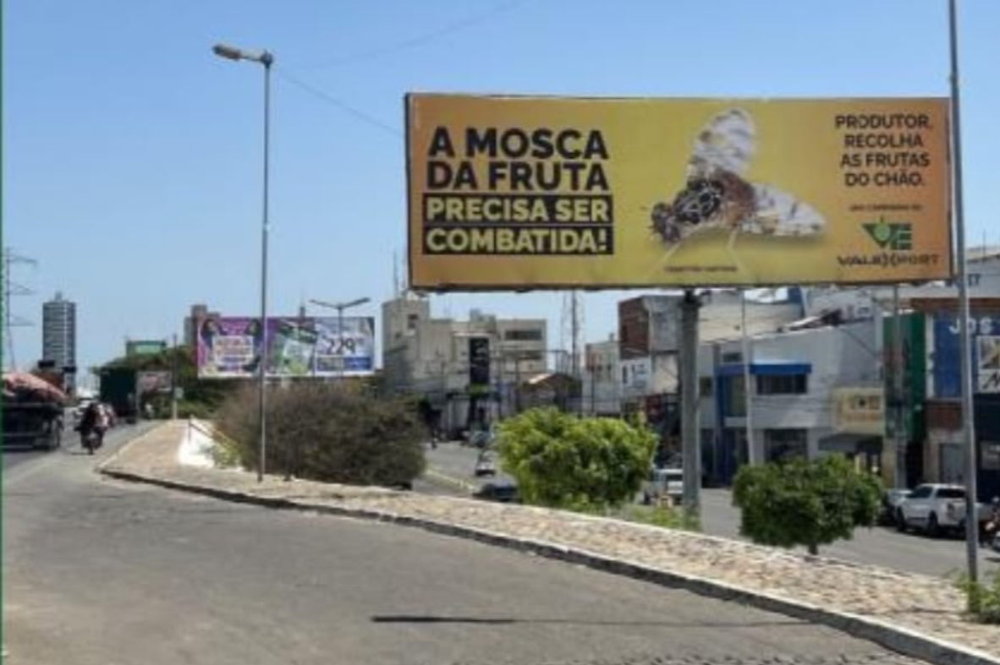
```

## ESTIMATIVA DE PREJUÍZOS COM MOSCA DAS FRUTAS {.titulo-pequeno}

<br>

```{r}
#| label: mba_variedades9

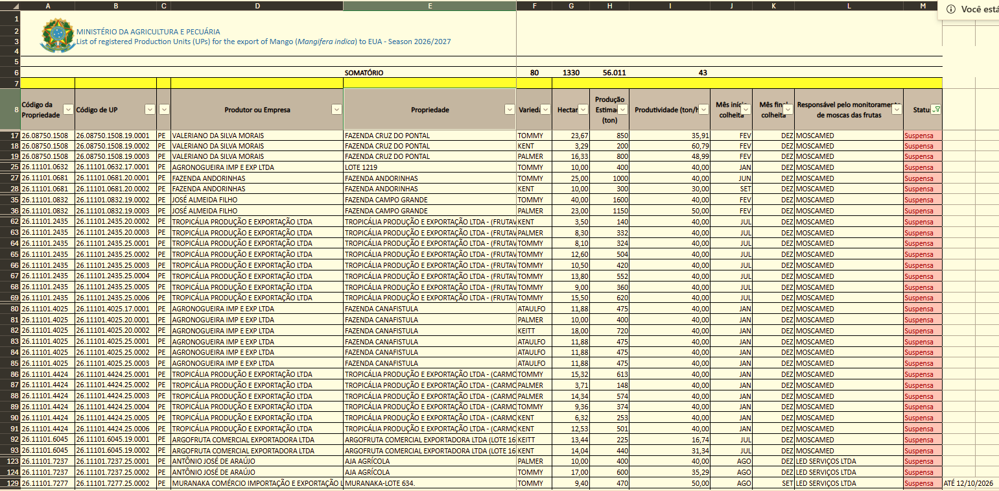
```
Fonte: MAPA, 13/10/26.

## ESTIMATIVA DE PREJUÍZOS COM MOSCA DAS FRUTAS {.titulo-pequeno}

<br>

```{r}
#| label: mba_variedades11

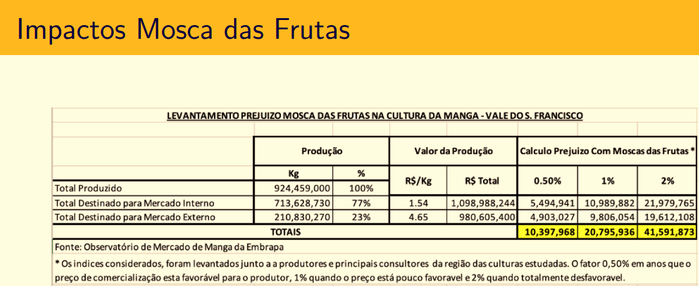
```
Fonte: Observatório da Manga e Valexport, 2023. 

## EXPORTAÇÕES DE MANGAS BRASIL X PERU

```{python}
#| label: mba_exp_peru_brasil
#| echo: false
#| warning: false
#| message: false
#| fig-width: 16
#| fig-height: 8
#| fig-align: "center"

import pandas as pd
import matplotlib.pyplot as plt
from plotnine import (
    ggplot, aes, geom_line, scale_color_manual,
    scale_x_continuous, scale_y_continuous, labs, theme_minimal, theme
)
from plotnine.themes.elements import *

# === fundo transparente ===
plt.rcParams['figure.facecolor'] = 'none'
plt.rcParams['axes.facecolor'] = 'none'

# Leitura dos dados
df = pd.read_csv("dados/brasil_peru_manga.csv", sep=";", decimal=".")

# Garantindo tipos numéricos
df["ano"] = pd.to_numeric(df["ano"], errors="coerce")
df["Brasil"] = pd.to_numeric(df["Brasil"], errors="coerce")
df["Peru"] = pd.to_numeric(df["Peru"], errors="coerce")

# Removendo NA e ordenando
df = df.dropna(subset=["ano", "Brasil", "Peru"]).sort_values("ano")

# Convertendo para mil toneladas e passando para formato longo
df["Brasil"] = df["Brasil"] / 1000
df["Peru"] = df["Peru"] / 1000
dados = df.melt(id_vars="ano", value_vars=["Brasil", "Peru"],
                var_name="pais", value_name="valor")

# Formatação numérica BR (milhar com ponto, decimal com vírgula)
def fmt_pt(v):
    s = f"{v:,.0f}"
    return s.replace(",", "X").replace(".", ",").replace("X", ".")

a_min, a_max = int(df["ano"].min()), int(df["ano"].max())

plot = (
    ggplot(dados, aes("ano", "valor", color="pais"))
    + geom_line(size=1.5)
    + scale_color_manual(values={"Brasil": "gold", "Peru": "#FF0000"})
    + scale_x_continuous(breaks=range(a_min, a_max + 1, 5))
    + scale_y_continuous(labels=lambda l: [fmt_pt(v) for v in l])
    + labs(
        x="Ano",
        y="Mil toneladas de Mangas",
        title="",
        caption="Fonte: COMTRADE/COMEXSTAT/APEM (2026). Dados reprocessados pelo "
                "Observatório de Mercado da Embrapa."
    )
    + theme_minimal()
    + theme(
        legend_position='bottom',
        legend_title=element_blank(),
        legend_text=element_text(size=18),
        axis_title_x=element_text(weight='bold', size=18),
        axis_title_y=element_text(weight='bold', size=18),
        axis_text_x=element_text(size=18),
        axis_text_y=element_text(size=18),
        plot_caption=element_text(ha='left', size=16),
        figure_size=(16, 8),
        panel_background=element_rect(fill='None', color='None'),
        plot_background=element_rect(fill='None', color='None'),
    )
)

plot.show()
```

## PERU E OS IMPACTOS DO CLIMA NA MANGA

<div style="text-align: center;">
  
</div>

## VARIEDADES PERU RESERV. SAN LORENZO 

<div style="text-align: center;">
  
</div>

<h2 style="font-size: 0.7em;">
  Fonte: Angel Gamarra, 2025.
</h2>

## MANGA KENT PERUANA AÉREA - 2025

<div style="text-align: center;">
  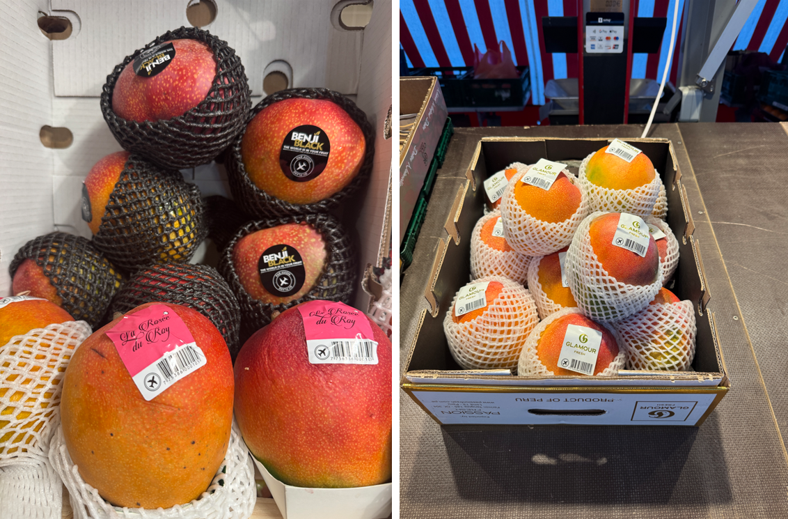
</div>

## MANGA KENT PERUANA MARITÍMA - 2026 {.titulo-pequeno}

<div style="text-align: center;">
  
</div>

## MANGAS ASIÁTICAS {.titulo-pequeno}

<div style="text-align: center;">
  
</div>

## MANGAS ASIÁTICAS {.titulo-pequeno}

<div style="text-align: center;">
  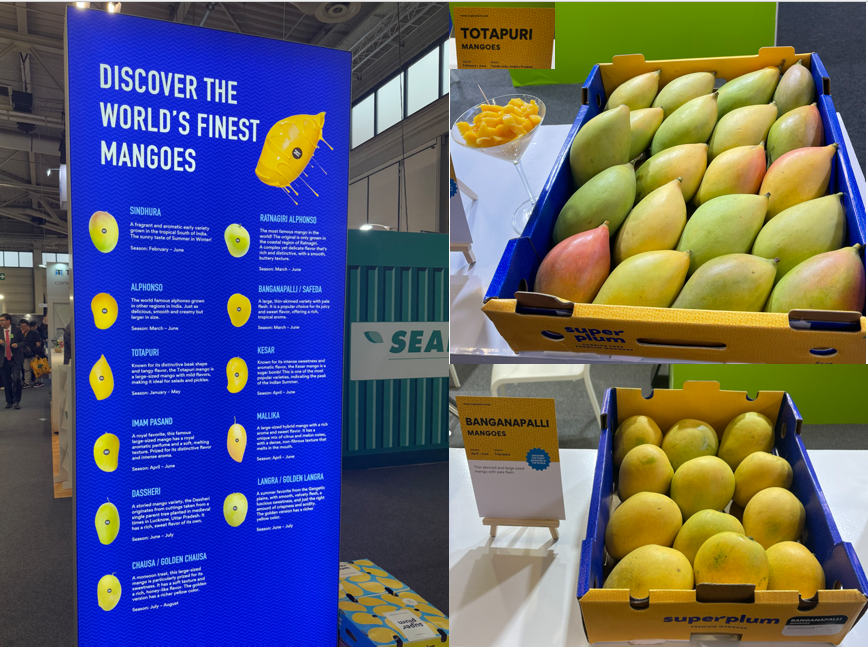
</div>

# OS PREÇOS DAS MANGAS AO PRODUTOR

```{r}
#| label: manga_precos_prep

# Preço semanal deflacionado (IGP-DI) de manga Palmer e Tommy ao produtor do
# Vale do São Francisco, comparado com a faixa histórica (mínimo/média/máximo)
# e com 2024/2025. Mesma lógica dos boletins semanais do Observatório de Manga
# (ler_serie_manga() + tabela_comparacao()).
sem_ano_manga <- 41
time_manga    <- 1:52

ler_serie_manga <- function(arquivo) {
  dados <- read.csv2(paste0('dados/', arquivo), header = TRUE, sep = ";", dec = ".")
  igpdi <- read.csv2('dados/igpdi.csv', header = TRUE, sep = ";", dec = ".")

  dadosp <- merge(dados[, c('ano', 'semana', 'preco')], igpdi,
                  by = c('ano', 'semana'), all.x = TRUE)
  dadosp <- dadosp[order(dadosp$ano, dadosp$semana), ]

  dadosp$preco_def <- dadosp$preco * (tail(dadosp$igpdi, 1) / dadosp$igpdi)
  dadosp$date <- as.Date(paste0(dadosp$ano, "-01-01")) + (dadosp$semana - 1) * 7
  dadosp
}

tabela_comparacao_manga <- function(preco_serie, dadosp) {
  preco_2025 <- window(preco_serie, end = c(2025, 52))
  seas25     <- seasplot(preco_2025, trend = FALSE, outplot = FALSE)
  medias25   <- colMeans(seas25$season)[1:52]

  preco_atual <- as.matrix(tail(dadosp$preco_def, sem_ano_manga))
  preco_2026  <- matrix(NA, nrow = 52, ncol = 1)
  for (i in 1:sem_ano_manga) preco_2026[i, 1] <- preco_atual[i, 1]

  # Apenas a média histórica (linha) e os anos 2025 e 2026 (barras)
  table <- data.frame(time_manga, round(medias25, 2),
                       round(tail(preco_2025, 52), 2), preco_2026[, 1])
  colnames(table) <- c('Semanas', 'Média', 'Ano 2025', 'Ano 2026')

  tablea <- table[, c('Semanas', 'Média')]
  tableb <- table[, c('Semanas', 'Ano 2025', 'Ano 2026')]

  list(tablea2 = melt(tablea, id.var = 'Semanas'),
       tableb2 = melt(tableb, id.var = 'Semanas'))
}

dados_palmer <- ler_serie_manga('dados_manga_palmer_semana.csv')
dados_tommy  <- ler_serie_manga('dados_manga_tommy_semana.csv')

preco_palmer <- ts(dados_palmer$preco_def, start = c(2012, 1), frequency = 52)
preco_tommy  <- ts(dados_tommy$preco_def,  start = c(2012, 1), frequency = 52)

comp_palmer <- tabela_comparacao_manga(preco_palmer, dados_palmer)
comp_tommy  <- tabela_comparacao_manga(preco_tommy,  dados_tommy)

cores_barras_manga <- c("gray44", "gold")
cores_linhas_manga <- c("red")
```

## EVOLUÇÃO DOS PREÇOS DE PALMER

<br>

```{r}
#| label: manga_palmer_grafico
#| fig-width: 20
#| fig-height: 8

lim_palmer <- max(comp_palmer$tableb2$value, comp_palmer$tablea2$value, na.rm = TRUE) * 1.1

g_palmer <- ggplot() +
  geom_col(data = comp_palmer$tableb2, aes(x = Semanas, y = value, fill = variable),
           width = 0.7, position = "dodge") +
  scale_fill_manual(values = cores_barras_manga) +
  geom_line(data = comp_palmer$tablea2, aes(x = Semanas, y = value, colour = variable),
            linewidth = 2) +
  scale_colour_manual(values = cores_linhas_manga) +
  scale_y_continuous(name = "Preço Palmer (R$/kg)", limits = c(0, lim_palmer),
                      n.breaks = 8, labels = number_format(accuracy = 0.01, decimal.mark = ",")) +
  scale_x_continuous(breaks = seq(1, 52, by = 3)) +
  labs(x = "Semanas de cada Ano", title = '', fill = '', colour = '',
       caption = "Fonte: CEPEA reprocessado pelo Observatório de Mercado de Manga da Embrapa, 2026.") +
  theme_classic() +
  theme(axis.text.x = element_text(size = 22, margin = margin(t = 10)),
        axis.text.y = element_text(size = 22, margin = margin(r = 10)),
        axis.title.x = element_text(size = 22, face = "bold", margin = margin(t = 10)),
        axis.title.y = element_text(size = 22, face = "bold", margin = margin(r = 20)),
        plot.caption = element_text(hjust = 0, size = 20),
        legend.position = "bottom", legend.text = element_text(size = 22))
g_palmer + tema_transparente
```

## EVOLUÇÃO DOS PREÇOS DE TOMMY

<br>

```{r}
#| label: manga_tommy_grafico
#| fig-width: 20
#| fig-height: 8

lim_tommy <- max(comp_tommy$tableb2$value, comp_tommy$tablea2$value, na.rm = TRUE) * 1.1

g_tommy <- ggplot() +
  geom_col(data = comp_tommy$tableb2, aes(x = Semanas, y = value, fill = variable),
           width = 0.7, position = "dodge") +
  scale_fill_manual(values = cores_barras_manga) +
  geom_line(data = comp_tommy$tablea2, aes(x = Semanas, y = value, colour = variable),
            linewidth = 2) +
  scale_colour_manual(values = cores_linhas_manga) +
  scale_y_continuous(name = "Preço Tommy (R$/kg)", limits = c(0, lim_tommy),
                      n.breaks = 8, labels = number_format(accuracy = 0.01, decimal.mark = ",")) +
  scale_x_continuous(breaks = seq(1, 52, by = 3)) +
  labs(x = "Semanas de cada Ano", title = '', fill = '', colour = '',
       caption = "Fonte: CEPEA reprocessado pelo Observatório de Mercado de Manga da Embrapa, 2026.") +
  theme_classic() +
  theme(axis.text.x = element_text(size = 22, margin = margin(t = 10)),
        axis.text.y = element_text(size = 22, margin = margin(r = 10)),
        axis.title.x = element_text(size = 22, face = "bold", margin = margin(t = 10)),
        axis.title.y = element_text(size = 22, face = "bold", margin = margin(r = 20)),
        plot.caption = element_text(hjust = 0, size = 20),
        legend.position = "bottom", legend.text = element_text(size = 22))
g_tommy + tema_transparente
```

## VOLUME PRODUZIDO X PREÇO DA PALMER {.titulo-pequeno}

<br>

```{r}
#| label: manga_volume_x_preco_palmer
#| fig-width: 20
#| fig-height: 8

# Crescimento do volume produzido de manga no Vale (PAM/IBGE) x preço médio anual
# da Palmer (CEPEA, deflacionado pelo IGP-DI no chunk manga_precos_prep).
# Médias anuais das séries semanais, 2012-2025, em número-índice (2012 = 100).
vol_vale <- read.csv('C:/Users/Lenovo/Dropbox/tempecon/dados_manga/2026/quanti_vale.csv') |>
  filter(ano >= 2012, ano <= 2025) |>
  group_by(ano) |>
  summarise(volume = sum(valor, na.rm = TRUE), .groups = "drop")

preco_palmer_ano <- dados_palmer |>
  filter(ano >= 2012, ano <= 2025) |>
  group_by(ano) |>
  summarise(preco = mean(preco_def, na.rm = TRUE), .groups = "drop")

comp_vp <- inner_join(vol_vale, preco_palmer_ano, by = "ano") |>
  mutate(`Volume produzido no Vale` = volume / volume[1] * 100,
         `Preço da Palmer (deflacionado)` = preco / preco[1] * 100)

comp_vp_long <- reshape2::melt(comp_vp[, c("ano", "Volume produzido no Vale",
                                          "Preço da Palmer (deflacionado)")],
                               id.vars = "ano")
rotulos_vp <- comp_vp_long |> filter(ano == 2025)

g_vp <- ggplot(comp_vp_long, aes(x = ano, y = value, colour = variable)) +
  geom_hline(yintercept = 100, linetype = "dashed", colour = "gray50") +
  geom_line(linewidth = 2.2) +
  geom_point(size = 3.5) +
  geom_text(data = rotulos_vp, aes(label = paste0(round(value - 100), "%")),
            hjust = -0.25, size = 8, fontface = "bold", show.legend = FALSE) +
  scale_colour_manual(values = c("Volume produzido no Vale" = "#d4a017",
                                 "Preço da Palmer (deflacionado)" = colors[["red"]])) +
  scale_x_continuous(breaks = seq(2012, 2025, by = 1), expand = expansion(add = c(0.3, 1))) +
  scale_y_continuous(name = "Número-índice (2012 = 100)", n.breaks = 8,
                     limits = c(0, NA)) +
  labs(x = "Anos", title = '', colour = '',
       caption = "Fonte: PAM/IBGE (volume produzido no Vale) e CEPEA (preço médio anual da Palmer, deflacionado pelo IGP-DI),\nreprocessados pelo Observatório de Mercado de Manga da Embrapa, 2026.") +
  theme_classic() +
  theme(axis.text.x = element_text(size = 22, margin = margin(t = 10)),
        axis.text.y = element_text(size = 22, margin = margin(r = 10)),
        axis.title.x = element_text(size = 22, face = "bold", margin = margin(t = 10)),
        axis.title.y = element_text(size = 22, face = "bold", margin = margin(r = 20)),
        plot.caption = element_text(hjust = 0, size = 16),
        legend.position = "bottom", legend.text = element_text(size = 22))
g_vp + tema_transparente
```

## RELAÇÃO CUSTO DE PRODUÇÃO X PREÇOS TOMMY {.titulo-pequeno}

<br>

```{python}
#| label: mba_custo_preco_tommy
#| echo: false
#| warning: false
#| message: false
#| fig-width: 18
#| fig-height: 8
#| fig-align: "center"

import pandas as pd
import matplotlib.pyplot as plt
from plotnine import (
    ggplot, aes, geom_col, geom_line, scale_fill_manual, scale_color_manual,
    scale_y_continuous, labs, theme_minimal, theme
)
from plotnine.themes.elements import *

plt.close('all')  # evita que figuras de chunks anteriores atrapalhem a captura desta
plt.rcParams['savefig.transparent'] = True  # remove o fundo branco do PNG

# Preço e custo de produção da manga Tommy Atkins, janeiro/2023 a junho/2026
df = pd.read_csv("dados/preco_custo_tommy.csv", sep=";", decimal=".")
df.columns = ['mes', 'preco', 'custo']
df['preco'] = (df['preco'].str.replace('R$', '', regex=False)
                           .str.replace(',', '.', regex=False)
                           .astype(float))
df['custo'] = pd.to_numeric(df['custo'], errors='coerce')
df['data'] = pd.date_range(start='2024-01-01', periods=len(df), freq='MS')
df['data_lab'] = df['data'].dt.strftime('%m/%Y')
df['data_lab'] = pd.Categorical(df['data_lab'], categories=df['data_lab'], ordered=True)

def fmt_pt(v, dec=2):
    s = f"{v:,.{dec}f}"
    return s.replace(",", "X").replace(".", ",").replace("X", ".")

plot = (
    ggplot(df, aes(x='data_lab'))
    + geom_col(aes(y='custo', fill='"Custo de Produção (R$/kg)"'), width=0.7)
    + geom_line(aes(y='preco', color='"Preço Tommy (R$/kg)"', group=1), size=1.8)
    + scale_fill_manual(name=None, values={"Custo de Produção (R$/kg)": "#b22200"})
    + scale_color_manual(name=None, values={"Preço Tommy (R$/kg)": "gold"})
    + scale_y_continuous(labels=lambda l: [fmt_pt(v, 2) for v in l])
    + labs(
        x="Mês/Ano", y="R$/kg", title="",
        caption="Fonte: CEPEA reprocessado pelo Observatório de Mercado de Manga da Embrapa, 2026. \n*Dados de setembro e outubro estimados."
    )
    + theme_minimal()
    + theme(
        legend_position='bottom',
        legend_title=element_blank(),
        legend_text=element_text(size=20),
        axis_title_x=element_text(weight='bold', size=20),
        axis_title_y=element_text(weight='bold', size=20),
        axis_text_x=element_text(size=20, rotation=90),
        axis_text_y=element_text(size=20),
        plot_caption=element_text(ha='left', size=16),
        figure_size=(18, 8),
    )
)

plot.show()
```

## RELAÇÃO CUSTO DE PRODUÇÃO X PREÇOS PALMER {.titulo-pequeno}

<br>

```{python}
#| label: mba_custo_preco_palmer
#| echo: false
#| warning: false
#| message: false
#| fig-width: 18
#| fig-height: 8
#| fig-align: "center"

import pandas as pd
import matplotlib.pyplot as plt
from plotnine import (
    ggplot, aes, geom_col, geom_line, scale_fill_manual, scale_color_manual,
    scale_y_continuous, labs, theme_minimal, theme
)
from plotnine.themes.elements import *

plt.close('all')  # evita que figuras de chunks anteriores atrapalhem a captura desta
plt.rcParams['savefig.transparent'] = True  # remove o fundo branco do PNG

# Preço e custo de produção da manga Palmer, janeiro/2023 a junho/2026
df = pd.read_csv("dados/preco_custo_palmer.csv", sep=";", decimal=".")
df.columns = ['mes', 'preco', 'custo']
df['preco'] = (df['preco'].str.replace('R$', '', regex=False)
                           .str.replace(',', '.', regex=False)
                           .astype(float))
df['custo'] = pd.to_numeric(df['custo'], errors='coerce')
df['data'] = pd.date_range(start='2024-01-01', periods=len(df), freq='MS')
df['data_lab'] = df['data'].dt.strftime('%m/%Y')
df['data_lab'] = pd.Categorical(df['data_lab'], categories=df['data_lab'], ordered=True)

def fmt_pt(v, dec=2):
    s = f"{v:,.{dec}f}"
    return s.replace(",", "X").replace(".", ",").replace("X", ".")

plot = (
    ggplot(df, aes(x='data_lab'))
    + geom_col(aes(y='custo', fill='"Custo de Produção (R$/kg)"'), width=0.7)
    + geom_line(aes(y='preco', color='"Preço Palmer (R$/kg)"', group=1), size=1.8)
    + scale_fill_manual(name=None, values={"Custo de Produção (R$/kg)": "#b22200"})
    + scale_color_manual(name=None, values={"Preço Palmer (R$/kg)": "gold"})
    + scale_y_continuous(labels=lambda l: [fmt_pt(v, 2) for v in l])
    + labs(
        x="Mês/Ano", y="R$/kg", title="",
        caption="Fonte: CEPEA reprocessado pelo observatório de Mercado de Manga da Embrapa, 2026.\n*Dados de setembro e outubro estimados. "
    )
    + theme_minimal()
    + theme(
        legend_position='bottom',
        legend_title=element_blank(),
        legend_text=element_text(size=20),
        axis_title_x=element_text(weight='bold', size=20),
        axis_title_y=element_text(weight='bold', size=20),
        axis_text_x=element_text(size=20, rotation=90),
        axis_text_y=element_text(size=20),
        plot_caption=element_text(ha='left', size=16),
        figure_size=(18, 8),
    )
)

plot.show()
```

# A MANGA DO VALE DO SÃO FRANCISCO: TENDÊNCIAS OU NECESSIDADES... {.titulo-pequeno}

## SERÁ QUE ESSAS MANGAS AUMENTAM A DEMANDA? {.titulo-pequeno}

```{r, echo=FALSE, out.width="78%"}
knitr::include_graphics("imgs/manga1.png")
```

## VENDAS NO  MERCADO INTERNO {.center}

::: columns
::: {.column width="50%"}

- Destino da maior parte da produção nacional (Mercado interno com mais de 210 milhões de pessoas). 

- Mas os brasileiros não distinguem as variedades de manga. Muitos não sabem o que é uma manga das variedades Palmer, Tommy Atkins ou Kent.

- Com frequência há um descompasso (ou descoordenação) entre oferta e demanda, sem alternativas de processamento (manga congelada, desidratada, polpa).

- Alta volatilidade dos preços recebidos pelo produtor
:::

::: {.column width="50%"}
{width=90%}
:::
:::


## VENDAS NO  MERCADO INTERNO {.center}

::: columns
::: {.column width="50%"}

- O mercado interno é muito grande.

- Sem concorrência internacional (produção nacional contínua durante as 52 semanas do ano).

- Consumidores pouco exigentes quanto à qualidade do fruto ou com poder aquisitivo insuficiente para comprar mangas de melhor qualidade (mais caras).

- É necessário melhorar a qualidade e a forma de comercialização da manga, por exemplo, por meio de melhores embalagens/apresentações e ações de marketing.

- Complicações na cadeia produtiva.

:::

::: {.column width="50%"}
{width=95%}
:::
:::

## A QUALIDADE DAS MANGAS

#### Temos sido negligentes com nossos clientes.

::: columns
::: {.column width="45%"}

<div style="text-align: center;">
  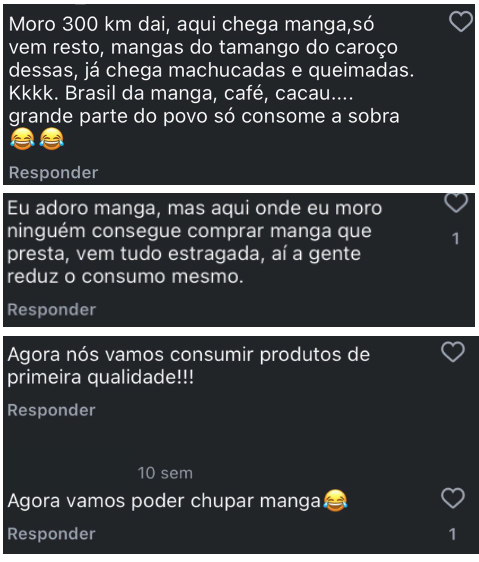
</div>

:::
::: {.column width="55%"}

<div style="text-align: center;">
  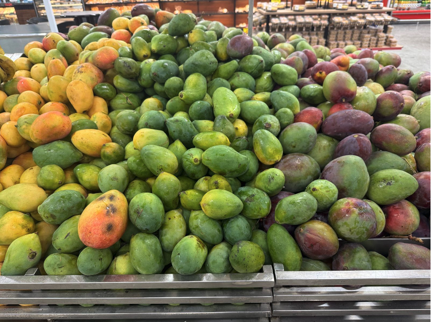
</div>

:::
:::

## A QUALIDADE DAS MANGAS - ANTRACNOSE

#### Maior problema do 1 semestre chuvoso

<div style="text-align: center;">
  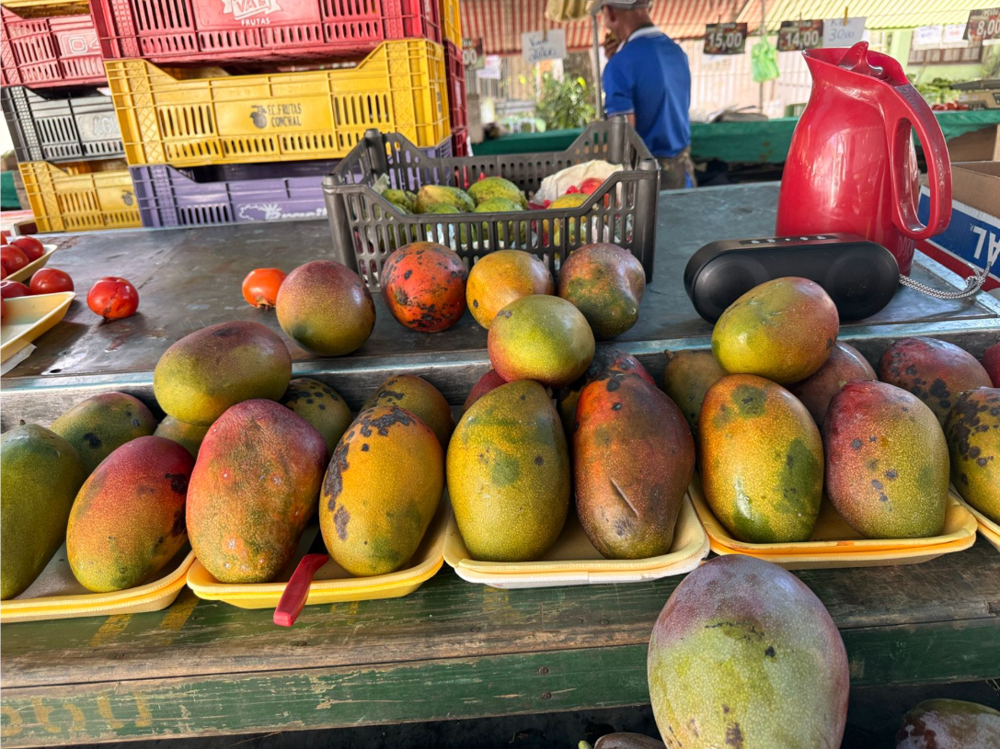
</div>
Foto: Feira Livre em SP em 03/2026

## A QUALIDADE DAS MANGAS - ANTRACNOSE

#### Maior problema do 1 semestre chuvoso

::: columns
::: {.column width="45%"}

<div style="text-align: center;">
  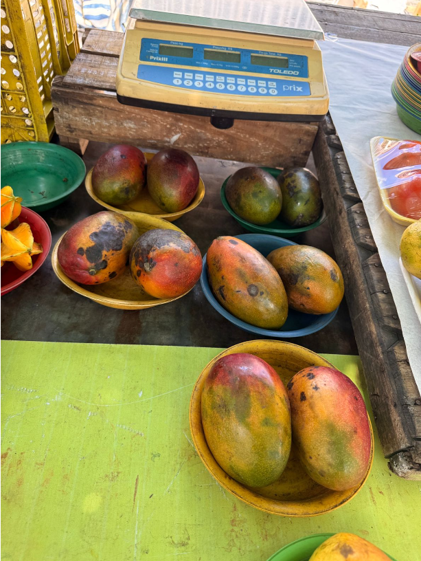
</div>

:::
::: {.column width="55%"}

<div style="text-align: center;">
  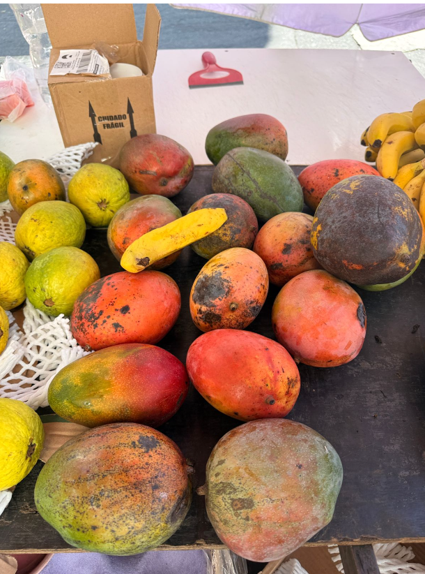
</div>

:::
:::

## A QUALIDADE DAS MANGAS

#### É urgente **diferenciar um produto** – sair da lógica de commodity.

<div style="text-align: center;">
  
</div>

## NOVAS FORMAS DE COMERCIALIZAR AS FRUTAS

::: columns
::: {.column width="50%"}

```{r}
#| label: embala1
#| out-width: "82%"
knitr::include_graphics("imgs/embala3.jpeg")
```

:::
::: {.column width="50%"}

```{r}
#| label: embala2
#| out-width: "82%"
#| 
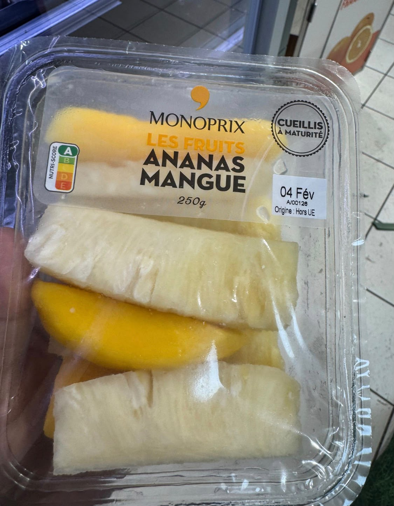
```

:::
:::

## NOVAS FORMAS DE COMERCIALIZAR AS FRUTAS

::: columns
::: {.column width="50%"}
```{r}
#| label: embala3
#| out-width: "86%"
knitr::include_graphics("imgs/embala1.jpeg")
```
:::
::: {.column width="50%"}
```{r}
#| label: embala4
#| out-width: "81%"
knitr::include_graphics("imgs/embala2.jpeg")
```
:::
:::

## NOVAS FORMAS DE COMERCIALIZAR AS FRUTAS

```{r}
#| label: embala11

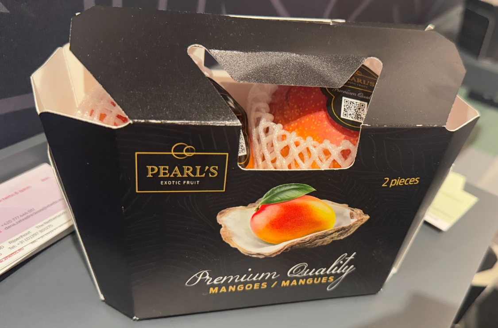
```

## NOVAS FORMAS DE COMERCIALIZAR AS FRUTAS

```{r}
#| label: embala12

knitr::include_graphics("imgs/embala12.png")
```

## NOVAS FORMAS DE COMERCIALIZAR AS FRUTAS

```{r}
#| label: embala13

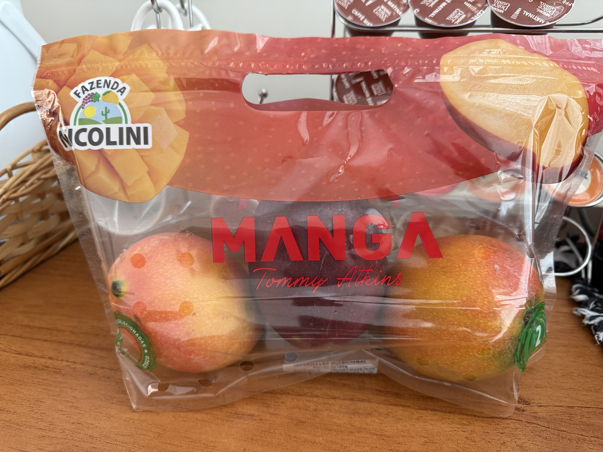
```

## NOVAS FORMAS DE COMERCIALIZAR AS FRUTAS

```{r}
#| label: embala14

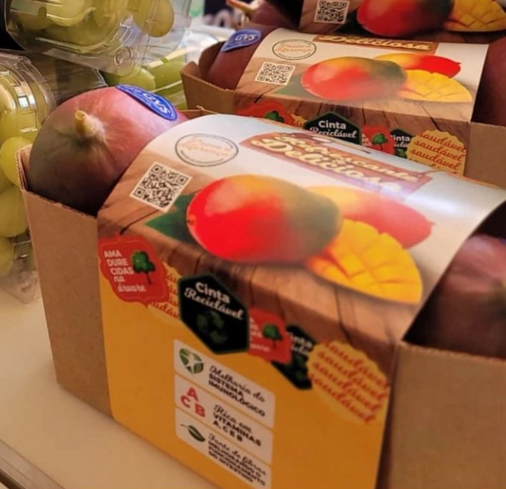
```

## CONSEGUIR **AGREGAR VALOR** AS FRUTAS

<br>

```{r, echo=FALSE, out.width="100%"}
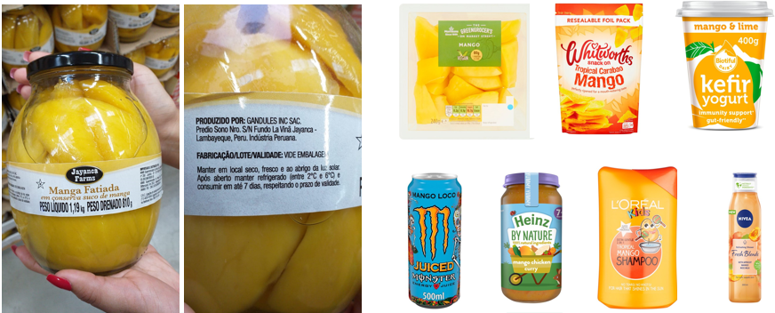
```

## {.center .thankslide}
<div style="text-align: center;">
  
</div>

<div style="text-align: center;"> 
  <h2 style="color: #282f6b; font-size: 2em; margin-bottom: 20px;">
    MUITO OBRIGADO!
  </h2>
  <br>
  <!-- This part will have a smaller font size -->
  <p style="font-size: 0.8em; color: #333;">
    <a href="https://www.embrapa.br/observatorio-da-manga" target="_blank">
      https://www.embrapa.br/web/semiarido/observatorio-da-manga
    </a>
    <br>
📲 **WhatsApp:** <br>
+55 87 99961-5799  
  </p>
  
</div>
