## João Ricardo Lima  {.center .aboutmeslide}

::: columns
::: {.column width="60%"}

-   Contatos

    -   Instagram: [\@jotaerre.econ](https://www.instagram.com/jotaerre.econ/)

    -   Email: [joao.ricardo@embrapa.br](joao.ricardo@embrapa.br)

    -   Linkedin: [Joao Ricardo Lima](https://www.linkedin.com/in/joao-ricardo-lima-7b6273240/)

-   Sobre mim

    -   Doutor em Economia Aplicada (UFV-MG)

    -   Pesquisador em Economia Rural da Embrapa Semiárido - Petrolina/PE

    -   Coordenador dos Observatórios de Mercado de Manga e Uva da Embrapa
    
    -   Professor da FACAPE (Faculdade de Petrolina)

:::
::: {.column width="40%"}
{width=90%}

:::
:::

```{r}
#| label: setup

# Dependências dos slides
library(knitr)
library(rmarkdown)
library(dplyr)
library(ggplot2)
library(reshape2)
library(scales)
library(reticulate)

# Usa o Python do sistema (ja tem pandas/plotnine instalados) em vez do
# ambiente gerenciado padrao do reticulate (que vem sem pacotes)
reticulate::use_python("C:/Users/Lenovo/AppData/Local/Programs/Python/Python314/python.exe", required = TRUE)

options(htmltools.dir.version = FALSE)
knitr::opts_chunk$set(
  echo       = FALSE,
  warning    = FALSE,
  message    = FALSE,
  fig.retina = 3,
  fig.width  = 16,
  fig.height = 8,
  out.width  = "100%",
  fig.align  = "center",
  comment    = "#",
  dev.args   = list(bg = "transparent")
  )

# Tema para remover o fundo branco dos gráficos ggplot
tema_transparente <- theme(
  plot.background   = element_rect(fill = "transparent", colour = NA),
  panel.background  = element_rect(fill = "transparent", colour = NA),
  legend.background = element_rect(fill = "transparent", colour = NA),
  legend.key        = element_rect(fill = "transparent", colour = NA)
  )

colors <- c(
  blue       = "#282f6b",
  red        = "#b22200",
  yellow     = "#eace3f",
  green      = "#224f20",
  purple     = "#5f487c",
  orange     = "#b35c1e",
  turquoise  = "#419391",
  green_two  = "#839c56",
  light_blue = "#3b89bc",
  gray       = "#666666"
  )
```

# A FRUTICULTURA DO VALE DO SÃO FRANCISCO

## EVOLUÇÃO DA ÁREA PLANTADA DE FRUTAS NO VALE {.titulo-pequeno}

- ####  Área plantada total foi de ~70.500 ha (2010) para ~122.600 ha (2024). A manga sozinha respondeu por ~40,7% de todo o crescimento líquido (21.201 ha dos 52.104 ha totais de expansão entre 2010 e 2024).

```{r}
#| label: slide10b
#| fig-width: 20
#| fig-height: 8

# Area plantada (ha) de manga, uva, banana, coco-da-baia, goiaba, limao,
# maracuja, melao e melancia, somada nos 42 municipios das mesorregioes
# Vale Sao-Franciscano da Bahia + Sao Francisco Pernambucano (IBGE/PAM)
dados_area <- read.csv2('dados/area_plantada_vsf_detalhe.csv', header = T, sep = ";", dec = ".")

dados_area_tot <- dados_area |>
  group_by(Ano) |>
  summarise(AreaPlantada_ha = sum(AreaPlantada_ha), .groups = "drop")

g7 <- ggplot(dados_area_tot, aes(x = Ano, y = AreaPlantada_ha)) +
  geom_line(color = colors[["green"]], linewidth = 2.2) +
  geom_point(color = colors[["green"]], size = 3.5) +
  scale_y_continuous(name = "Área Plantada (ha)", n.breaks = 8,
                      limits = c(0, max(dados_area_tot$AreaPlantada_ha) * 1.1),
                      expand = expansion(add = c(0, 0))) +
  scale_x_continuous(breaks = seq(2010, 2024, by = 1)) +
  labs(x = "Anos", title = '',
       caption = "Fonte: IBGE - PAM (Produção Agrícola Municipal), reprocessado pelos Observatórios de Manga e Uva da Embrapa, 2025.\nSoma de manga, uva, banana, coco-da-baía, goiaba, limão, maracujá, melão e melancia nas mesorregiões Vale São-Franciscano da Bahia e São Francisco Pernambucano.") +
  theme_classic() +
  theme(axis.text.x = element_text(angle = 45, hjust = 1, size = 18, margin = margin(t = 5)),
        axis.text.y = element_text(size = 18, margin = margin(r = 10)),
        axis.title.x = element_text(size = 20, face = "bold", margin = margin(t = 10)),
        axis.title.y = element_text(size = 20, face = "bold", margin = margin(r = 20)),
        plot.caption = element_text(hjust = 0, size = 14))
g7 + tema_transparente
```

## A CADEIA PRODUTIVA DA VITICULTURA {.titulo-pequeno}

```{r}
#| label: cadeia1

knitr::include_graphics("imgs/cadeia_uva_transparente.png")
```
Fonte: LIMA, 2026.

## ÁREA COM UVA NO VALE

```{python}
#| label: mba_areauva1
#| echo: false
#| warning: false
#| message: false
#| fig-width: 16
#| fig-height: 8
#| fig-align: "center"


# --- Imports
from pathlib import Path
#import os
import pandas as pd
import matplotlib.pyplot as plt
from plotnine import *

plt.close('all')  # evita que figuras de chunks anteriores atrapalhem a captura desta
plt.rcParams['savefig.transparent'] = True  # remove o fundo branco do PNG

data_dir = Path("C:/Users/Lenovo/Dropbox/tempecon/dados_uva/2025")

# ========= Vale do São Francisco =========
vale = pd.read_excel(
    data_dir/'area_vale.xlsx',
    skiprows=4,
    na_values='-'
)
vale = vale.rename(columns={vale.columns[0]: 'mesorregiao'})
vale = vale.iloc[:-1, :]  # remove total/rodapé

# Somar todas as linhas (fica 1 linha com os anos)
year_cols = vale.columns[1:]
vale_sum = pd.DataFrame(vale[year_cols].sum()).T
vale_sum.insert(0, 'regiao', 'Vale do São Francisco')

# ========= Long format (melt) =========
dados_long = vale_sum.melt(id_vars='regiao', var_name='year', value_name='value')

# Garantir numérico e criar valor em mil ha
dados_long['value'] = pd.to_numeric(dados_long['value'], errors='coerce')
dados_long['value_k'] = dados_long['value'] / 1000.0

# Ordenar anos (mesmo se forem strings)
try:
    anos_ordenados = sorted(dados_long['year'].unique(), key=lambda x: int(str(x)))
except Exception:
    anos_ordenados = sorted(dados_long['year'].unique())
dados_long['year'] = pd.Categorical(dados_long['year'], categories=anos_ordenados, ordered=True)

# ========= Plot =========
paleta = {
    "Vale do São Francisco": "#6F2DA8"  # Grape
}
cores = [paleta[k] for k in ["Vale do São Francisco"]]

plot = (
    ggplot(dados_long, aes(x='year', y='value_k', fill='regiao')) +
    geom_col(position=position_dodge(width=0.9), size=1) +
    scale_fill_manual(values=cores) +
    labs(
        y="Área Plantada de Uva (mil ha)",
        x="Ano",
        title="",
        caption="Fonte: PAM/IBGE (2025) reprocessado pelo Observatório de Mercado de Uva da Embrapa"
    )
    + theme_minimal()
    + theme(
        legend_position='bottom',
        legend_title=element_blank(),
        legend_text=element_text(size=18),
        axis_title_x=element_text(weight='bold', size=18),
        axis_title_y=element_text(weight='bold', size=18),
        axis_text_x=element_text(size=18),
        axis_text_y=element_text(size=18),
        plot_caption=element_text(ha='left', size=18),
        figure_size=(16, 8),
    )
)

plot.show()
```

## QUANTIDADE DE UVA NO VALE

```{python}
#| label: mba_quantiuva
#| echo: false
#| warning: false
#| message: false
#| fig-width: 16
#| fig-height: 8
#| fig-align: "center"


# --- Imports
from pathlib import Path
#import os
import pandas as pd
import matplotlib.pyplot as plt
from plotnine import *

plt.close('all')  # evita que figuras de chunks anteriores atrapalhem a captura desta
plt.rcParams['savefig.transparent'] = True  # remove o fundo branco do PNG

data_dir = Path("C:/Users/Lenovo/Dropbox/tempecon/dados_uva/2025")

# ========= Vale do São Francisco =========
vale = pd.read_excel(
    data_dir/'quanti_vale.xlsx',
    skiprows=4,
    na_values='-'
)
vale = vale.rename(columns={vale.columns[0]: 'mesorregiao'})
vale = vale.iloc[:-1, :]  # remove total/rodapé

# Somar todas as linhas (fica 1 linha com os anos)
year_cols = vale.columns[1:]
vale_sum = pd.DataFrame(vale[year_cols].sum()).T
vale_sum.insert(0, 'regiao', 'Vale do São Francisco')

# ========= Long format (melt) =========
dados_long = vale_sum.melt(id_vars='regiao', var_name='year', value_name='value')

# Garantir numérico e criar valor em mil ha
dados_long['value'] = pd.to_numeric(dados_long['value'], errors='coerce')
dados_long['value_k'] = dados_long['value'] / 1000.0

# Ordenar anos (mesmo se forem strings)
try:
    anos_ordenados = sorted(dados_long['year'].unique(), key=lambda x: int(str(x)))
except Exception:
    anos_ordenados = sorted(dados_long['year'].unique())
dados_long['year'] = pd.Categorical(dados_long['year'], categories=anos_ordenados, ordered=True)

# ========= Plot =========
paleta = {
    "Vale do São Francisco": "#6F2DA8"  # Grape
}
cores = [paleta[k] for k in ["Vale do São Francisco"]]

plot = (
    ggplot(dados_long, aes(x='year', y='value_k', fill='regiao')) +
    geom_col(position=position_dodge(width=0.9), size=1) +
    scale_fill_manual(values=cores) +
    labs(
        y="Quantidade Produzida de Uva (mil Ton.)",
        x="Ano",
        title="",
        caption="Fonte: PAM/IBGE (2025) reprocessado pelo Observatório de Mercado de Uva da Embrapa"
    )
    + theme_minimal()
    + theme(
        legend_position='bottom',
        legend_title=element_blank(),
        legend_text=element_text(size=18),
        axis_title_x=element_text(weight='bold', size=18),
        axis_title_y=element_text(weight='bold', size=18),
        axis_text_x=element_text(size=18),
        axis_text_y=element_text(size=18),
        plot_caption=element_text(ha='left', size=18),
        figure_size=(16, 8),
    )
)

plot.show()
```

## A CADEIA PRODUTIVA DA MANGICULTURA {.titulo-pequeno}

```{r}
#| label: cadeia2

knitr::include_graphics("imgs/cadeia_manga_transparente.png")
```
Fonte: LIMA et al, 2023.


## ÁREA COM MANGA NO VALE

```{python}
#| label: mba_areamanga1
#| echo: false
#| warning: false
#| message: false
#| fig-width: 16
#| fig-height: 8
#| fig-align: "center"


# --- Imports
from pathlib import Path
#import os
import pandas as pd
from plotnine import *

data_dir = Path("C:/Users/Lenovo/Dropbox/tempecon/dados_manga/2025")

# ========= Vale do São Francisco =========
vale = pd.read_excel(
    data_dir/'area_vale.xlsx',
    skiprows=4,
    na_values='-'
)
vale = vale.rename(columns={vale.columns[0]: 'mesorregiao'})
vale = vale.iloc[:-1, :]  # remove total/rodapé

# Somar todas as linhas (fica 1 linha com os anos)
year_cols = vale.columns[1:]
vale_sum = pd.DataFrame(vale[year_cols].sum()).T
vale_sum.insert(0, 'regiao', 'Vale do São Francisco')

# ========= Long format (melt) =========
dados_long = vale_sum.melt(id_vars='regiao', var_name='year', value_name='value')

# Garantir numérico e criar valor em mil ha
dados_long['value'] = pd.to_numeric(dados_long['value'], errors='coerce')
dados_long['value_k'] = dados_long['value'] / 1000.0

# Ordenar anos (mesmo se forem strings)
try:
    anos_ordenados = sorted(dados_long['year'].unique(), key=lambda x: int(str(x)))
except Exception:
    anos_ordenados = sorted(dados_long['year'].unique())
dados_long['year'] = pd.Categorical(dados_long['year'], categories=anos_ordenados, ordered=True)

# ========= Plot =========
paleta = {
    "Vale do São Francisco": "gold"  # Gold
}
cores = [paleta[k] for k in ["Vale do São Francisco"]]

plot = (
    ggplot(dados_long, aes(x='year', y='value_k', fill='regiao')) +
    geom_col(position=position_dodge(width=0.9), size=1) +
    scale_fill_manual(values=cores) +
    labs(
        y="Área Plantada de Manga (mil ha)",
        x="Ano",
        title="",
        caption="Fonte: PAM/IBGE (2025) reprocessado pelo Observatório de Mercado de Manga da Embrapa"
    )
    + theme_minimal()
    + theme(
        legend_position='bottom',
        legend_title=element_blank(),
        legend_text=element_text(size=18),
        axis_title_x=element_text(weight='bold', size=18),
        axis_title_y=element_text(weight='bold', size=18),
        axis_text_x=element_text(size=18),
        axis_text_y=element_text(size=18),
        plot_caption=element_text(ha='left', size=18),
        figure_size=(16, 8),
        panel_background=element_rect(fill='None', color='None'),
        plot_background=element_rect(fill='None', color='None'),
    )
)

# desenha o gráfico na figura atual respeitando o fundo transparente

plot.show()
```

## QUANTIDADE DE MANGA NO VALE

```{python}
#| label: mba_quantimanga
#| echo: false
#| warning: false
#| message: false
#| fig-width: 16
#| fig-height: 8
#| fig-align: "center"


# --- Imports
from pathlib import Path
#import os
import pandas as pd
from plotnine import *

data_dir = Path("C:/Users/Lenovo/Dropbox/tempecon/dados_manga/2025")

# ========= Vale do São Francisco =========
vale = pd.read_excel(
    data_dir/'quanti_vale.xlsx',
    skiprows=4,
    na_values='-'
)
vale = vale.rename(columns={vale.columns[0]: 'mesorregiao'})
vale = vale.iloc[:-1, :]  # remove total/rodapé

# Somar todas as linhas (fica 1 linha com os anos)
year_cols = vale.columns[1:]
vale_sum = pd.DataFrame(vale[year_cols].sum()).T
vale_sum.insert(0, 'regiao', 'Vale do São Francisco')

# ========= Long format (melt) =========
dados_long = vale_sum.melt(id_vars='regiao', var_name='year', value_name='value')

# Garantir numérico e criar valor em mil ha
dados_long['value'] = pd.to_numeric(dados_long['value'], errors='coerce')
dados_long['value_k'] = dados_long['value'] / 1000.0

# Ordenar anos (mesmo se forem strings)
try:
    anos_ordenados = sorted(dados_long['year'].unique(), key=lambda x: int(str(x)))
except Exception:
    anos_ordenados = sorted(dados_long['year'].unique())
dados_long['year'] = pd.Categorical(dados_long['year'], categories=anos_ordenados, ordered=True)

# ========= Plot =========
paleta = {
    "Vale do São Francisco": "gold"  # Grape
}
cores = [paleta[k] for k in ["Vale do São Francisco"]]

plot = (
    ggplot(dados_long, aes(x='year', y='value_k', fill='regiao')) +
    geom_col(position=position_dodge(width=0.9), size=1) +
    scale_fill_manual(values=cores) +
    labs(
        y="Quantidade Produzida de Manga (mil Ton.)",
        x="Ano",
        title="",
        caption="Fonte: PAM/IBGE (2025) reprocessado pelo Observatório de Mercado de Manga da Embrapa"
    )
    + theme_minimal()
    + theme(
        legend_position='bottom',
        legend_title=element_blank(),
        legend_text=element_text(size=18),
        axis_title_x=element_text(weight='bold', size=18),
        axis_title_y=element_text(weight='bold', size=18),
        axis_text_x=element_text(size=18),
        axis_text_y=element_text(size=18),
        plot_caption=element_text(ha='left', size=18),
        figure_size=(16, 8),
        panel_background=element_rect(fill='None', color='None'),
        plot_background=element_rect(fill='None', color='None'),
    )
)

# desenha o gráfico na figura atual respeitando o fundo transparente

plot.show()
```

# O MERCADO EXTERNO

## O "TARIFAÇO" AMERICANO x ACORDO UE/MERCOSUL {.titulo-pequeno}

::: columns
::: {.column width="58%"}

**Manga**

- Tarifa dos EUA: início em 2025 com **50%**, anunciada com vigência a partir de agosto de 2025
- Isenta posteriormente e em 2026, da sobretaxada combinada de **37,5%**

**Uva**

- Tarifada dos EUA em **50%** no 2 semestre de 2025
- 1 semestre de 2026 queda para **10%** seguido de uma nova taxa de **25%** fazendo **35%** até 24 de julho quando a taxa expecional de **10%** perde a validade e uma nova sobretaxa de **12,5%** inicia chegando atualmente aos **37,5%**.

:::
::: {.column width="42%"}

<br> 

- A exportação de Uva do Vale para a **União Europeia** passa a ter **tarifa zero**, com o início do acordo Mercosul–UE

- Isso equipara o Brasil a concorrentes que já tinham esse benefício, como **Chile** e **Peru**

- A Manga já era isenta na União Europeia

:::
:::

## A IMPORTANTE FUNÇÃO DO MERCADO EXTERNO.

<br>

```{r}
#| label: slide16
#| fig-width: 20
#| fig-height: 8

dados3 <- read.csv2('dados/uva_exportacoes_2004_2026.csv', header=T, sep=";", dec = ".")
dados3 <- dados3/1000
dados3[,1] <- seq(2004, 2026, by = 1)
colnames(dados3) = c('Ano', 'Valor', "Toneladas")
dados3 <- dplyr::tibble(dados3)

# fator para plotar "Valor" (US$ Mil) na mesma escala visual de "Toneladas",
# assim os dois cabem no mesmo gráfico com eixos Y independentes
fator_escala <- max(dados3$Toneladas) / max(dados3$Valor)

g3 <- ggplot(dados3, aes(x = Ano)) +
  geom_col(aes(y = Toneladas), fill = "purple", width = 0.7) +
  geom_line(aes(y = Valor * fator_escala), color = "red", linewidth = 2.2) +
  scale_y_continuous(
    name = "Toneladas de Uvas",
    limits = c(0, max(dados3$Toneladas) * 1.15),
    expand = expansion(add = c(0, 0)),
    n.breaks = 10,
    sec.axis = sec_axis(~ . / fator_escala, name = "US$ Mil")
  ) +
  scale_x_continuous(breaks = seq(2004, 2026, by = 1)) +
  labs(x = "Anos", title = '',
       caption = "Fonte: COMEXSTAT reprocessado pelo Observatório de Mercado de Uva da Embrapa, 2026") +
  theme_classic() + #Definindo tema
  theme(axis.text.x = element_text(angle = 45, hjust = 1, size = 18, margin = margin(b = 10)),
        axis.text.y = element_text(hjust = 1, size = 18, margin = margin(l = 20), color = "purple"),
        axis.text.y.right = element_text(hjust = 0, size = 18, margin = margin(r = 20), color = "red"),
        axis.title.x = element_text(size = 20, face = "bold", margin = margin(b = 5)),
        axis.title.y = element_text(size = 20, face = "bold", margin = margin(l = 20), color = "purple"),
        axis.title.y.right = element_text(size = 20, face = "bold", margin = margin(l = 20), color = "red"),
        plot.caption = element_text(hjust = 0, size = 18),
        legend.position = "none") # Definindo posição da legenda
g3 + tema_transparente
```

## EXPORTAÇÕES DE UVAS BRASIL X PERU

```{python}
#| label: mba_exp_brasil_peru
#| echo: false
#| warning: false
#| message: false
#| fig-width: 16
#| fig-height: 8
#| fig-align: "center"

import pandas as pd
import matplotlib.pyplot as plt
from plotnine import (
    ggplot, aes, geom_line, scale_color_manual,
    scale_x_continuous, scale_y_continuous, labs, theme_minimal, theme
)
from plotnine.themes.elements import *

plt.close('all')  # evita que figuras de chunks anteriores atrapalhem a captura desta
plt.rcParams['savefig.transparent'] = True  # remove o fundo branco do PNG

# Leitura dos dados
df = pd.read_csv("dados/brasil_peru_uva.csv", sep=";", decimal=".")

# Garantindo tipos numéricos
df["ano"] = pd.to_numeric(df["ano"], errors="coerce")
df["Brasil"] = pd.to_numeric(df["Brasil"], errors="coerce")
df["Peru"] = pd.to_numeric(df["Peru"], errors="coerce")

# Removendo NA e ordenando
df = df.dropna(subset=["ano", "Brasil", "Peru"]).sort_values("ano")

# Convertendo para mil toneladas e passando para formato longo
df["Brasil"] = df["Brasil"] / 1000
df["Peru"] = df["Peru"] / 1000
dados = df.melt(id_vars="ano", value_vars=["Brasil", "Peru"],
                var_name="pais", value_name="valor")

# Formatação numérica BR (milhar com ponto, decimal com vírgula)
def fmt_pt(v):
    s = f"{v:,.0f}"
    return s.replace(",", "X").replace(".", ",").replace("X", ".")

a_min, a_max = int(df["ano"].min()), int(df["ano"].max())

plot = (
    ggplot(dados, aes("ano", "valor", color="pais"))
    + geom_line(size=1.5)
    + scale_color_manual(values={"Brasil": "#6F2DA8", "Peru": "#FF0000"})
    + scale_x_continuous(breaks=range(a_min, a_max + 1, 5))
    + scale_y_continuous(labels=lambda l: [fmt_pt(v) for v in l])
    + labs(
        x="Ano",
        y="Mil toneladas de Uvas",
        title="",
        caption="Fonte: COMTRADE/COMEXSTAT (2026). Dados reprocessados pelo "
                "Observatório de Mercado da Embrapa."
    )
    + theme_minimal()
    + theme(
        legend_position='bottom',
        legend_title=element_blank(),
        legend_text=element_text(size=18),
        axis_title_x=element_text(weight='bold', size=18),
        axis_title_y=element_text(weight='bold', size=18),
        axis_text_x=element_text(size=18),
        axis_text_y=element_text(size=18),
        plot_caption=element_text(ha='left', size=16),
        figure_size=(16, 8),
    )
)

plot.show()
```

## EXPORTAÇÕES DE UVAS DO BRASIL X EUA

```{python}
#| label: mba_exporta_eua
#| echo: false
#| warning: false
#| message: false
#| fig-width: 16
#| fig-height: 8
#| fig-align: "center"

import unicodedata
import pandas as pd
import matplotlib.pyplot as plt
from plotnine import (
    ggplot, aes, geom_col, geom_text, position_dodge,
    scale_fill_manual, scale_y_continuous, labs, theme_minimal, theme
)
from plotnine.themes.elements import *

plt.close('all')  # evita que figuras de chunks anteriores atrapalhem a captura desta
plt.rcParams['savefig.transparent'] = True  # remove o fundo branco do PNG

def _norm(s):
    s = unicodedata.normalize('NFKD', str(s).strip().lower())
    return ''.join(c for c in s if not unicodedata.combining(c))

df = pd.read_csv("C:/Users/Lenovo/Dropbox/tempecon/dados_uva/USA_24_25.csv",
                 sep=";", decimal=".")
df.columns = ['mes', 'Toneladas_2024', 'Toneladas_2025']
df['mes'] = df['mes'].map(_norm)

ordem = ['janeiro', 'fevereiro', 'marco', 'abril', 'maio', 'junho',
         'julho', 'agosto', 'setembro', 'outubro', 'novembro', 'dezembro']
abbr = {'janeiro': 'Jan', 'fevereiro': 'Fev', 'marco': 'Mar', 'abril': 'Abr',
        'maio': 'Mai', 'junho': 'Jun', 'julho': 'Jul', 'agosto': 'Ago',
        'setembro': 'Set', 'outubro': 'Out', 'novembro': 'Nov',
        'dezembro': 'Dez'}

df = df[df['mes'].isin(ordem)]
longo = df.melt(id_vars='mes',
                value_vars=['Toneladas_2024', 'Toneladas_2025'],
                var_name='Ano', value_name='valor')
longo['Ano'] = longo['Ano'].str[-4:]
longo['valor'] = pd.to_numeric(longo['valor'], errors='coerce')
longo['mes_lab'] = pd.Categorical(longo['mes'].map(abbr),
                                  categories=[abbr[m] for m in ordem],
                                  ordered=True)

def fmt1(v):
    s = f"{v:,.1f}"
    return s.replace(",", "X").replace(".", ",").replace("X", ".")

longo['label'] = longo['valor'].map(
    lambda v: fmt1(v) if pd.notna(v) else "")

plot = (
    ggplot(longo, aes('mes_lab', 'valor', fill='Ano'))
    + geom_col(position=position_dodge(width=0.8), width=0.7)
    + scale_fill_manual(values={'2024': '#6F2DA8', '2025': '#FF0000'})
    + scale_y_continuous(labels=lambda l: [fmt1(v) for v in l])
    + labs(
        x="Meses",
        y="Volume export uvas para os EUA (ton)",
        title="",
        caption="Fonte: COMEXSTAT (2025). Dados reprocessados pelo "
                "Observatório de Mercado da Embrapa."
    )
    + theme_minimal()
    + theme(
        legend_position='bottom',
        legend_title=element_blank(),
        legend_text=element_text(size=18),
        axis_title_x=element_text(weight='bold', size=18),
        axis_title_y=element_text(weight='bold', size=18),
        axis_text_x=element_text(size=16),
        axis_text_y=element_text(size=18),
        plot_caption=element_text(ha='left', size=16),
        figure_size=(16, 8),
    )
)

plot.show()
```

## EXPORTAÇÕES UVAS EUA × RESTO DO MUNDO

<br>

```{python}
#| label: mba_uva_eua_resto
#| echo: false
#| warning: false
#| message: false
#| fig-width: 20
#| fig-height: 16
#| fig-align: "center"

import pandas as pd
import matplotlib.pyplot as plt
from matplotlib.ticker import FuncFormatter

plt.rcParams['figure.facecolor'] = 'none'
plt.rcParams['axes.facecolor'] = 'none'

df = pd.read_csv("dados/brasil_eua_uva.csv", sep=";")
df.columns = [c.strip() for c in df.columns]
for c in ["ano", "exportacao_total", "exportacao_eua"]:
    df[c] = pd.to_numeric(df[c], errors="coerce")

# Fator médio ton/contêiner, calculado a partir dos dois únicos anos com
# contagem real de contêineres (2024: 971 cont. / 13.825 ton; 2025: 327
# cont. / 4.159 ton) e aplicado à série toda.
fator_ton_container = (13825 + 4159) / (971 + 327)

df["exportacao_eua_cont"] = df["exportacao_eua"] / fator_ton_container
df["perc_eua"] = (df["exportacao_eua"] / df["exportacao_total"] * 100).round(0)

fig, ax1 = plt.subplots(figsize=(14, 6))
ax2 = ax1.twinx()

ax1.bar(df["ano"], df["exportacao_eua_cont"], width=0.6, color="purple",
        label="Contêineres uva p/ EUA (estimado)")
ax2.plot(df["ano"], df["perc_eua"], color="#FF0000", linewidth=2,
         marker="o", label="% do total exportado")

for x, y in zip(df["ano"], df["perc_eua"]):
    ax2.annotate(f"{int(y)}%", (x, y), textcoords="offset points",
                 xytext=(0, 10), ha="center", color="#FF0000",
                 fontsize=13, fontweight="bold")

ax1.set_xlabel("Ano", fontsize=18, fontweight="bold")
ax1.set_ylabel("Contêineres export uva para EUA",
                fontsize=18, fontweight="bold")
ax2.set_ylabel("% do total exportado uva pelo Brasil",
                fontsize=18, fontweight="bold")
ax1.set_xticks(df["ano"])
ax1.tick_params(axis='both', labelsize=15)
ax2.tick_params(axis='both', labelsize=15)
# eixo do percentual começa em 0
_ = ax2.set_ylim(0, (int(df["perc_eua"].max()) // 5 + 1) * 5)
ax2.yaxis.set_major_formatter(FuncFormatter(lambda v, p: f"{int(v)}%"))
for s in ax1.spines.values():
    s.set_visible(False)
for s in ax2.spines.values():
    s.set_visible(False)
ax1.set_facecolor('none')
ax2.set_facecolor('none')
fig.patch.set_alpha(0)

l1, lab1 = ax1.get_legend_handles_labels()
l2, lab2 = ax2.get_legend_handles_labels()
_ = ax1.legend(l1 + l2, lab1 + lab2, loc='upper center',
               bbox_to_anchor=(0.5, -0.12), ncol=2, fontsize=15, frameon=False)
_ = fig.text(0.01, 0.01,
             "Fonte: COMEXSTAT (2026). Reprocessado pelo Observatório de Mercado de Uva da Embrapa.\n"
             "Contêineres estimados a partir da tonelada exportada, usando o peso médio por "
             "contêiner observado em 2024-2025 (~13,9 t/contêiner).",
             ha='left', fontsize=13)
fig.subplots_adjust(bottom=0.24)
plt.show()
plt.close(fig)
```

## A IMPORTANTE FUNÇÃO DO MERCADO EXTERNO.

<br>

```{r}
#| label: slide18
#| fig-width: 20
#| fig-height: 8

dados4 <- read.csv2('dados/manga_exportacoes_2004_2026.csv', header=T, sep=";", dec = ".")
dados4[,1] <- seq(2004, 2026, by = 1)
colnames(dados4) = c('Ano', 'Valor', "Toneladas")
dados4 <- dplyr::tibble(dados4)

# Toneladas e Valor (US$ Mil) ficam em faixas parecidas (dezenas/centenas de
# milhares), entao cabem num unico eixo Y sem precisar de eixo secundario
dados4a <- dados4 |> dplyr::mutate(Toneladas = Toneladas/1000, Valor = Valor/1000)

g5 <- ggplot(dados4a, aes(x = Ano)) +
  geom_col(aes(y = Toneladas, fill = "Toneladas"), width = 0.7) +
  geom_line(aes(y = Valor, color = "Valor (US$ Mil)"), linewidth = 2.2) +
  scale_fill_manual(name = NULL, values = c("Toneladas" = "gold")) +
  scale_color_manual(name = NULL, values = c("Valor (US$ Mil)" = "red")) +
  scale_y_continuous(name = "Toneladas de Mangas / US$ Mil", n.breaks = 10, expand = expansion(add = c(0, 0.5))) +
  scale_x_continuous(breaks = seq(2004, 2026, by = 1)) +
  labs(x = "Anos", title = '',
       caption = "Fonte: COMEXSTAT reprocessado pelo Observatório de Mercado de Manga da Embrapa, 2026.") +
  theme_classic() + #Definindo tema
  theme(axis.text.x = element_text(angle = 45, hjust = 1, size = 18, margin = margin(b = 5)),
        axis.text.y = element_text(hjust = 1, size = 18, margin = margin(l = 20)),
        axis.title.x = element_text(size = 20, face = "bold", margin = margin(b = 5)),
        axis.title.y = element_text(size = 20, face = "bold", margin = margin(l = 20)),
        plot.caption = element_text(hjust = 0, size = 18),
        legend.position = "bottom", legend.title = element_blank(),
        legend.text = element_text(size = 22)) # Definindo posição da legenda
g5 + tema_transparente
```

## EXPORTAÇÕES DE MANGAS BRASIL X PERU

```{python}
#| label: mba_exp_peru_brasil
#| echo: false
#| warning: false
#| message: false
#| fig-width: 16
#| fig-height: 8
#| fig-align: "center"

import pandas as pd
import matplotlib.pyplot as plt
from plotnine import (
    ggplot, aes, geom_line, scale_color_manual,
    scale_x_continuous, scale_y_continuous, labs, theme_minimal, theme
)
from plotnine.themes.elements import *

# === fundo transparente ===
plt.rcParams['figure.facecolor'] = 'none'
plt.rcParams['axes.facecolor'] = 'none'

# Leitura dos dados
df = pd.read_csv("dados/brasil_peru_manga.csv", sep=";", decimal=".")

# Garantindo tipos numéricos
df["ano"] = pd.to_numeric(df["ano"], errors="coerce")
df["Brasil"] = pd.to_numeric(df["Brasil"], errors="coerce")
df["Peru"] = pd.to_numeric(df["Peru"], errors="coerce")

# Removendo NA e ordenando
df = df.dropna(subset=["ano", "Brasil", "Peru"]).sort_values("ano")

# Convertendo para mil toneladas e passando para formato longo
df["Brasil"] = df["Brasil"] / 1000
df["Peru"] = df["Peru"] / 1000
dados = df.melt(id_vars="ano", value_vars=["Brasil", "Peru"],
                var_name="pais", value_name="valor")

# Formatação numérica BR (milhar com ponto, decimal com vírgula)
def fmt_pt(v):
    s = f"{v:,.0f}"
    return s.replace(",", "X").replace(".", ",").replace("X", ".")

a_min, a_max = int(df["ano"].min()), int(df["ano"].max())

plot = (
    ggplot(dados, aes("ano", "valor", color="pais"))
    + geom_line(size=1.5)
    + scale_color_manual(values={"Brasil": "gold", "Peru": "#FF0000"})
    + scale_x_continuous(breaks=range(a_min, a_max + 1, 5))
    + scale_y_continuous(labels=lambda l: [fmt_pt(v) for v in l])
    + labs(
        x="Ano",
        y="Mil toneladas de Mangas",
        title="",
        caption="Fonte: COMTRADE/COMEXSTAT/APEM (2026). Dados reprocessados pelo "
                "Observatório de Mercado da Embrapa."
    )
    + theme_minimal()
    + theme(
        legend_position='bottom',
        legend_title=element_blank(),
        legend_text=element_text(size=18),
        axis_title_x=element_text(weight='bold', size=18),
        axis_title_y=element_text(weight='bold', size=18),
        axis_text_x=element_text(size=18),
        axis_text_y=element_text(size=18),
        plot_caption=element_text(ha='left', size=16),
        figure_size=(16, 8),
        panel_background=element_rect(fill='None', color='None'),
        plot_background=element_rect(fill='None', color='None'),
    )
)

plot.show()
```

## EXPORTAÇÃO MANGAS EUA × RESTO DO MUNDO

<br>

```{python}
#| label: mba_manga_eua_resto
#| echo: false
#| warning: false
#| message: false
#| fig-width: 18
#| fig-height: 16
#| fig-align: "center"

import pandas as pd
import matplotlib.pyplot as plt
from matplotlib.ticker import FuncFormatter

plt.rcParams['figure.facecolor'] = 'none'
plt.rcParams['axes.facecolor'] = 'none'

df = pd.read_csv("dados/brasil_eua.csv", sep=";")
df.columns = [c.strip() for c in df.columns]
for c in ["ano", "exportacao_total", "exportacao_eua"]:
    df[c] = pd.to_numeric(df[c], errors="coerce")
df["perc_eua"] = (df["exportacao_eua"] / df["exportacao_total"] * 100).round(0)

fig, ax1 = plt.subplots(figsize=(14, 6))
ax2 = ax1.twinx()

ax1.bar(df["ano"], df["exportacao_eua"], width=0.6, color="gold",
        label="Contêineres p/ EUA")
ax2.plot(df["ano"], df["perc_eua"], color="#FF0000", linewidth=2,
         marker="o", label="% do total exportado")

for x, y in zip(df["ano"], df["perc_eua"]):
    ax2.annotate(f"{int(y)}%", (x, y), textcoords="offset points",
                 xytext=(0, 10), ha="center", color="#FF0000",
                 fontsize=13, fontweight="bold")

ax1.set_xlabel("Ano", fontsize=18, fontweight="bold")
ax1.set_ylabel("Contêineres export mangas p/ EUA",
                fontsize=18, fontweight="bold")
ax2.set_ylabel("% do total export mangas pelo Brasil",
                fontsize=18, fontweight="bold")
ax1.set_xticks(df["ano"])
ax1.tick_params(axis='both', labelsize=15)
ax2.tick_params(axis='both', labelsize=15)
# eixo do percentual começa em 0
_ = ax2.set_ylim(0, (int(df["perc_eua"].max()) // 5 + 1) * 5)
ax2.yaxis.set_major_formatter(FuncFormatter(lambda v, p: f"{int(v)}%"))
for s in ax1.spines.values():
    s.set_visible(False)
for s in ax2.spines.values():
    s.set_visible(False)
ax1.set_facecolor('none')
ax2.set_facecolor('none')
fig.patch.set_alpha(0)

l1, lab1 = ax1.get_legend_handles_labels()
l2, lab2 = ax2.get_legend_handles_labels()
_ = ax1.legend(l1 + l2, lab1 + lab2, loc='upper center',
               bbox_to_anchor=(0.5, -0.12), ncol=2, fontsize=15, frameon=False)
_ = fig.text(0.01, 0.01, "Fonte: COMEXSTAT (2025). Reprocessado pelo "
             "Observatório de Mercado da Embrapa.", ha='left', fontsize=14)
fig.subplots_adjust(bottom=0.20)
plt.show()
plt.close(fig)
```


## PREÇO NOS EUA — TOMMY ATKINS: 2024 × 2025 {.titulo-pequeno}

```{python}
#| label: mba_manga_preco_tommy
#| echo: false
#| warning: false
#| message: false
#| fig-width: 16
#| fig-height: 8
#| fig-align: "center"

import pyreadr
import pandas as pd
import matplotlib.pyplot as plt
from plotnine import (
    ggplot, aes, geom_col, geom_text, position_dodge,
    scale_fill_manual, scale_y_continuous, labs, theme_minimal, theme
)
from plotnine.themes.elements import *

plt.rcParams['figure.facecolor'] = 'none'
plt.rcParams['axes.facecolor'] = 'none'

# --- Dados (RData via pyreadr) ---
res = pyreadr.read_r("dados/dados_eua2.RData")
df = res['dados']

tommy = df[(df['variedade'] == 'TOMMY ATKINS') &
           (df['origem'] == 'BRAZIL') &
           (df['ano'].isin(['2024', '2025']))].copy()
tommy['semana'] = tommy['semana'].astype(int)
tommy['ano'] = tommy['ano'].astype(int)
tommy = tommy[(tommy['semana'] >= 31) & (tommy['semana'] <= 50)]

g = (tommy.groupby(['ano', 'semana'])['Tam_10'].mean()
          .reset_index().dropna(subset=['Tam_10']))
g['ano'] = pd.Categorical(g['ano'].astype(str), categories=['2024', '2025'],
                          ordered=True)
g['semana'] = pd.Categorical(g['semana'],
                             categories=sorted(g['semana'].unique()),
                             ordered=True)

def fmt_pt(v, dec=2):
    s = f"{v:,.{dec}f}"
    return s.replace(",", "X").replace(".", ",").replace("X", ".")

g['label'] = g['Tam_10'].map(lambda v: fmt_pt(v, 2))

plot = (
    ggplot(g, aes('semana', 'Tam_10', fill='ano'))
    + geom_col(position=position_dodge(width=0.8), width=0.7)
    + geom_text(aes(label='label'),
                position=position_dodge(width=0.8),
                va='bottom', size=9)
    + scale_fill_manual(values={'2024': '#027559', '2025': 'gold'})
    + scale_y_continuous(labels=lambda l: [fmt_pt(v, 0) for v in l])
    + labs(
        x="Semanas", y="Preço (USD) Caixa 4kg mangas", title="",
        caption="Fonte: USDA/AMS (2025). Reprocessado pelo Observatório de "
                "Mercado de Manga da Embrapa."
    )
    + theme_minimal()
    + theme(
        legend_position='bottom',
        legend_title=element_blank(),
        legend_text=element_text(size=18),
        axis_title_x=element_text(weight='bold', size=18),
        axis_title_y=element_text(weight='bold', size=18),
        axis_text_x=element_text(size=15),
        axis_text_y=element_text(size=18),
        plot_caption=element_text(ha='left', size=16),
        figure_size=(16, 8),
        panel_background=element_rect(fill='None', color='None'),
        plot_background=element_rect(fill='None', color='None'),
    )
)

plot.show()
```

## VOLUME EXPORTADO UVA POR DESTINO

```{r}
#| label: slide20

dados_exporta <- read.csv2('dados/destinos_exporta_uva.csv', header=T, sep=";", stringsAsFactors = FALSE)

# Step 2: Convert 'Date' column to Date format and reorder data
dados_exporta$Ano <- as.Date(paste0(dados_exporta$Ano, "-01-01"), format = "%Y-%m-%d")

# Filter data for the years 2015 to 2025
dados_exporta <- dados_exporta |>
  filter(format(Ano, "%Y") >= 2015 & format(Ano, "%Y") <= 2025) |>
  arrange(Ano) # Arrange in descending order (from 2015 to 2025)

# Step 3: Create the bar graph
ggplot(dados_exporta, aes(x = format(Ano, "%Y"), y = quilo/1000, fill = bloco)) +
  geom_bar(stat = "identity", position = "dodge") +
  labs(x = "Anos", y = "Volume Exportado Uvas", 
       title = "",
       fill = "Destino",
       caption = "Fonte: COMEXSTAT reprocessado pelo Observatório de Mercado de Uva da Embrapa, 2026.") +
  scale_y_continuous(n.breaks = 10)+
  theme_minimal()+ #Definindo tema
  theme(axis.text.x=element_text(angle=0, hjust=0.5, size=16, margin = margin(b=5)),
        axis.text.y=element_text(hjust=1, size=16, margin = margin(l=20)),
        axis.title.x = element_text(size=16, face = "bold", margin = margin(b=5)),
        axis.title.y = element_text(size=16, face = "bold", margin = margin(l=20)),
        plot.caption = element_text(hjust = 0, size=16),
        legend.position = "bottom", legend.title = element_blank(),
        legend.text=element_text(size=16)) + # Definindo posição da legenda
  tema_transparente
```

## VOLUME EXPORTADO MANGA POR DESTINO

```{r}
#| label: slide21

dados_exporta <- read.csv2('dados/destinos_exporta.csv', header=T, sep=";", stringsAsFactors = FALSE)

# Step 2: Convert 'Date' column to Date format and reorder data
dados_exporta$Ano <- as.Date(paste0(dados_exporta$Ano, "-01-01"), format = "%Y-%m-%d")

# Filter data for the years 2015 to 2025
dados_exporta <- dados_exporta |>
  filter(format(Ano, "%Y") >= 2015 & format(Ano, "%Y") <= 2025) |>
  arrange(Ano) # Arrange in descending order (from 2015 to 2025)

# Step 3: Create the bar graph
ggplot(dados_exporta, aes(x = format(Ano, "%Y"), y = quilo/1000, fill = bloco)) +
  geom_bar(stat = "identity", position = "dodge") +
  labs(x = "Anos", y = "Volume Exportado Mangas", 
       title = "",
       fill = "Destino",
       caption = "Fonte: COMEXSTAT reprocessado pelo Observatório de Mercado de Manga da Embrapa, 2026") +
  scale_y_continuous(n.breaks = 10)+
  theme_minimal()+ #Definindo tema
  theme(axis.text.x=element_text(angle=0, hjust=0.5, size=16, margin = margin(b=5)),
        axis.text.y=element_text(hjust=1, size=16, margin = margin(l=20)),
        axis.title.x = element_text(size=16, face = "bold", margin = margin(b=5)),
        axis.title.y = element_text(size=16, face = "bold", margin = margin(l=20)),
        plot.caption = element_text(hjust = 0, size=16),
        legend.position = "bottom", legend.title = element_blank(),
        legend.text=element_text(size=16)) + # Definindo posição da legenda
  tema_transparente
```

# OS PREÇOS DAS UVAS E DAS MANGAS AO PRODUTOR

## EVOLUÇÃO DOS PREÇOS DE UVAS NEGRAS EMBALADAS {.titulo-pequeno}

<br> 

```{r}
#| label: uva_precos_prep

# Preços semanais deflacionados (IGP-DI) de uva branca (Arra-15) e uva negra
# (Vitória) sem semente, embaladas, ao produtor do Vale do São Francisco.
# Mesma lógica dos boletins semanais do Observatório de Uva (ler_uva_embalada()).
library(tsutils)
library(imputeTS)

arra <- read.csv2('dados/dados_uva_arra_semana.csv', header = TRUE, sep = ";", dec = ".")
vitoria <- read.csv2('dados/dados_uva_vitoria_semana.csv', header = TRUE, sep = ";", dec = ".")
igpdi_uva <- read.csv2('dados/igpdi_uva.csv', header = TRUE, sep = ";", dec = ".")

arra <- na_kalman(arra)
vitoria <- na_kalman(vitoria)

arra$date    <- as.Date(paste0(arra$ano, "-01-01"))    + (arra$semana - 1) * 7
vitoria$date <- as.Date(paste0(vitoria$ano, "-01-01")) + (vitoria$semana - 1) * 7

arra    <- dplyr::left_join(arra, igpdi_uva, by = c("ano", "semana"))
vitoria <- dplyr::left_join(vitoria, igpdi_uva, by = c("ano", "semana"))

# Deflaciona pelo IGP-DI (base na última semana disponível)
arra$preco_def    <- arra$preco    * (tail(arra$igpdi, 1)    / arra$igpdi)
vitoria$preco_def <- vitoria$preco * (tail(vitoria$igpdi, 1) / vitoria$igpdi)

preco_arra    <- ts(arra$preco_def, start = c(2017, 1), frequency = 52)
preco_vitoria <- ts(vitoria$preco_def, start = c(2017, 1), frequency = 52)

arra$sazonal    <- as.numeric(cmav(preco_arra, outplot = FALSE))
vitoria$sazonal <- as.numeric(cmav(preco_vitoria, outplot = FALSE))

# Última semana com dado na base (dados vão até a semana 37/2026) — fixo, em
# vez de calculado a partir da data de hoje, para não desalinhar com a base.
sem_ano <- 37
time    <- 1:52

# Monta a tabela mínimo/média/máximo (2017-2025) + Ano 2024/2025/2026 por
# semana, para o gráfico de comparação com a média histórica.
tabela_comparacao_uva <- function(preco_serie, serie_df) {
  preco_2025 <- window(preco_serie, end = c(2025, 52))
  seas25     <- seasplot(preco_2025, trend = FALSE, outplot = FALSE)
  medias25   <- colMeans(seas25$season)[1:52]

  preco_2024 <- window(preco_serie, end = c(2024, 52))

  preco_atual <- as.matrix(tail(serie_df$preco_def, sem_ano))
  preco_2026  <- matrix(NA, nrow = 52, ncol = 1)
  for (i in 1:sem_ano) preco_2026[i, 1] <- preco_atual[i, 1]

  minmax <- matrix(NA, nrow = 52, ncol = 2)
  for (i in 1:52) {
    minmax[i, 1] <- min(seas25$season[, i])
    minmax[i, 2] <- max(seas25$season[, i])
  }

  table <- data.frame(time, minmax[, 1], round(medias25, 2), minmax[, 2],
                       round(tail(preco_2024, 52), 2),
                       round(tail(preco_2025, 52), 2), preco_2026[, 1])
  colnames(table) <- c('Semanas', 'Mínimo', 'Média', 'Máximo',
                        'Ano 2024', 'Ano 2025', 'Ano 2026')

  tablea <- table[, -c(5:7)]
  tableb <- table[, -c(2, 3, 4)]

  list(tablea2 = melt(tablea, id.var = 'Semanas'),
       tableb2 = melt(tableb, id.var = 'Semanas'))
}

comp_arra    <- tabela_comparacao_uva(preco_arra, arra)
comp_vitoria <- tabela_comparacao_uva(preco_vitoria, vitoria)

cores_barras <- c("dodgerblue2", "gold", "darkmagenta")
cores_linhas <- c("red", "chocolate", "darkgreen")
```

```{r}
#| label: uva_negra_grafico
#| fig-width: 20
#| fig-height: 8

lim_negra <- max(comp_vitoria$tableb2$value, comp_vitoria$tablea2$value, na.rm = TRUE) * 1.1

g_vitoria <- ggplot() +
  geom_col(data = comp_vitoria$tableb2, aes(x = Semanas, y = value, fill = variable),
           width = 0.7, position = "dodge") +
  scale_fill_manual(values = cores_barras) +
  geom_line(data = comp_vitoria$tablea2, aes(x = Semanas, y = value, colour = variable),
            linewidth = 2) +
  scale_colour_manual(values = cores_linhas) +
  scale_y_continuous(name = "Preço Uva Negra Embalada R$/kg", limits = c(0, lim_negra),
                      n.breaks = 10, labels = number_format(accuracy = 0.01, decimal.mark = ",")) +
  scale_x_continuous(breaks = seq(1, 52, by = 3)) +
  labs(x = "Semanas de cada Ano", title = '', fill = '', colour = '',
       caption = "Fonte: CEPEA reprocessado pelo Observatório de Mercado de Uva da Embrapa, 2026.") +
  theme_classic() +
  theme(axis.text.x = element_text(size = 18, margin = margin(t = 10)),
        axis.text.y = element_text(size = 18, margin = margin(r = 10)),
        axis.title.x = element_text(size = 22, face = "bold", margin = margin(t = 10)),
        axis.title.y = element_text(size = 22, face = "bold", margin = margin(r = 20)),
        plot.caption = element_text(hjust = 0, size = 20),
        legend.position = "bottom", legend.text = element_text(size = 18))
g_vitoria + tema_transparente
```

## EVOLUÇÃO PREÇOS DE UVAS BRANCAS EMBALADAS {.titulo-pequeno}

<br> 

```{r}
#| label: uva_branca_grafico
#| fig-width: 20
#| fig-height: 8

lim_branca <- max(comp_arra$tableb2$value, comp_arra$tablea2$value, na.rm = TRUE) * 1.1

g_arra <- ggplot() +
  geom_col(data = comp_arra$tableb2, aes(x = Semanas, y = value, fill = variable),
           width = 0.7, position = "dodge") +
  scale_fill_manual(values = cores_barras) +
  geom_line(data = comp_arra$tablea2, aes(x = Semanas, y = value, colour = variable),
            linewidth = 2) +
  scale_colour_manual(values = cores_linhas) +
  scale_y_continuous(name = "Preço Uva Branca Embalada R$/kg", limits = c(0, lim_branca),
                      n.breaks = 10, labels = number_format(accuracy = 0.01, decimal.mark = ",")) +
  scale_x_continuous(breaks = seq(1, 52, by = 3)) +
  labs(x = "Semanas de cada Ano", title = '', fill = '', colour = '',
       caption = "Fonte: CEPEA reprocessado pelo Observatório de Mercado de Uva da Embrapa, 2026.") +
  theme_classic() +
  theme(axis.text.x = element_text(size = 18, margin = margin(t = 10)),
        axis.text.y = element_text(size = 18, margin = margin(r = 10)),
        axis.title.x = element_text(size = 22, face = "bold", margin = margin(t = 10)),
        axis.title.y = element_text(size = 22, face = "bold", margin = margin(r = 20)),
        plot.caption = element_text(hjust = 0, size = 20),
        legend.position = "bottom", legend.text = element_text(size = 18))
g_arra + tema_transparente
```

```{r}
#| label: manga_precos_prep

# Preço semanal deflacionado (IGP-DI) de manga Palmer e Tommy ao produtor do
# Vale do São Francisco, comparado com a faixa histórica (mínimo/média/máximo)
# e com 2024/2025. Mesma lógica dos boletins semanais do Observatório de Manga
# (ler_serie_manga() + tabela_comparacao()).
sem_ano_manga <- 37
time_manga    <- 1:52

ler_serie_manga <- function(arquivo) {
  dados <- read.csv2(paste0('dados/', arquivo), header = TRUE, sep = ";", dec = ".")
  igpdi <- read.csv2('dados/igpdi.csv', header = TRUE, sep = ";", dec = ".")

  dadosp <- merge(dados[, c('ano', 'semana', 'preco')], igpdi,
                  by = c('ano', 'semana'), all.x = TRUE)
  dadosp <- dadosp[order(dadosp$ano, dadosp$semana), ]

  dadosp$preco_def <- dadosp$preco * (tail(dadosp$igpdi, 1) / dadosp$igpdi)
  dadosp$date <- as.Date(paste0(dadosp$ano, "-01-01")) + (dadosp$semana - 1) * 7
  dadosp
}

tabela_comparacao_manga <- function(preco_serie, dadosp) {
  preco_2025 <- window(preco_serie, end = c(2025, 52))
  seas25     <- seasplot(preco_2025, trend = FALSE, outplot = FALSE)
  medias25   <- colMeans(seas25$season)[1:52]

  preco_2024 <- window(preco_serie, end = c(2024, 52))

  preco_atual <- as.matrix(tail(dadosp$preco_def, sem_ano_manga))
  preco_2026  <- matrix(NA, nrow = 52, ncol = 1)
  for (i in 1:sem_ano_manga) preco_2026[i, 1] <- preco_atual[i, 1]

  minmax <- matrix(NA, nrow = 52, ncol = 2)
  for (i in 1:52) {
    minmax[i, 1] <- min(seas25$season[, i])
    minmax[i, 2] <- max(seas25$season[, i])
  }

  table <- data.frame(time_manga, minmax[, 1], round(medias25, 2), minmax[, 2],
                       round(tail(preco_2024, 52), 2),
                       round(tail(preco_2025, 52), 2), preco_2026[, 1])
  colnames(table) <- c('Semanas', 'Mínimo', 'Média', 'Máximo',
                        'Ano 2024', 'Ano 2025', 'Ano 2026')

  tablea <- table[, -c(5:7)]
  tableb <- table[, -c(2, 3, 4)]

  list(tablea2 = melt(tablea, id.var = 'Semanas'),
       tableb2 = melt(tableb, id.var = 'Semanas'))
}

dados_palmer <- ler_serie_manga('dados_manga_palmer_semana.csv')
dados_tommy  <- ler_serie_manga('dados_manga_tommy_semana.csv')

preco_palmer <- ts(dados_palmer$preco_def, start = c(2012, 1), frequency = 52)
preco_tommy  <- ts(dados_tommy$preco_def,  start = c(2012, 1), frequency = 52)

comp_palmer <- tabela_comparacao_manga(preco_palmer, dados_palmer)
comp_tommy  <- tabela_comparacao_manga(preco_tommy,  dados_tommy)

cores_barras_manga <- c("lightblue3", "gray44", "gold")
cores_linhas_manga <- c("red", "chocolate", "darkgreen")
```

## EVOLUÇÃO DOS PREÇOS DE PALMER

<br>

```{r}
#| label: manga_palmer_grafico
#| fig-width: 20
#| fig-height: 8

lim_palmer <- max(comp_palmer$tableb2$value, comp_palmer$tablea2$value, na.rm = TRUE) * 1.1

g_palmer <- ggplot() +
  geom_col(data = comp_palmer$tableb2, aes(x = Semanas, y = value, fill = variable),
           width = 0.7, position = "dodge") +
  scale_fill_manual(values = cores_barras_manga) +
  geom_line(data = comp_palmer$tablea2, aes(x = Semanas, y = value, colour = variable),
            linewidth = 2) +
  scale_colour_manual(values = cores_linhas_manga) +
  scale_y_continuous(name = "Preço Palmer (R$/kg)", limits = c(0, lim_palmer),
                      n.breaks = 8, labels = number_format(accuracy = 0.01, decimal.mark = ",")) +
  scale_x_continuous(breaks = seq(1, 52, by = 3)) +
  labs(x = "Semanas de cada Ano", title = '', fill = '', colour = '',
       caption = "Fonte: CEPEA reprocessado pelo Observatório de Mercado de Manga da Embrapa, 2026.") +
  theme_classic() +
  theme(axis.text.x = element_text(size = 18, margin = margin(t = 10)),
        axis.text.y = element_text(size = 18, margin = margin(r = 10)),
        axis.title.x = element_text(size = 22, face = "bold", margin = margin(t = 10)),
        axis.title.y = element_text(size = 22, face = "bold", margin = margin(r = 20)),
        plot.caption = element_text(hjust = 0, size = 20),
        legend.position = "bottom", legend.text = element_text(size = 18))
g_palmer + tema_transparente
```

## EVOLUÇÃO DOS PREÇOS DE TOMMY

<br>

```{r}
#| label: manga_tommy_grafico
#| fig-width: 20
#| fig-height: 8

lim_tommy <- max(comp_tommy$tableb2$value, comp_tommy$tablea2$value, na.rm = TRUE) * 1.1

g_tommy <- ggplot() +
  geom_col(data = comp_tommy$tableb2, aes(x = Semanas, y = value, fill = variable),
           width = 0.7, position = "dodge") +
  scale_fill_manual(values = cores_barras_manga) +
  geom_line(data = comp_tommy$tablea2, aes(x = Semanas, y = value, colour = variable),
            linewidth = 2) +
  scale_colour_manual(values = cores_linhas_manga) +
  scale_y_continuous(name = "Preço Tommy (R$/kg)", limits = c(0, lim_tommy),
                      n.breaks = 8, labels = number_format(accuracy = 0.01, decimal.mark = ",")) +
  scale_x_continuous(breaks = seq(1, 52, by = 3)) +
  labs(x = "Semanas de cada Ano", title = '', fill = '', colour = '',
       caption = "Fonte: CEPEA reprocessado pelo Observatório de Mercado de Manga da Embrapa, 2026.") +
  theme_classic() +
  theme(axis.text.x = element_text(size = 18, margin = margin(t = 10)),
        axis.text.y = element_text(size = 18, margin = margin(r = 10)),
        axis.title.x = element_text(size = 22, face = "bold", margin = margin(t = 10)),
        axis.title.y = element_text(size = 22, face = "bold", margin = margin(r = 20)),
        plot.caption = element_text(hjust = 0, size = 20),
        legend.position = "bottom", legend.text = element_text(size = 18))
g_tommy + tema_transparente
```

## RELAÇÃO CUSTO DE PRODUÇÃO X PREÇOS VITÓRIA {.titulo-pequeno}

<br>

```{python}
#| label: mba_custo_preco_vitória
#| echo: false
#| warning: false
#| message: false
#| fig-width: 18
#| fig-height: 8
#| fig-align: "center"

import pandas as pd
import matplotlib.pyplot as plt
from plotnine import (
    ggplot, aes, geom_col, geom_line, scale_fill_manual, scale_color_manual,
    scale_y_continuous, labs, theme_minimal, theme
)
from plotnine.themes.elements import *

plt.close('all')  # evita que figuras de chunks anteriores atrapalhem a captura desta
plt.rcParams['savefig.transparent'] = True  # remove o fundo branco do PNG

# Preço e custo de produção da manga Palmer, janeiro/2023 a junho/2026
df = pd.read_csv("dados/preco_custo_vitoria.csv", sep=";", decimal=".")
df.columns = ['mes', 'preco', 'custo']
df['preco'] = (df['preco'].str.replace('R$', '', regex=False)
                           .str.replace(',', '.', regex=False)
                           .astype(float))
df['custo'] = pd.to_numeric(df['custo'], errors='coerce')
df['data'] = pd.date_range(start='2025-01-01', periods=len(df), freq='MS')
df['data_lab'] = df['data'].dt.strftime('%m/%Y')
df['data_lab'] = pd.Categorical(df['data_lab'], categories=df['data_lab'], ordered=True)

def fmt_pt(v, dec=2):
    s = f"{v:,.{dec}f}"
    return s.replace(",", "X").replace(".", ",").replace("X", ".")

plot = (
    ggplot(df, aes(x='data_lab'))
    + geom_col(aes(y='custo', fill='"Custo de Produção (R$/kg)"'), width=0.7)
    + geom_line(aes(y='preco', color='"Preço Uva Vitória (R$/kg)"', group=1), size=1.8)
    + scale_fill_manual(name=None, values={"Custo de Produção (R$/kg)": "#b22200"})
    + scale_color_manual(name=None, values={"Preço Uva Vitória (R$/kg)": "purple"})
    + scale_y_continuous(labels=lambda l: [fmt_pt(v, 2) for v in l])
    + labs(
        x="Mês/Ano", y="R$/kg", title="",
        caption="Fonte: CEPEA reprocessado pelo observatório de Mercado de Uva da Embrapa, 2026."
    )
    + theme_minimal()
    + theme(
        legend_position='bottom',
        legend_title=element_blank(),
        legend_text=element_text(size=16),
        axis_title_x=element_text(weight='bold', size=18),
        axis_title_y=element_text(weight='bold', size=18),
        axis_text_x=element_text(size=16, rotation=90),
        axis_text_y=element_text(size=16),
        plot_caption=element_text(ha='left', size=14),
        figure_size=(18, 8),
    )
)

plot.show()
```

## RELAÇÃO CUSTO DE PRODUÇÃO X PREÇOS TOMMY {.titulo-pequeno}

<br>

```{python}
#| label: mba_custo_preco_tommy
#| echo: false
#| warning: false
#| message: false
#| fig-width: 18
#| fig-height: 8
#| fig-align: "center"

import pandas as pd
import matplotlib.pyplot as plt
from plotnine import (
    ggplot, aes, geom_col, geom_line, scale_fill_manual, scale_color_manual,
    scale_y_continuous, labs, theme_minimal, theme
)
from plotnine.themes.elements import *

plt.close('all')  # evita que figuras de chunks anteriores atrapalhem a captura desta
plt.rcParams['savefig.transparent'] = True  # remove o fundo branco do PNG

# Preço e custo de produção da manga Tommy Atkins, janeiro/2023 a junho/2026
df = pd.read_csv("dados/preco_custo_tommy.csv", sep=";", decimal=".")
df.columns = ['mes', 'preco', 'custo']
df['preco'] = (df['preco'].str.replace('R$', '', regex=False)
                           .str.replace(',', '.', regex=False)
                           .astype(float))
df['custo'] = pd.to_numeric(df['custo'], errors='coerce')
df['data'] = pd.date_range(start='2024-01-01', periods=len(df), freq='MS')
df['data_lab'] = df['data'].dt.strftime('%m/%Y')
df['data_lab'] = pd.Categorical(df['data_lab'], categories=df['data_lab'], ordered=True)

def fmt_pt(v, dec=2):
    s = f"{v:,.{dec}f}"
    return s.replace(",", "X").replace(".", ",").replace("X", ".")

plot = (
    ggplot(df, aes(x='data_lab'))
    + geom_col(aes(y='custo', fill='"Custo de Produção (R$/kg)"'), width=0.7)
    + geom_line(aes(y='preco', color='"Preço Tommy (R$/kg)"', group=1), size=1.8)
    + scale_fill_manual(name=None, values={"Custo de Produção (R$/kg)": "#b22200"})
    + scale_color_manual(name=None, values={"Preço Tommy (R$/kg)": "gold"})
    + scale_y_continuous(labels=lambda l: [fmt_pt(v, 2) for v in l])
    + labs(
        x="Mês/Ano", y="R$/kg", title="",
        caption="Fonte: CEPEA reprocessado pelo Observatório de Mercado de Manga da Embrapa, 2026."
    )
    + theme_minimal()
    + theme(
        legend_position='bottom',
        legend_title=element_blank(),
        legend_text=element_text(size=16),
        axis_title_x=element_text(weight='bold', size=18),
        axis_title_y=element_text(weight='bold', size=18),
        axis_text_x=element_text(size=16, rotation=90),
        axis_text_y=element_text(size=16),
        plot_caption=element_text(ha='left', size=14),
        figure_size=(18, 8),
    )
)

plot.show()
```

## RELAÇÃO CUSTO DE PRODUÇÃO X PREÇOS PALMER {.titulo-pequeno}

<br>

```{python}
#| label: mba_custo_preco_palmer
#| echo: false
#| warning: false
#| message: false
#| fig-width: 18
#| fig-height: 8
#| fig-align: "center"

import pandas as pd
import matplotlib.pyplot as plt
from plotnine import (
    ggplot, aes, geom_col, geom_line, scale_fill_manual, scale_color_manual,
    scale_y_continuous, labs, theme_minimal, theme
)
from plotnine.themes.elements import *

plt.close('all')  # evita que figuras de chunks anteriores atrapalhem a captura desta
plt.rcParams['savefig.transparent'] = True  # remove o fundo branco do PNG

# Preço e custo de produção da manga Palmer, janeiro/2023 a junho/2026
df = pd.read_csv("dados/preco_custo_palmer.csv", sep=";", decimal=".")
df.columns = ['mes', 'preco', 'custo']
df['preco'] = (df['preco'].str.replace('R$', '', regex=False)
                           .str.replace(',', '.', regex=False)
                           .astype(float))
df['custo'] = pd.to_numeric(df['custo'], errors='coerce')
df['data'] = pd.date_range(start='2024-01-01', periods=len(df), freq='MS')
df['data_lab'] = df['data'].dt.strftime('%m/%Y')
df['data_lab'] = pd.Categorical(df['data_lab'], categories=df['data_lab'], ordered=True)

def fmt_pt(v, dec=2):
    s = f"{v:,.{dec}f}"
    return s.replace(",", "X").replace(".", ",").replace("X", ".")

plot = (
    ggplot(df, aes(x='data_lab'))
    + geom_col(aes(y='custo', fill='"Custo de Produção (R$/kg)"'), width=0.7)
    + geom_line(aes(y='preco', color='"Preço Palmer (R$/kg)"', group=1), size=1.8)
    + scale_fill_manual(name=None, values={"Custo de Produção (R$/kg)": "#b22200"})
    + scale_color_manual(name=None, values={"Preço Palmer (R$/kg)": "gold"})
    + scale_y_continuous(labels=lambda l: [fmt_pt(v, 2) for v in l])
    + labs(
        x="Mês/Ano", y="R$/kg", title="",
        caption="Fonte: CEPEA reprocessado pelo observatório de Mercado de Manga da Embrapa, 2026."
    )
    + theme_minimal()
    + theme(
        legend_position='bottom',
        legend_title=element_blank(),
        legend_text=element_text(size=16),
        axis_title_x=element_text(weight='bold', size=18),
        axis_title_y=element_text(weight='bold', size=18),
        axis_text_x=element_text(size=16, rotation=90),
        axis_text_y=element_text(size=16),
        plot_caption=element_text(ha='left', size=14),
        figure_size=(18, 8),
    )
)

plot.show()
```

# A FRUTICULTURA DO VALE DO SÃO FRANCISCO: TENDÊNCIAS

## O PADRÃO QUE SE REPETE...

::: columns
::: {.column width="50%"}

<br>

**Fase 1 — Substituição de variedade**

- Manga: Tommy Atkins → Palmer
- Novas variedades são testadas: Kent, Keitt, Ataulfo, R2E2, etc
- Uva: variedades tradicionais (ex.: Crimson, Thompson) → variedades patenteadas (ARRA, Autumn Crisp, Sugar Crisp, Cotton Candy)
- Motivação: produtividade, exigência do mercado importador, valor agregado

:::
::: {.column width="50%"}

<br>

**Fase 2 — Substituição de cultura**

- Exemplo já em curso: Novas culturas ganhando espaço como é o caso do Mirtilo
- Motivação: quando a rentabilidade da fase 1 já não compensa mais o custo/risco, e uma cultura nova entrega margem melhor

:::
:::

> Toda região produtora madura passa por essas duas fases. Quem entende o padrão se antecipa — em vez de ser pego de surpresa.

## REINVENÇÃO É CONSTANTE

```{r}
#| label: reinvencao1


```

## REINVENÇÃO É CONSTANTE

```{r}
#| label: reinvencao2

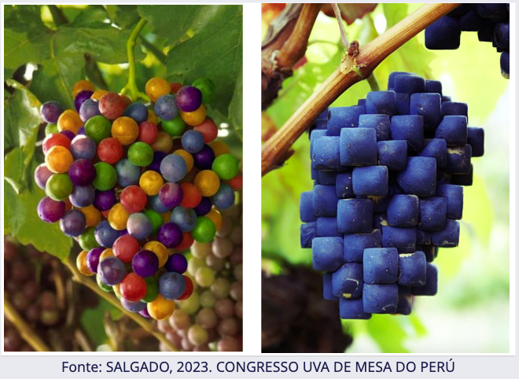
```

## NOVAS FORMAS DE COMERCIALIZAR AS FRUTAS

::: columns
::: {.column width="50%"}

```{r}
#| label: embala1
#| out-width: "82%"
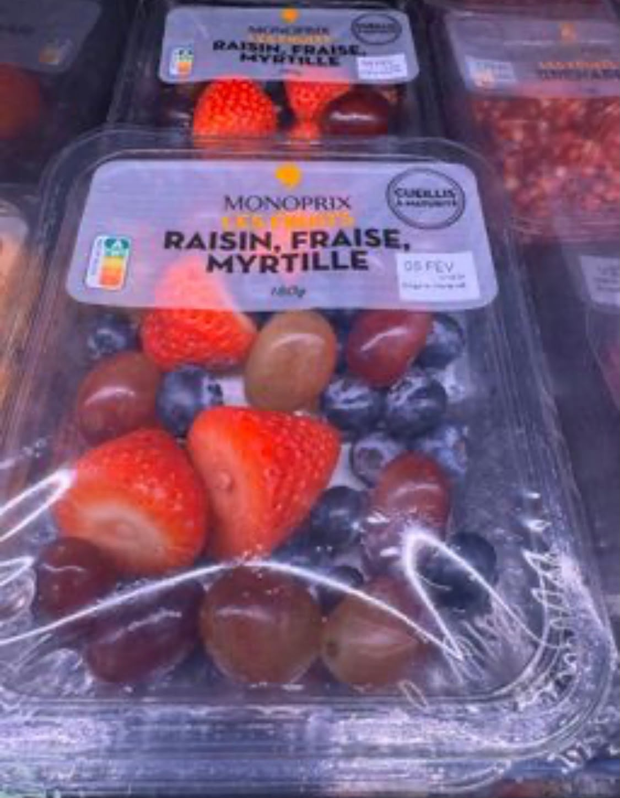
```

:::
::: {.column width="50%"}

```{r}
#| label: embala2
#| out-width: "82%"
#| 
knitr::include_graphics("imgs/embala4.jpeg")
```

:::
:::

## NOVAS FORMAS DE COMERCIALIZAR AS FRUTAS

::: columns
::: {.column width="50%"}
```{r}
#| label: embala3
#| out-width: "86%"
knitr::include_graphics("imgs/embala1.jpeg")
```
:::
::: {.column width="50%"}
```{r}
#| label: embala4
#| out-width: "81%"
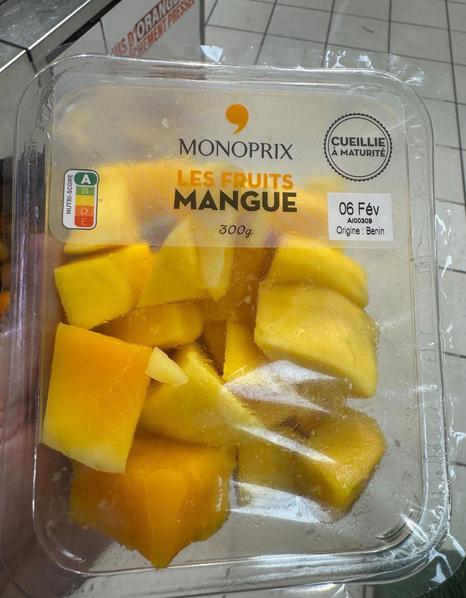
```
:::
:::

## NOVAS FORMAS DE COMERCIALIZAR AS FRUTAS

::: columns
::: {.column width="50%"}
```{r}
#| label: embala5
#| out-width: "80%"
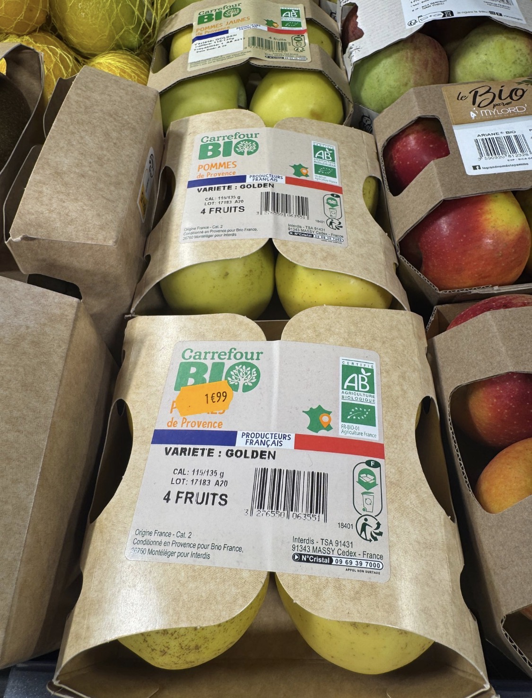
```
:::
::: {.column width="50%"}
```{r}
#| label: embala6
#| out-width: "81%"
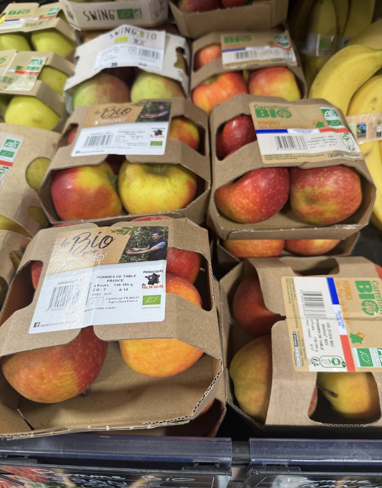
```
:::
:::

## NOVAS FORMAS DE COMERCIALIZAR AS FRUTAS

::: columns
::: {.column width="50%"}
```{r}
#| label: embala7
#| out-width: "81%"
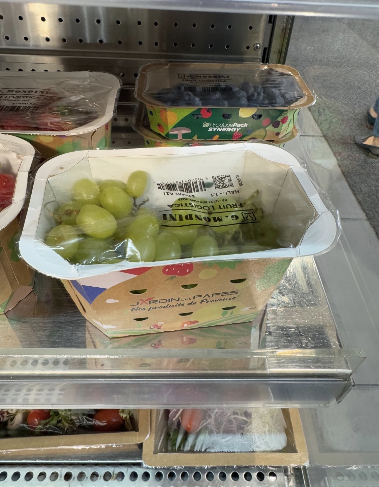
```
:::
::: {.column width="50%"}
```{r}
#| label: embala8
#| out-width: "81%"
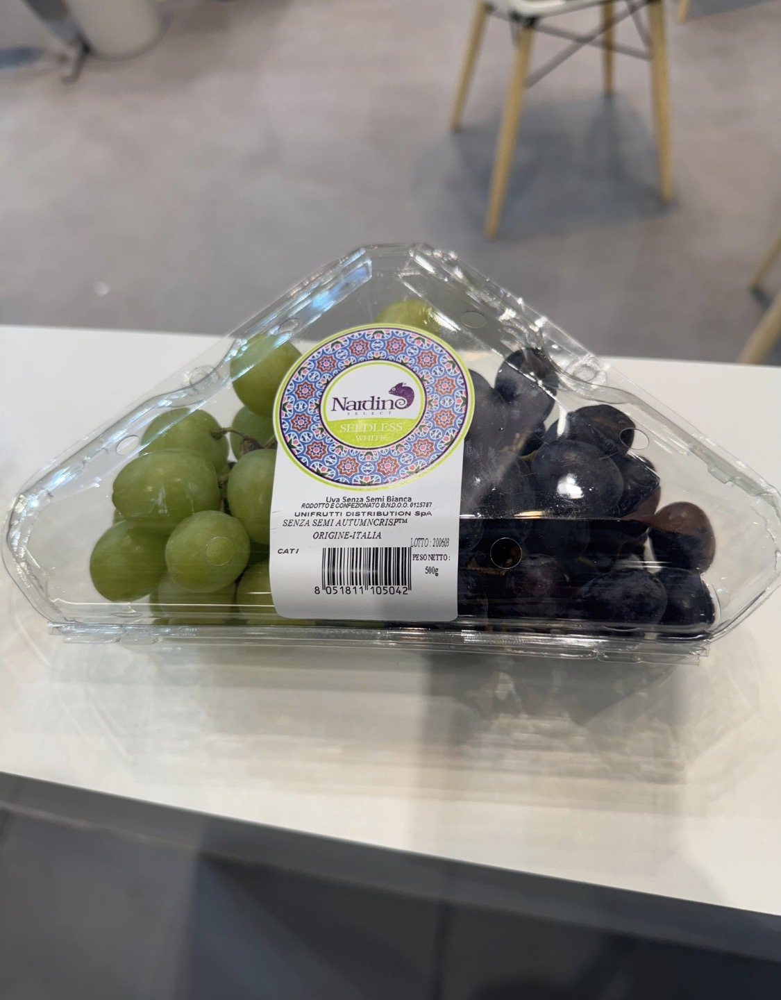
```
:::
:::

## NOVAS FORMAS DE COMERCIALIZAR AS FRUTAS

::: columns
::: {.column width="50%"}
```{r}
#| label: embala9
#| out-width: "81%"
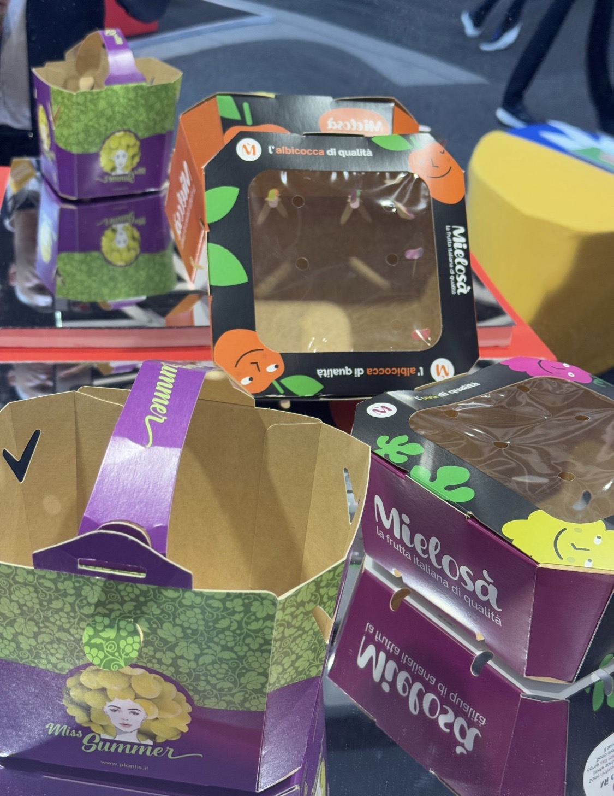
```
:::
::: {.column width="50%"}
```{r}
#| label: embala10
#| out-width: "81%"
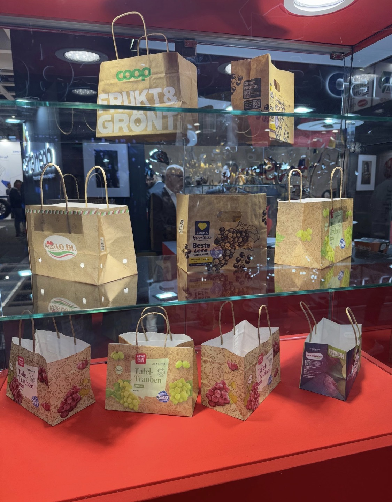
```
:::
:::

## NOVAS FORMAS DE COMERCIALIZAR AS FRUTAS

```{r}
#| label: embala11

knitr::include_graphics("imgs/embala11.jpg")
```

## NOVAS FORMAS DE COMERCIALIZAR AS FRUTAS

```{r}
#| label: embala12

knitr::include_graphics("imgs/embala12.png")
```

## NOVAS FORMAS DE COMERCIALIZAR AS FRUTAS

```{r}
#| label: embala13

knitr::include_graphics("imgs/embala13.jpg")
```

## NOVAS FORMAS DE COMERCIALIZAR AS FRUTAS

```{r}
#| label: embala14

knitr::include_graphics("imgs/embala14.jpg")
```

## NOVAS CULTURAS

```{r}
#| label: diversificacao

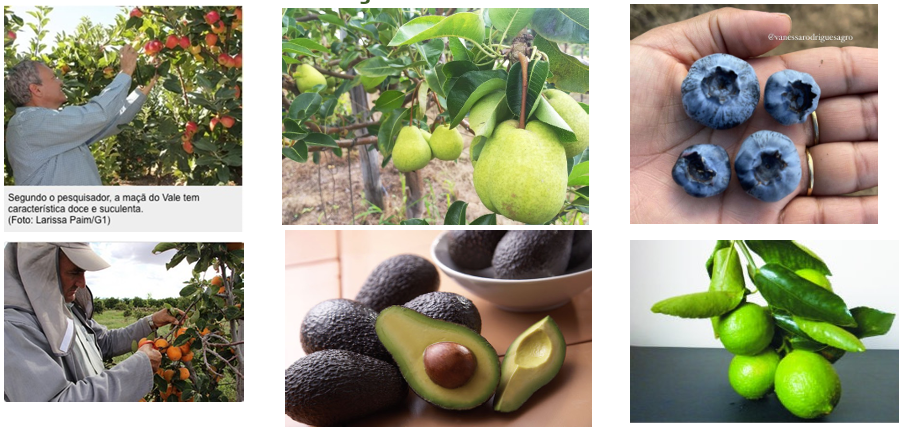
```

## MENOS GENTE, MAIS MÁQUINA

```{r}
#| label: tecno1


```

## MENOS GENTE, MAIS MÁQUINA

```{r}
#| label: tecno2

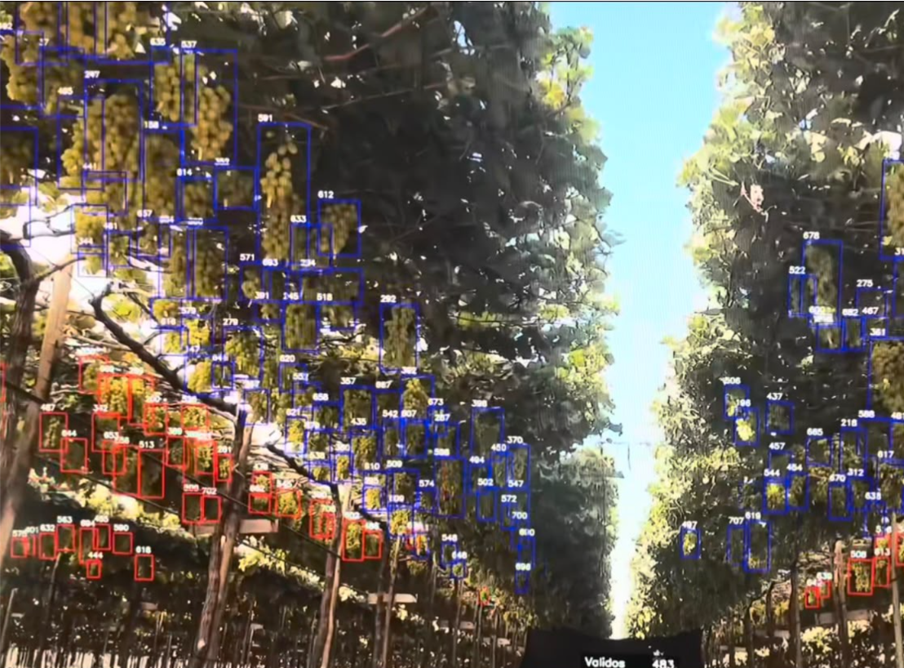
```

## MENOS GENTE, MAIS MÁQUINA {.titulo-pequeno}

::: columns
::: {.column width="50%"}
```{r}
#| label: tecno3
#| out-width: "70%"

```

:::
::: {.column width="50%"}

```{r}
#| label: tecno4
#| out-width: "70%"
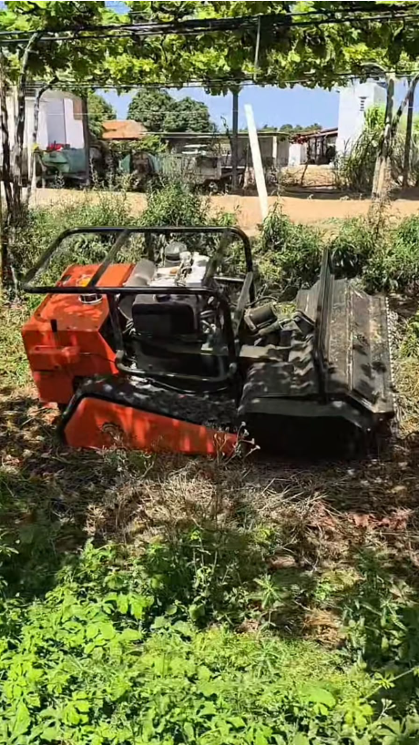
```

:::
::: 

## MENOS GENTE, MAIS MÁQUINA {.titulo-pequeno}

::: columns
::: {.column width="50%"}
```{r}
#| label: tecno5
#| out-width: "80%"
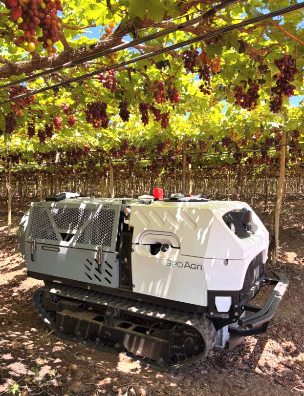
```

:::
::: {.column width="50%"}

```{r}
#| label: tecno6
#| out-width: "80%"
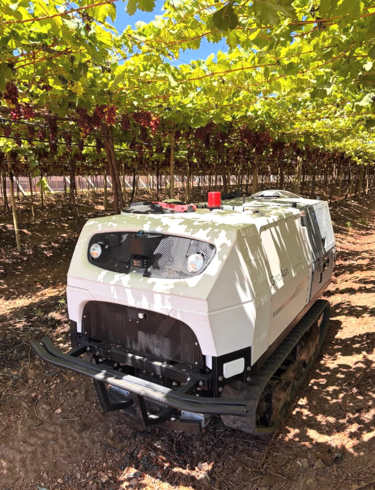
```

:::
::: 

## A ÚLTIMA FRONTEIRA DA AUTOMAÇÃO {.titulo-pequeno}

::: columns
::: {.column width="40%"}

- A colheita de frutas é descrita como **"uma das últimas fronteiras"** da automação agrícola — mais difícil que grãos, cana ou pulverização por drone

- O motivo: exige reconhecimento visual complexo (fruto parcialmente escondido, ângulo de corte certo) e manuseio delicado, sem danificar a fruta

- Culturas mais avançadas hoje em colheita robótica: **maçã e cogumelo** — manga, uva e mirtilo ainda não estão nessa fronteira

:::
::: {.column width="60%"}

<br>

```{r}
#| label: tecno7
##| out-width: "80%"
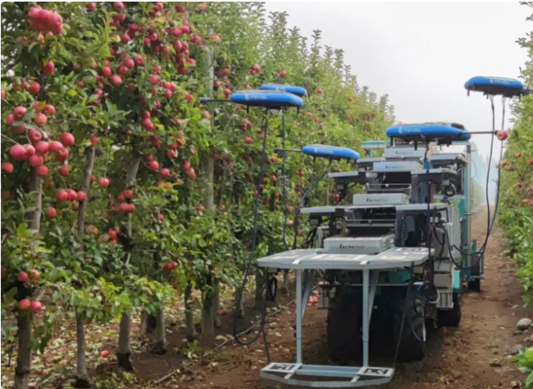
```

:::
::: 

# A PRÓXIMA FASE DO CICLO: NOVAS OPORTUNIDADES

## MIRTILO: O NOVO BOOM DA FRUTICULTURA? {.titulo-pequeno}

::: columns
::: {.column width="50%"}

```{r}
#| label: mirtilo1
#| out-width: "75%"
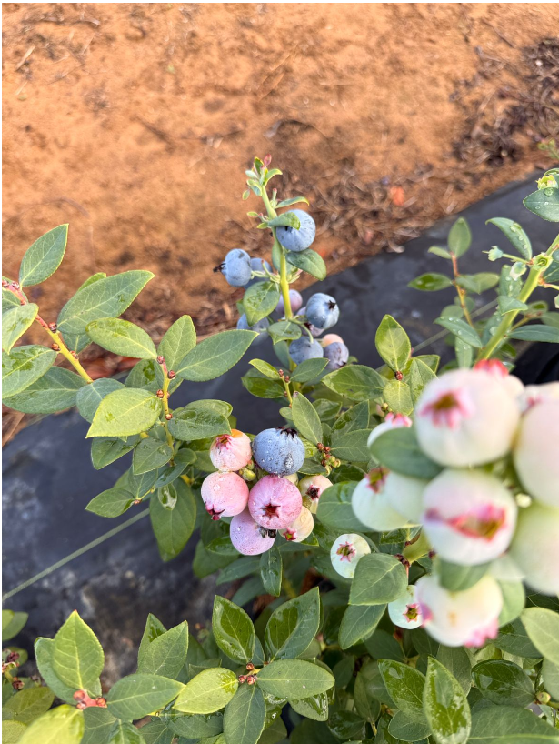
```

:::
::: {.column width="50%"}

```{r}
#| label: mirtilo2
#| out-width: "75%"
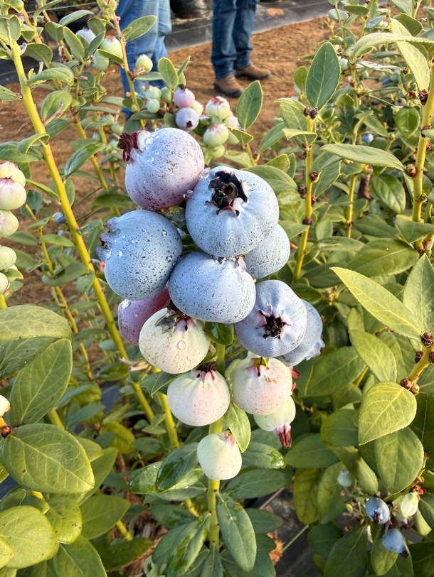
```

:::
::: 

## MIRTILO: O NOVO BOOM DA FRUTICULTURA? {.titulo-pequeno}

::: columns
::: {.column width="50%"}
```{r}
#| label: mirtilo3
#| out-width: "75%"
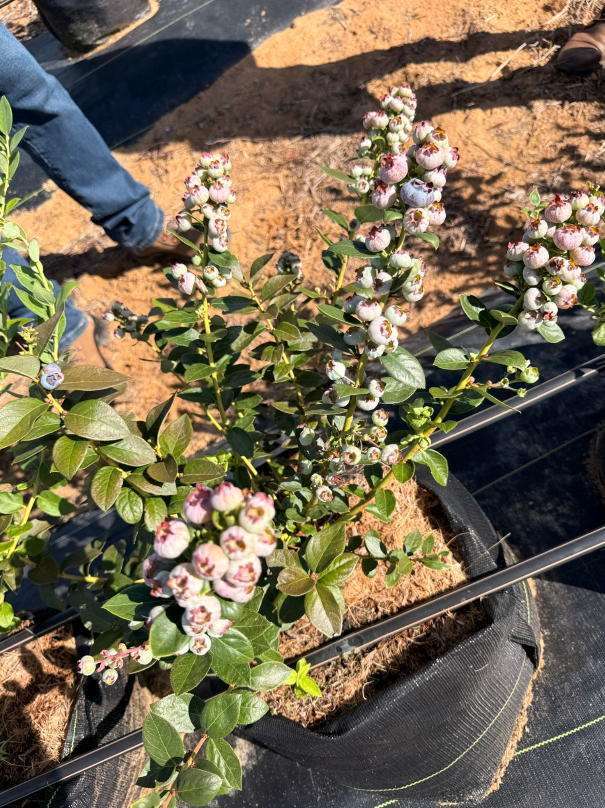
```

:::
::: {.column width="50%"}

```{r}
#| label: mirtilo4
#| out-width: "75%"
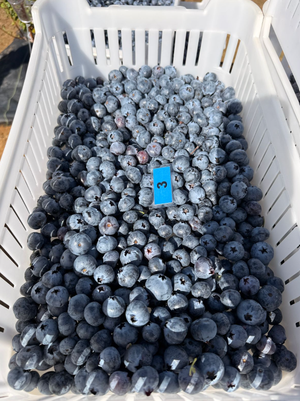
```

:::
::: 

## MIRTILO: O NOVO BOOM DA FRUTICULTURA? {.titulo-pequeno}

::: columns
::: {.column width="60%"}

- Mirtilo subiu ao **7º lugar** no ranking mundial de frutas mais vendidas

- O Vale do São Francisco tem condições excepcionais para o mirtilo: compatibilidade logística com a uva;

- Desafios técnicos reais na variedade **Biloxi** (dominante hoje): calibre menor e vida útil mais curta que variedades importadas mais modernas — aponta para uma próxima onda de melhoramento 

- Expectativa de se ter 9 quilos por planta ano, em uma área com 10 mil plantas em bags. 

- Exigente em mão de obra para a colheita.

- Alto custo de implantação. Alto preço no mercado. Necessidade de crescer a demanda doméstica.

:::
::: {.column width="40%"}

```{r}
#| label: palato1
##| out-width: "75%"
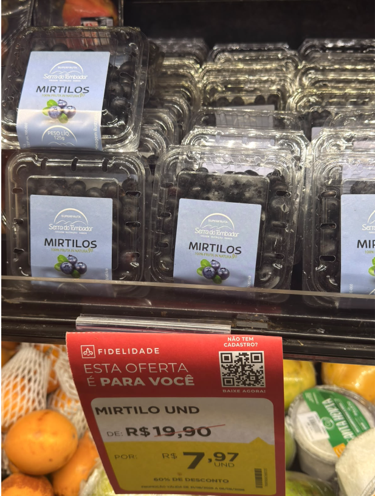
```

:::
::: 

## MIRTILO: O NOVO BOOM DA FRUTICULTURA? {.titulo-pequeno}

```{python}
#| label: mirtilo_paises
#| echo: false
#| warning: false
#| message: false
#| fig-width: 16
#| fig-height: 8
#| fig-align: "center"

import pandas as pd
from plotnine import (
    ggplot, aes, geom_col, geom_text, scale_y_continuous,
    labs, theme_minimal, theme
)
from plotnine.themes.elements import *

df = pd.read_excel("dados/paises_importacao.xlsx", sheet_name="Resultado")
df = df.dropna(subset=["Países"])
df = df[df["Países"] != "Total"].copy()
df["Toneladas"] = pd.to_numeric(df["Toneladas"], errors="coerce")
df = df.sort_values("Toneladas", ascending=False)
df["Países"] = pd.Categorical(df["Países"], categories=df["Países"], ordered=True)

def fmt_pt(v, dec=0):
    s = f"{v:,.{dec}f}"
    return s.replace(",", "X").replace(".", ",").replace("X", ".")

df["label"] = df["Toneladas"].map(lambda v: fmt_pt(v, 0))

plot = (
    ggplot(df, aes(x="Países", y="Toneladas"))
    + geom_col(fill="#6F2DA8", width=0.6)
    + geom_text(aes(label="label"), va="bottom", size=14)
    + scale_y_continuous(labels=lambda l: [fmt_pt(v, 0) for v in l])
    + labs(x="País de origem", y="Toneladas importadas (2025)", title="",
           caption="Fonte: Comexstat (2026). Elaboração própria.\n"
                   "NCM 0810.40.00 - Airelas, mirtilos e outras frutas do "
                   "gênero Vaccinium, frescas.")
    + theme_minimal()
    + theme(
        axis_title_x=element_text(weight="bold", size=18),
        axis_title_y=element_text(weight="bold", size=18),
        axis_text_x=element_text(size=18),
        axis_text_y=element_text(size=16),
        plot_caption=element_text(ha="left", size=14),
        figure_size=(16, 8),
    )
)
plot.show()
```


## MIRTILO: O NOVO BOOM DA FRUTICULTURA? {.titulo-pequeno}

```{python}
#| label: mirtilo_ano
#| echo: false
#| warning: false
#| message: false
#| fig-width: 18
#| fig-height: 8
#| fig-align: "center"

import pandas as pd
from plotnine import (
    ggplot, aes, geom_col, geom_text, scale_x_continuous, scale_y_continuous,
    labs, theme_minimal, theme
)
from plotnine.themes.elements import *

df = pd.read_excel("dados/importa_ano.xlsx", sheet_name="Resultado")
df.columns = [c.strip() for c in df.columns]
df["Ano"] = pd.to_numeric(df["Ano"], errors="coerce")
df["toneladas"] = pd.to_numeric(df["Quilograma Líquido"], errors="coerce") / 1000
df = df.dropna(subset=["Ano"])
df = df[df["Ano"] <= 2025].sort_values("Ano")

def fmt_pt(v, dec=0):
    s = f"{v:,.{dec}f}"
    return s.replace(",", "X").replace(".", ",").replace("X", ".")

df["label"] = df["toneladas"].map(lambda v: fmt_pt(v, 0))
a_min, a_max = int(df["Ano"].min()), int(df["Ano"].max())

plot = (
    ggplot(df, aes(x="Ano", y="toneladas"))
    + geom_col(fill="#6F2DA8", width=0.7)
    + geom_text(aes(label="label"), va="bottom", size=10)
    + scale_x_continuous(breaks=range(a_min, a_max + 1, 1))
    + scale_y_continuous(labels=lambda l: [fmt_pt(v, 0) for v in l])
    + labs(x="Ano", y="Toneladas importadas", title="",
           caption="Fonte: Comexstat (2026). Elaboração própria.\n"
                   "NCM 0810.40.00 - Airelas, mirtilos e outras frutas do "
                   "gênero Vaccinium, frescas.")
    + theme_minimal()
    + theme(
        axis_title_x=element_text(weight="bold", size=18),
        axis_title_y=element_text(weight="bold", size=18),
        axis_text_x=element_text(size=18, rotation=45),
        axis_text_y=element_text(size=18),
        plot_caption=element_text(ha="left", size=14),
        figure_size=(18, 8),
    )
)
plot.show()
```

## MIRTILO: O NOVO BOOM DA FRUTICULTURA? {.titulo-pequeno}

```{python}
#| label: mirtilo_mes
#| echo: false
#| warning: false
#| message: false
#| fig-width: 18
#| fig-height: 8
#| fig-align: "center"

import pandas as pd
from plotnine import (
    ggplot, aes, geom_col, position_dodge, scale_fill_manual,
    labs, theme_minimal, theme
)
from plotnine.themes.elements import *

df = pd.read_excel("dados/importa_mes.xlsx", sheet_name="Resultado")
df.columns = [c.strip() for c in df.columns]
df["mes_num"] = df["Mês"].str.slice(0, 2).astype(int)
df["toneladas"] = pd.to_numeric(df["Quilograma Líquido"], errors="coerce") / 1000
df["Ano"] = df["Ano"].astype(int)

# apenas 2021-2025 (anos com os 12 meses completos e mais recentes)
df = df[(df["Ano"] >= 2021) & (df["Ano"] <= 2025)].copy()

abrev = {1:"Jan",2:"Fev",3:"Mar",4:"Abr",5:"Mai",6:"Jun",
         7:"Jul",8:"Ago",9:"Set",10:"Out",11:"Nov",12:"Dez"}
df["mes_lab"] = pd.Categorical(df["mes_num"].map(abrev),
                                categories=list(abrev.values()), ordered=True)
df["Ano"] = pd.Categorical(df["Ano"].astype(str),
                            categories=[str(a) for a in range(2021, 2026)], ordered=True)

paleta = {"2021": "#cbb8e8", "2022": "#a480d9", "2023": "#7e4dc9",
          "2024": "#5a2ea3", "2025": "#3d1f70"}

plot = (
    ggplot(df, aes(x="mes_lab", y="toneladas", fill="Ano"))
    + geom_col(position=position_dodge(width=0.8), width=0.75)
    + scale_fill_manual(values=paleta)
    + labs(x="Mês", y="Toneladas importadas", fill="Ano", title="",
           caption="Fonte: Comexstat (2026). Elaboração própria.\n"
                   "NCM 0810.40.00 - Airelas, mirtilos e outras frutas do gênero "
                   "Vaccinium, frescas. Anos com os 12 meses completos (2021-2025).")
    + theme_minimal()
    + theme(
        legend_position="bottom",
        axis_title_x=element_text(weight="bold", size=18),
        axis_title_y=element_text(weight="bold", size=18),
        axis_text_x=element_text(size=16),
        axis_text_y=element_text(size=15),
        plot_caption=element_text(ha="left", size=13),
        legend_title=element_text(size=14),
        legend_text=element_text(size=13),
        figure_size=(18, 8),
    )
)
plot.show()
```

## SINAL NO RADAR: O PISTACHE {.titulo-pequeno}


::: columns
::: {.column width="40%"}

<br>

- O pistache ainda **não tem lavoura** no Vale do São Francisco

- 100% importado

- Mas já há gente procurando mudas na Califórnia

- Necessidade de horas de frio

- Colheita toda mecanizada 

:::
::: {.column width="60%"}

```{r}
#| label: tecno0
#| out-width: "65%"

```

:::
:::

## {.center .thankslide}

<div style="text-align: center;">
  
</div>

<br>

<div style="text-align: center;">
  <h2 style="color: #282f6b; font-size: 2em; margin-bottom: 20px;">
    MUITO OBRIGADO!
  </h2>
  <br>
  <p style="font-size: 0.8em; color: #333;">
    <a href="https://www.embrapa.br/web/semiarido/observatorio-da-manga" target="_blank">
      https://www.embrapa.br/web/semiarido/observatorio-da-manga
    </a>
    <br>
    <a href="https://www.embrapa.br/web/semiarido/observatorio-da-uva" target="_blank">
      https://www.embrapa.br/web/semiarido/observatorio-da-uva
    </a>
    <br>
    <br>
📲 **WhatsApp:**
+55 87 99961-5799
  </p>
</div>
